# Building Midlife Survivors: The Textbook

A picture-first guide to how this game works, one chapter per idea. Each chapter adds what we just built. Read it in any order, but it makes the most sense from top to bottom.

---

## Chapter 1: The map of the project

Your game is just a handful of plain files. The browser opens `index.html`, which loads everything else in order.

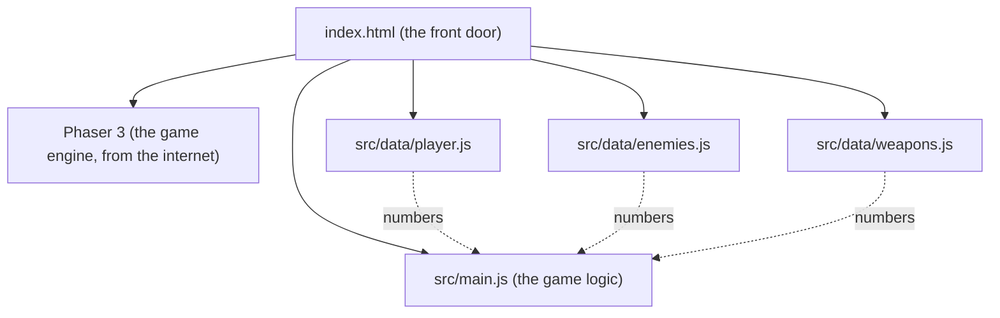

**Key idea:** the `data` files hold **numbers and names** (speeds, health, colors). `main.js` holds **rules** (how things move and fight). You can edit the data files freely without breaking the rules.

| File | What lives there | Example you can change |
|---|---|---|
| `player.js` | your speed, size, color | `speed: 400` = too much coffee |
| `enemies.js` | Bill speed, health, spawn rate | `everyMs: 300` = chaos |
| `weapons.js` | Coffee Splash fire rate, range, damage | `fireEveryMs: 300` = triple espresso |

---

## Chapter 2: The game loop

A game is a flipbook. The screen is redrawn about **60 times every second**, and between each drawing the game decides what moved.

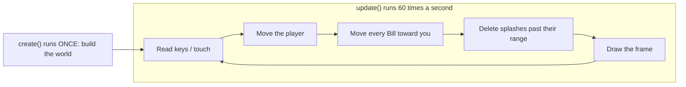

**Think of it like video:** 60 frames per second, except each frame is calculated on the spot instead of recorded.

**Bonus: why we "normalize" movement.** Pressing right and up at once would push you 1 step right *and* 1 step up, about 1.41 steps total, so diagonals would be faster. Normalizing shrinks the arrow back to length 1.

```
 Without normalizing        With normalizing
       ↑ 1                      ↑ 0.71
       |  ↗ 1.41                |  ↗ 1.0
       |/                       |/
       +---→ 1                  +---→ 0.71
```

---

## Chapter 3: The camera and the world

The world (4000 × 4000 pixels of office carpet) is much bigger than your screen. The camera is a window that follows you around, like a photographer tracking a subject.

```
+------------------------- WORLD (4000 x 4000) -------------------------+
|                                                                       |
|              $ ← Bill spawns here, just outside the window            |
|        +-------- CAMERA VIEW (your screen) --------+                  |
|        |                                           |                  |
|        |                  ■ You                     |  $               |
|        |                                           |                  |
|        +-------------------------------------------+                  |
|                       $                                               |
+-----------------------------------------------------------------------+
```

The HUD ("AGE 40...") is pinned to the **screen**, not the world, so it stays put while the carpet scrolls.

---

## Chapter 4: Spawning and chasing

**Spawning** means creating enemies while the game runs. A **timer** goes off every 0.9 seconds and drops one Bill on a random edge just outside the camera view.

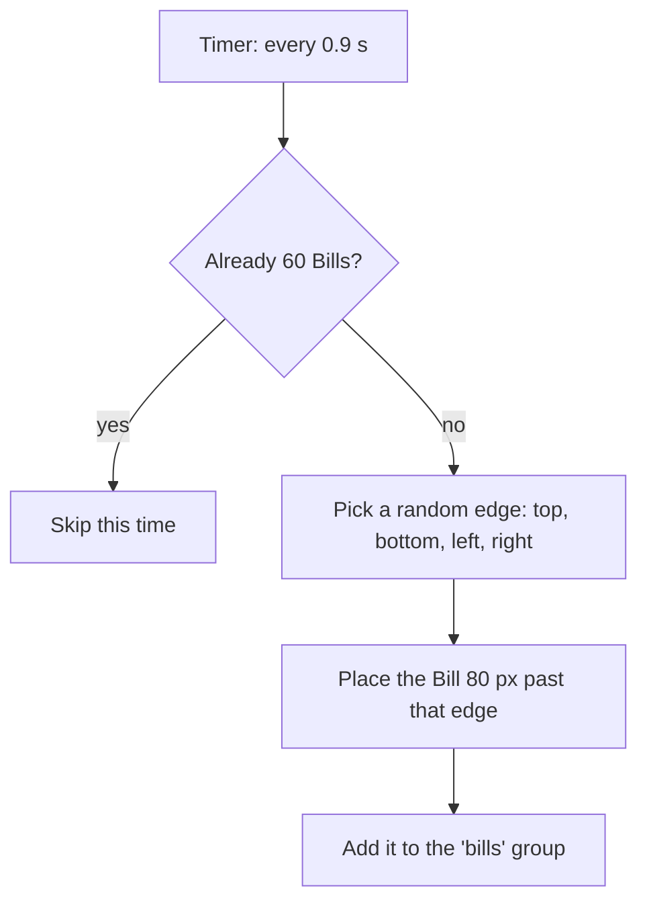

**Chasing** happens inside the game loop. Every frame, each Bill turns to face you and moves forward.

```
frame 1      frame 2      frame 3      frame 4
$            
              $
                           $
                                        $ ■
```

A **group** is a bag holding every Bill, so one line of code can move them all. Bills also **collide with each other**, so they form a crowd instead of melting into one square.

---

## Chapter 5: Targeting

Coffee Splash aims for you. Every second it checks the distance to **every** Bill and keeps the shortest one.

```
          $ 310px
                          
   $ 180px    ■ You  ───────▶  $ 95px  ← nearest, so it gets the coffee
                          
                 $ 240px
```

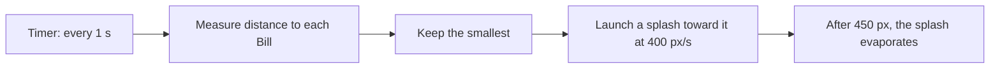

Deleting splashes that missed is important. Without it, thousands of invisible drops would pile up and slow the game down.

---

## Chapter 6: Collisions and health

Every frame the physics engine asks: **is any splash touching any Bill?** This is called an **overlap check**. When the answer is yes, a small function runs.

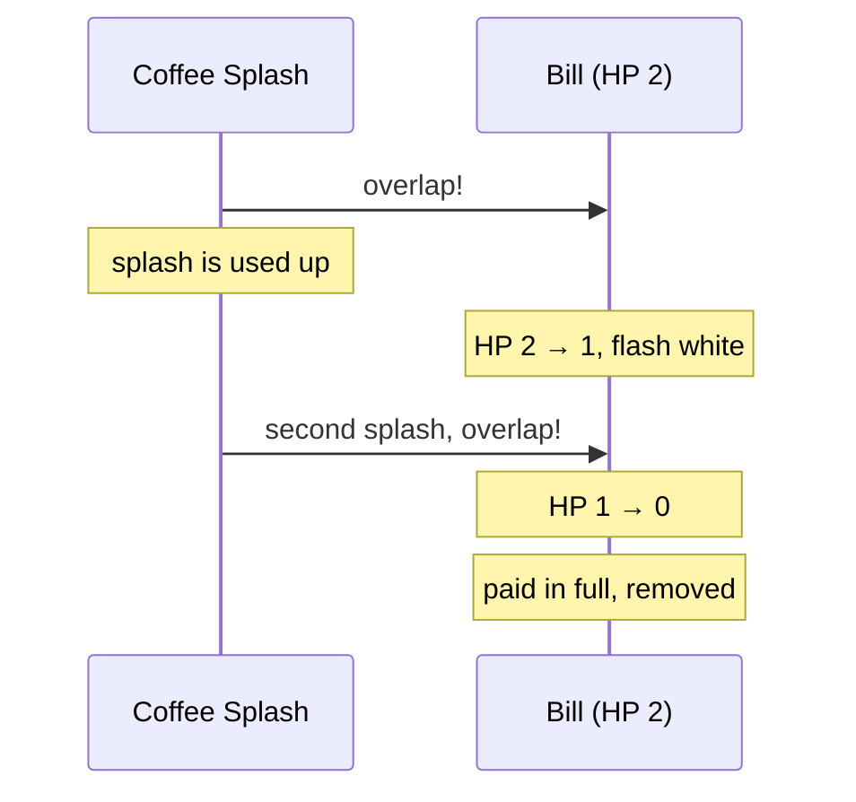

**HP (hit points)** is a number on each enemy. Damage subtracts from it, and at zero the enemy is gone. Two numbers control how tough the fight feels:

| Bill `hp` | Splash `damage` | Splashes needed |
|---|---|---|
| 2 | 1 | 2 (current) |
| 1 | 1 | 1 (easy) |
| 6 | 2 | 3 (tough) |

The white flash is the first bit of **game juice**: a tiny effect that makes a hit *feel* like a hit.

---

## Chapter 7: Taking damage

You have **10 HP**. Touching a Bill costs 1. Right after a hit you get a short **safe window** (0.7 s) so a crowd can't drain you all at once in a single moment.

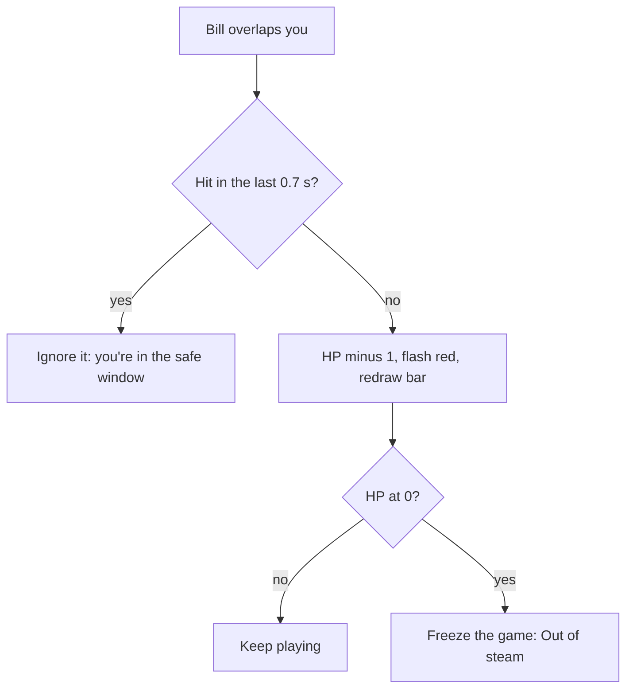

```
Time:     0.0s    0.3s    0.7s    1.0s    1.4s
Touch:     $       $       $       $       $
Damage:   -1       .      -1       .      -1
          [ hit ][ safe  ][ hit ][ safe  ][ hit ]
```

The health bar is drawn **on the screen, not in the world** (like the HUD), and redrawn after every hit: a dark empty bar, then a red bar whose width is `HP / maxHP`.

```
10 HP  [##########]
 6 HP  [######    ]
 2 HP  [##        ]
```

---

## Chapter 8: Game Over and restarting

When HP hits 0, the game **freezes the physics**, lays a dark sheet over the screen, and shows four things:

```
+-------------------------------------------+
|                GAME OVER                  |
|     Crushed by a late electric bill.      |  <- random line from deaths.js
|           You lasted 2:13                 |  <- time since the run started
|            [  Try again  ]                |  <- click, tap, or Space
+-------------------------------------------+
```

**Restarting** means running `create()` again from scratch. Anything remembered *outside* the scene (like `gameOver` or your HP) has to be reset by hand at the top of `create()`, or the new run would start already dead.

```
 Try again
     |
     v
 scene.restart()  -->  create() runs again  -->  reset: gameOver, timer, touch
                                             -->  rebuild: floor, you, Bills group
```

The jokes live in `src/data/deaths.js`, grouped by **who killed you**. Later, each enemy type gets its own list.

| Killer | Example line |
|---|---|
| bill | "Died of autopay failure." |
| (later) email | "Replied all. Fatally." |

---

## Chapter 9: The endless floor (a magic trick)

Before, the carpet was one giant 4000 x 4000 rug with walls at the edges. Now there's no rug at all. The carpet is **exactly the size of your screen**, glued to the camera, and its **pattern slides** as you move.

```
 OLD: a huge rug, camera moves over it      NEW: a screen-sized rug, pattern slides
 +--------------------------+               +----------+
 |  +------+                |               |##########|  camera moves right 64px
 |  |camera| ->             |               |##########|  -> pattern shifts left 64px
 |  +------+          WALL  |               +----------+  -> looks like you walked
 +--------------------------+                            (and it never ends)
```

It's the same trick as old cartoons: the character runs in place while the background scrolls behind them. Each frame:

```
floor.tilePositionX = camera.scrollX
floor.tilePositionY = camera.scrollY
```

| | Old giant rug | New sliding rug |
|---|---|---|
| Size in memory | 4000 x 4000 | screen size |
| Edge of the world | wall at 4000px | none |
| You notice the difference | no | no |

Updated Chapter 3 note: the world no longer has an edge, so the big box in that diagram now goes on forever.

---

## Chapter 10: Wisdom gems and experience (XP)

Every paid-off Bill leaves a blue **Wisdom gem**. Gems near you get pulled in by a **magnet**; the rest wait on the floor until you walk closer.

```
            ◆  (far: waits)
                                 
       ◆ ─────▶ ■ You             magnet radius = 90px
          ◆ ──▶                   (gems inside it fly to you)
                                 
                     ◆  (far: waits)
```

Each gem adds XP. When the bar fills, you **level up**, the leftover XP carries over, and the next level asks for 40% more:

| Level | Gems needed to reach the next one |
|---|---|
| 1 → 2 | 5 |
| 2 → 3 | 7 |
| 3 → 4 | 10 |
| 4 → 5 | 14 |
| 5 → 6 | 20 |

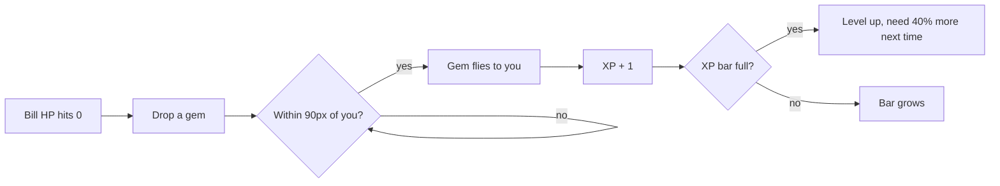

This growing cost is a **curve**: early levels come fast so the game feels generous, later ones slow down so each one feels earned.

---

## Chapter 11: The level-up screen

When the XP bar fills, the world **pauses** and you pick 1 of 3 random upgrades.

```
+--------------------------------------------+
|                 LEVEL 2!                   |
|  Pick one (click, tap, or press 1 / 2 / 3) |
|  +--------------------------------------+  |
|  | 1. Extra Shot                        |  |
|  |    Coffee fires 20% faster.          |  |
|  +--------------------------------------+  |
|  | 2. Reading Glasses                   |  |
|  |    Gem magnet reaches 40% farther.   |  |
|  +--------------------------------------+  |
|  | 3. Annual Checkup                    |  |
|  |    +3 max HP, and heal 3.            |  |
|  +--------------------------------------+  |
+--------------------------------------------+
```

**The big idea: data vs. stats.** The data files are the *recipe*. At the start of each run, the game copies those numbers into a `stats` object. Upgrades change the **copy**, so a new run always starts back at the recipe.

```
 src/data files (recipe, never changes)
        │  copied at the start of every run
        ▼
 stats  { speed 220, damage 1, fireEveryMs 1000, ... }
        │  upgrades edit this copy
        ▼
 Dark Roast  →  damage 1 → 2
 Extra Shot  →  fireEveryMs 1000 → 800
```

**Pausing** means stopping two things: the physics (nothing moves or collides) and the clock (no new Bills, no shots). Picking an upgrade turns both back on.

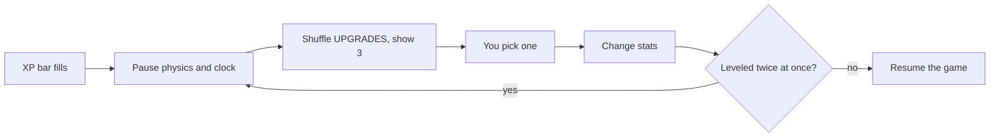

---

## Chapter 12: Audio cues and game controllers

**Synthesized sound (Web Audio API):** Instead of loading MP3 files, the browser generates sound waves on the fly using numbers `[frequency, duration, waveShape]`.

```
  Sound Recipe (sounds.js)                Browser Synthesizer (sfx.js)
  billPaid: [                             Oscillator ──▶ Gain (fade out) ──▶ Speakers
    [880 Hz,  0.06s, "square"],   ───▶    ♪ 880 Hz  (B5)
    [1320 Hz, 0.10s, "square"]            ♪ 1320 Hz (E6) -> "Cha-ching!"
  ]
```

**Controller input:** A thumbstick gives two numbers from `-1.0` to `+1.0` (left/right and up/down). Because sticks never rest at a perfect `0.0`, we ignore tiny values under `0.2` (a **deadzone**) so your character doesn't drift when you let go.

```
        Thumbstick Deadzone                        "Held" vs "Just Pressed"
            -1.0 (up)                         Frame:   1     2     3     4
         +-------------+                      Button: [up]  [up]  [up]  [  ]
         |   .-----.   |                      Held:   yes   yes   yes   no
   -1.0  |  /  0.2  \  | +1.0                 Just:   YES   no    no    no
  (left) | |  (dead) | | (right)                      (moves menu 1 step, not 3)
         |  \       /  |
         +-------------+
            +1.0 (down)
```

---

## Chapter 13: Area weapons, knockback, and conditional upgrades

Until now, you only had a **single-target projectile** (Coffee Splash). Now you can unlock **area-of-effect (AoE)** weapons that hit every enemy inside a circle around you:

```
  1. Coffee Splash             2. Dad Joke (Aura)          3. The Word "No." (Knockback)
   (single nearest)          (damages all in radius)      (damages + shoves outward)

                        . - ~ - .                    . - ~ - .
      ■ ───▶ $               /   $     \                  /  ↖$   ↗$                             |     ■     |                |     ■      |
                             \       $ /                  \  ↙$      /
                              ' - _ - '                    ' - _ - '
```

**How Knockback works:** To push a Bill directly away from you, we find the arrow pointing from you to the Bill `(bill.x - player.x, bill.y - player.y)`, divide by the distance `d` so the arrow has length `1`, and multiply by `noPush` (95 pixels).

**Conditional Upgrades (`when`):** You shouldn't see "Louder Groan" before you even own **Dad Joke**. Each upgrade can have a `when(stats)` check:

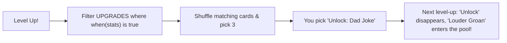

---

## Chapter 14: The Age Clock, Pause, and Boss Fights

**1. The Age Clock:** Instead of a plain timer, we convert elapsed seconds into **years of age** (`secondsPerYear: 20` in `player.js`, so 1 year passes every 20 seconds while playtesting):

```
  Elapsed seconds:   0s ────────▶ 20s ────────▶ 40s (Age 42.0)
  Your Age:         40.0         41.0         42.0 ──▶ BOSS SPAWNS!
```

**2. Pausing cleanly:** When you press **P**, **Esc**, or controller **Start**, `scene.time.paused = true` freezes Phaser's clock, which means `this.time.now` also stops advancing—so pausing for 5 minutes won't accidentally age you or spawn the boss early!

**3. Boss Lifecycle (The Performance Review):**

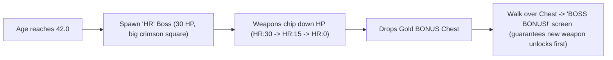

---

## Chapter 15: Wave Schedules & Enemy State Machines

**1. Wave Schedule tied to Age (`SPAWNING.waves`):** Instead of spawning at the same slow pace forever, the game checks your age against a table in `enemies.js` and speeds up the spawn timer while mixing in new enemy types:

| Age Milestone | Spawn Delay | What Spawns |
|---|---|---|
| **Age 40** | every `900ms` | 100% Bills (`$`) |
| **Age 41** | every `750ms` | 70% Bills + 30% **Spam Likely** (`TEL`) |
| **Age 42** | *Boss Event* | **The Performance Review** (`HR:30`) |
| **Age 43** | every `580ms` | 60% Bills + 40% Spam Likely |
| **Age 45+** | every `440ms` | 55% Bills + 45% Spam Likely (pure chaos) |

**2. Enemy State Machines:** Different enemies now have different "brains" inside `update()`:

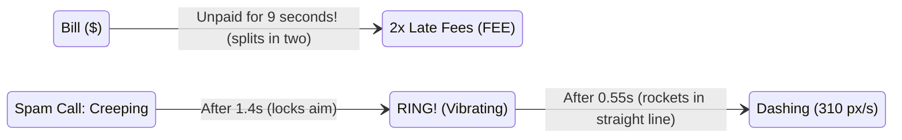

Because **Spam Likely** locks its aim when it starts ringing and pauses for `0.55s` to vibrate (`RING!`), you get a clear visual + audio cue to sidestep out of its path before it rockets across the screen!

---

## Chapter 16: Weighted Spawning & Weapon Evolutions

**1. Weighted Spawn Tables (`wave.mix`):** Instead of simple coin flips, each wave now gives every enemy a **raffle ticket count** (weight). Adding `[enemy, weight]` to a wave automatically adjusts the odds:

```
  Age 44 Wave Mix:  [["bill", 4], ["spamCall", 2], ["snackAttack", 2], ["backTwinge", 2], ["officeGossip", 1]]
  Total Tickets = 11:
  [ $ ][ $ ][ $ ][ $ ][ TEL ][ TEL ][ YUM ][ YUM ][ OUCH ][ OUCH ][ CC: ]
   \_______4/11______/ \___2/11___/  \___2/11___/  \____2/11____/  \_1/11_/
```

**2. Weapon Evolutions (Synergy Recipes):** Just like *Vampire Survivors*, upgrading a weapon **and** holding its matching passive unlocks a super-card at the top of your next level-up or boss chest:

```mermaid
flowchart LR
    W1["Upgraded Coffee"] & P1["Good Night's Sleep"] --> E1["EVOLVE: Cold Brew Concentrate
(3-way piercing espresso spread!)"]
    W2["Upgraded Dad Joke"] & P2["Reading Glasses"] --> E2["EVOLVE: Unhinged Pun Storm
(Giant double-speed cringe ring!)"]
    W3['Upgraded "No."'] & P3["Comfortable Shoes"] --> E3["EVOLVE: Healthy Boundaries
(Huge shockwave + heals 1 HP!)"]
```

---

## Chapter 17: Procedural Pixel-Art Sprites (`src/sprites.js`)

Instead of loading external `.png` files, `makePixelArt(scene, key, rows, palette, scale)` paints tiny text grids into real Phaser textures at startup. Each letter maps to a hex color (`"."` is transparent):

```
  Grid in src/sprites.js ("gem")         Rendered Sprite in Game
  "...BB..."                             
  "..BWWB.."                                   ⟐  Sparkling
  ".BWLLWB."      ──(makePixelArt)──▶         ⟐⟐⟐  Faceted
  "BWLCCLLB"                                   ⟐  Crystal
  ".BLLLLB."
```

| Sprite Key | Visual Design |
|---|---|
| `floor` | 128x128 woven office carpet tile with quadrant seams, fiber speckles, and a faint coffee-ring stain |
| `player` | 16x16 midlife hero with salt-and-pepper temples, glasses, dress shirt, red tie, and orange coffee mug |
| `bill` / `lateFee` | Green dollar-bill envelope (`$`) and jagged red PAST DUE notice (`!`) |
| `spamCall` | Glowing purple smartphone with red caller-ID alert screen |
| `snackAttack` / `backTwinge` | Pink frosted donut with rainbow sprinkles; jagged yellow-orange lightning bolt |
| `officeGossip` | Corporate email envelope with a red unread notification badge (`CC:`) |
| `performanceReview` / `mortgageRefinance` / `midlifeCrisis` | Giant HR clipboard with frowny chart, columned purple bank (`APR`), and cherry-red convertible (`V8`) |

Plus, `player.setFlipX(x < 0)` and a sine-wave wobble `Math.sin(time / 55) * 7` give your character a jaunty walking bounce as you move!

---

## Chapter 18: Reaching Age 50 (The Reaper & Win Screen)

Just like the 30-minute Reaper in *Vampire Survivors*, surviving to **Age 50.0** triggers **Father Time (`50:9999`)**, an unstoppable hooded figure with a scythe. Touching him doesn't mean you lost—it triggers the golden **"YOU SURVIVED YOUR 40s!"** victory screen!

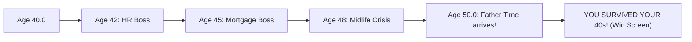

---

## Chapter 19: Game Juice, Chiptune Groove & Title Screen

**1. Layered "Game Juice" on Every Hit:** None of these effects change the math of the game, yet together they make combat feel 10x more physical:

```
  Weapon hits Enemy
        ├── 1. White Flash + Squash-and-Stretch (scaleX 1.22, scaleY 0.82 for 55ms)
        ├── 2. Floating Damage Number ("-2" drifts up & fades out; gold when >= 2)
        ├── 3. Shredded Paper Confetti (6-16 colored scraps burst outward on KO)
        └── 4. Camera Shake (120ms jolt on hurt, 180ms rumble on Boss arrival)
```

**2. Sequenced Chiptune Groove (`SOUNDS.music`):** A `setInterval` in `sfx.js` steps through a 16-note bassline (`triangle` wave) and melody (`square` wave) every `165ms`. And because clicking **"CLOCK IN"** on the Title Screen unlocks the browser's `AudioContext`, the groove and sound effects work from frame 1!

---

## Chapter 20: Meta-Progression, 401(k) Shop & `localStorage` (`src/data/meta.js`)

In a roguelite like *Vampire Survivors*, **Run Stats** (`stats`) reset when you die, while **Meta-Progression** (`meta`) saves permanently in the browser's `localStorage` so every run makes the next one a little stronger:

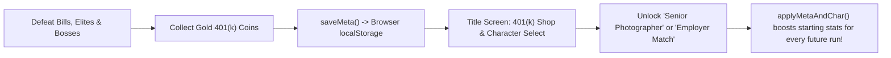

| Feature | How it works |
|---|---|
| **401(k) Coins (`coin401k`)** | 35% drop from Bills, 2 from Elites, 5 from Decade Bosses; pulled in by your magnet |
| **Permanent Shop (`META_SHOP`)** | **Employer Match** (+2 max HP/rank), **Home Espresso** (+10% speed & fire rate/rank), **CPA on Retainer** (+25% magnet/rank) |
| **3 Playable Archetypes (`CHARACTERS`)** | **The 9-to-5er** (Free), **The Senior Photographer** (10k: starts with Dad Joke + 25% wider radius & faster feet), **The Grad Student at 45** (15k: starts with "No." shockwave + huge magnet) |

---

## Chapter 21: One Simulation, Three Cameras (`src/view3d.js`)

How can a game switch mid-run between a **2D 16-Bit** top-down view, a **Diablo 3/4** isometric dungeon crawler, and a **3D Third-Person** action view without rewriting a single rule of gameplay? By separating the **Simulation (Model)** from the **Camera (View)**:

```
   PHASER 2D SIMULATION (The "Truth")             THREE.JS 3D RENDERER (src/view3d.js)
  ┌──────────────────────────────────┐           ┌────────────────────────────────────────┐
  │  Player & Bills move on (x, y)   │ ──sync──► │ Maps 2D (x, y) -> 3D Floor (x, 0, z)   │
  │  Arcade Physics checks overlaps  │           │ Style 1 (Diablo 3/4): high angle,      │
  │  Timers fire weapons & waves     │           │   38° FOV, dark fog + warm torchlight  │
  │  HUD, XP bar & menus draw on top │ ◄─project─│ Style 2 (3D Third-Person): low behind  │
  └──────────────────────────────────┘           │   shoulder, 60° FOV, bright sky & fog  │
                                                 └────────────────────────────────────────┘
```

| Camera Style (`V` Key) | Camera Offset `(dx, dy, dz)` | Field of View (`FOV`) | Lighting & Atmosphere |
|---|---|---|---|
| **1. `2D 16-Bit`** | Directly overhead (2D tileSprite) | Orthographic / Flat | Crisp 16-bit pixel art sprites & multi-zone office floor |
| **2. `Diablo 3/4`** | `(-260, +420, +320)` angled 45° | Narrow (`38°`) | Dark `#090b14` fog + golden player torchlight (`PointLight`) + long shadows |
| **3. `3D Third-Person`** | `(0, +165, +250)` over-the-shoulder | Wide (`60°`) | Stylized `#283866` sky + horizon fog + 3D hero, enemy, and boss meshes |

---

## Chapter 22: Pacing Math, Physical Barriers & Climbable Mezzanine Platforms

### 1. Why the First 40 Seconds Felt Too Hard (DPS vs. Spawn Rate)
In a survival game, early-game fun comes from **Kills Per Second (KPS)** outpacing **Spawns Per Second (SPS)** just enough that you can scoop up gems and hit Level 3-4 before the first Boss arrives:

| Metric | Old Value (Too Hard) | New Value (Balanced Progression) |
|---|---|---|
| **Starter Coffee Fire Rate** | `1000ms` (1.0 shot/sec) | **`650ms` (1.54 shots/sec)** |
| **Regular Bill HP & Overdue Split** | `2 HP` (took 2.0s to kill!), splits in `9s` | **`1 HP` (1 splash pays it off!), splits in `14s`** |
| **XP Curve & Gem Magnet** | `5 XP` for Lv 2 (`1.4x` growth), `90px` magnet | **`3 XP` for Lv 2 (`1.25x` growth), `120px` magnet** |
| **Player Survivability** | `10 HP`, no level-up heal | **`14 HP` + heals `+2 HP` on every Level-Up!** |

### 2. Solid Scenery Barriers & 2.5D Mezzanine Platforms (`ent.elev`)
Every office prop (`prop_desk`, `prop_plant`, `prop_cooler`) now has a solid Arcade Physics hitbox, and we added **Raised Mezzanine Platforms (`prop_platform`)** with a **6-step staircase**:

```
             TOP GUARDRAIL (Solid Ledge Barrier)
            ╔═══════════════════════════════════╗
  STAIRCASE ║                                   ║
  ┌─┬─┬─┬─┬─╢     RAISED MEZZANINE DECK         ║ RIGHT
  │1│2│3│4│5│        (Elevation = +42)          ║ GUARDRAIL
  └─┴─┴─┴─┴─╢   Walk up the stairs on the left  ║ (Solid)
  Open Ramp ║   to take the High Ground!        ║
            ╚═══════════════════════════════════╝
            BOTTOM GUARDRAIL (Solid Ledge Barrier)
```

---

## Chapter 23: Chameleon UI (`src/ui.js`) & Smashable Props (`damagePlant`)

### 1. Why Web Games Use an HTML/CSS UI Layer (`#ui-layer`) Over the Canvas
Drawing complex menus, fonts, and cards inside a WebGL canvas takes hundreds of lines of positioning math. Layering a DOM `<div id="ui-layer">` on top gives us CSS Grid, Flexbox, `backdrop-filter: blur()`, and **CSS Custom Properties (`--var`)** so pressing **`[V]`** transforms the entire UI aesthetic automatically:

```
  Press [V] -> window.syncUITheme() sets #ui-layer[data-theme="0 | 1 | 2"]
        ├── Theme 0 (16-Bit):  --font-head: 'Press Start 2P'; --pod-skew: 0deg;  ("CORP-OS v1.98")
        ├── Theme 1 (Diablo):  --font-head: 'Cinzel';         --border-col: gold; ("SANCTUARY HR")
        └── Theme 2 (AAA 3D):  --font-head: 'Bungee';         --pod-skew: -4deg; ("MIDLIFE ROYALE")
```

### 2. Smashable Potted Plants & Loot Table (`damagePlant`)
Just like candlesticks in *Vampire Survivors*, every `prop_plant` has `hp: 2` and rolls a 3-way loot table when smashed:

| Roll (`Math.random()`) | Drop Reward | Effect |
|---|---|---|
| `0.00 - 0.38` (**38%**) | **Leftover Breakroom Pizza (`pizza`)** | Restores **`+3 HP`** immediately on pickup! |
| `0.38 - 0.78` (**40%**) | **401(k) Coin + Wisdom Gem** | **`+1k` permanent coin** + **`+1 XP`** |
| `0.78 - 1.00` (**22%**) | **Bonus Stash Jackpot** | **3 Wisdom Gems + 1 Gold 401(k) Coin!** |

---

## Chapter 24: Active-Play Clocks, the Age 80-100 Senior Campaign & Mid-Run Save States

### 1. Why You Hit Age 50.8 in 40 Seconds (Wall-Clock Time vs. Active-Play Time)
In Phaser 3, `this.time.now` measures **wall-clock time** since the page loaded. Even when `this.time.paused = true` (like while you are reading 3 Perk Cards on the Level-Up screen), `this.time.now` keeps ticking!
- **Old Buggy Formula:** `elapsedSec = (this.time.now - startTime) / 1000` (spending 30 seconds reading Level-Up cards aged you 3 full years while paused!).
- **New Active-Play Accumulator:** We now add `runElapsedMs += delta` **only** when `!gameOver && !levelUpOpen && !paused && !titleOpen && !retire80Open`. Reading upgrade cards or pausing now takes **zero** seconds off your life clock!

### 2. The Full 60-Year Arc: Age 40 -> 80 (Retirement) -> 100 (Bonus Senior Rounds)
```
  AGE 40 ───────► AGE 50 ───────► AGE 60 ───────► AGE 70 ───────► AGE 80 (RETIREMENT!) ───────► AGE 100 (CENTENARIAN!)
  [Checkpt]       [Checkpt]       [Checkpt]       [Checkpt]       [Claim Win OR Keep Going]     [20 Bonus Senior Rounds]
     │               │               │               │                       │                             │
   Lv +0           Lv +3           Lv +6           Lv +9                   Lv +12                    6 AM Pickleball
  45: 📋 HR       52: 🏦 Bank     60: 🏎️ Crisis   70: 🏡 HOA Pres.        80: 🏖️ Audit              90: 🏓 Champ / 100: 🏆
```

### 3. Two-Tier Save System in `localStorage` (`src/data/meta.js`)
| Storage Key | What It Saves | When It Updates |
|---|---|---|
| `midlife_survivors_save_v1` | **Permanent Career Dossier:** 401(k) Coins, Shop Ranks (including **Pension Plan**), Unlocked Characters, **Best Age**, and **Unlocked Decade Checkpoints (`40, 50, 60, 70, 80`)** | Every coin pickup, shop purchase, checkpoint unlock, and run end |
| `midlife_survivors_run_v1` | **Mid-Run Save State:** Exact `currentAge`, `hp`, `level`, `xp`, `bossesSpawned`, and your entire `stats` upgrade build | Auto-saves every 3 seconds of active play + when clicking **Save & Exit** |

---

## Chapter 25: Universal 2D Menu Navigation, Direct Gamepad Polling & Mobile Touch UX

### 1. How `window.menuNav` Makes Every Screen Work with Arrow Keys, WASD & Controllers
Instead of writing separate keyboard/controller code for the Title Screen, Level-Up Cards, Pause/Options, Age 80 Retirement, and Game Over screens, every interactive card or button is registered with `bindNavItem(el, rowIndex, onActivate)` in `src/ui.js`:

```
  TITLE DOSSIER 2D NAVIGATION GRID (data-nav-row)
  ┌─────────────────────────────────────────────────────────────────────┐
  │ Row 0: [ ☕ The 9-to-5er ]  [ 📸 Photographer ]  [ 🎓 Grad Student ] │ ◄─ Left / Right
  │ Row 1: [ 🔓 Age 40 ] [ 🔒 Age 50 ] [ 🔒 Age 60 ] [ 🔒 70 ] [ 🔒 80 ] │ ◄─ Left / Right
  │ Row 2: [ 💼 Employer Match (Max HP)                      BUY 2k   ] │ ▲
  │ Row 3: [ ☕ Home Espresso (Move Speed & Fire Rate)        BUY 2k   ] │ │ Up / Down
  │ Row 4: [ 🧾 CPA on Retainer (Gem & Coin Magnet)          BUY 2k   ] │ │
  │ Row 5: [ 📈 Pension Plan (+1 Starting Weapon Damage)     BUY 3k   ] │ ▼
  │ Row 6: [ 👾 16-Bit Retro ]  [ 🕯️ Diablo 3/4 ]  [ 🚀 Fortnite 3D  ] │ ◄─ Left / Right
  │ Row 7: [ 💾 RESUME SAVED RUN (if a mid-run save exists)           ] │
  │ Row 8: [ ☕ START NEW RUN AT AGE 40 (Default Focus!)              ] │ ◄─ Space / Enter / A
  └─────────────────────────────────────────────────────────────────────┘
```

### 2. Why Direct `navigator.getGamepads()` Beats Canvas-Only Gamepad Plugins
When you click an HTML `<button>` inside `#ui-layer`, browser focus moves from the `<canvas>` to that `<button>`. By reading `navigator.getGamepads()` directly every frame in `readPad()` (and listening to `window.addEventListener("keydown")` with `e.preventDefault()`), controller sticks, D-pads, Arrow keys, and the **Spacebar Pause & Options Screen** stay 100% responsive no matter what you clicked last!

---

## Chapter 26: Pacing Level-Ups & 3-Tier Perk Scaling Across the Playthrough

### 1. Why Pure Multiplication Clustered Early Level-Ups (`3 -> 4 -> 5 -> 6`)
When `firstLevelXp` was `3` and `growth` was `1.25`, `Math.round(xpNeeded * 1.25)` produced:
- **Old Curve:** `3 -> 4 -> 5 -> 6 -> 8 -> 10` gems (6 level-up screens in your first 36 kills, interrupting gameplay every 5 seconds!).
- **New Compound + Step Curve (`Math.round(xpNeeded * 1.35 + 4)` starting at `8`):**

| Level Transition | Old Gems Needed | New Gems Needed | Approx. Gameplay Between Menus |
|---|---|---|---|
| **Lv 1 -> Lv 2** | `3` | **`8`** | ~15 seconds of initial combat |
| **Lv 2 -> Lv 3** | `4` | **`15`** | ~20 seconds |
| **Lv 3 -> Lv 4** | `5` | **`24`** | ~25 seconds |
| **Lv 4 -> Lv 5** | `6` | **`36`** | ~32 seconds |
| **Lv 5 -> Lv 6** | `8` | **`53`** | ~40 seconds |
| **Lv 6 -> Lv 7** | `10` | **`76`** | ~48 seconds |
| **Lv 7 -> Lv 8** | `13` | **`107`** | ~55 seconds |

### 2. 3-Tier Perk Progression (`src/data/upgrades.js`)
Perks now display their **Rank (`RANK 1/4 -> 4/4`)** on the card ribbon and unlock in 3 distinct career stages:
1. **Tier 1 (40s - Foundation):** Unlock `Dad Joke` and `"No."`, pick up passives (`Comfortable Shoes`, `Good Night's Sleep`, `Reading Glasses`), and level up weapon ranks (`Rank 1 -> 2+`).
2. **Tier 2 (50s & 60s - Evolutions):** Once a weapon reaches **Rank 2+** AND you own its matching Passive, its **✨ Evolution** (`Cold Brew Concentrate`, `Unhinged Pun Storm`, `Healthy Boundaries`) unlocks!
3. **Tier 3 (Late Career & 80-100 Senior Rounds):** Unlocks **Executive Delegation (`📊`)** (`+1` damage and `10%` faster fire rate to ALL weapons, 4 ranks) and **Titanium Knees (`🦿`)** (`+4 Max HP`, `+4` heal, `+10%` speed, 3 ranks)!

---

## Coming next

- **Phase 6: Sharing with friends & collecting playtest notes!**
