# Building Midlife Survivors: The Textbook

A picture-first guide to how this game works, one chapter per idea. Each chapter adds what we just built. Read it in any order, but it makes the most sense from top to bottom.

## Environment layers: make the room support the action (Nov 1, 2026, Codex)

```text
  Health bar                         always readable
  Furniture + people                 ordered by floor contact
  Light pools + paper + short shadows quiet detail
  Carpet / wood                      repeating seamless patterns
```

`Floor -> light and floor marks -> furniture and people -> health bar`

The office kit separates solid illustrated props from flat floor details. The cabinet and printer block their floor footprints; papers and coffee stains do not. The 64x64 carpet and wood textures have identical opposite edges, so copies join seamlessly on the existing 32px grid. Low-contrast floors and small upper-left light accents keep attention on moving characters and discoveries.

## Character animation: four directions, one consistent frame (Oct 31, 2026, Codex)

```text
             Walk 1    Walk 2    Walk 3    Walk 4
  Down         []        []        []        []
  Up           []        []        []        []
  Left         []        []        []        []
  Right        []        []        []        []
       Every box is the same 56x60 game frame.
```

`Move -> choose direction -> advance walk pose -> stop -> hold pose`

The sheet is a flipbook. We imported all three characters using a shared crop and scale for each sheet, then exported exact 224x240 grids with magenta backgrounds. The preview advances through poses as distance accumulates, rather than playing a walk loop when the hero is stationary. Separate idle and combat sequences can be added after the walking pass looks right.

## Prop families: three ways through Tuesday (Oct 31, 2026, Codex)

```text
               SAME DESK FRAME
            /         |         \
        File tray  Paper stacks  Pizza box
          Tidy      Overloaded   Working lunch
            \         |         /
              SAME FLOOR FOOTPRINT
```

`Shared desk shape + one readable story = a cohesive prop family`

The desk base, camera and palette tie the variants together. A few large objects carry the personality, rather than tiny scattered detail. Each imported frame is 96x104 with the same bottom anchor and floor collision area, so the artwork can vary without changing navigation. Check readability at game size before producing the full furniture set.

## Corporate Campus: exploration before decoration (Oct 31, 2026, Codex)

```text
  Accounts Payable      Quiet Zone
       |     \          /     |
       |      CROSSROADS      |    outer routes connect departments
       |     /          \    |
    Breakroom          Wellness
```

`Landmark -> detour -> small discovery -> alternate route back`

A blockout tests space using existing art and simple placeholders. Our four departments give the office memorable destinations; optional finds reward curiosity. The 192-pixel crossroads and outer routes preserve room to move. The first test checks navigation; the next should add crowds before final scenery is commissioned.

## Art study: big illustration, tiny game character (Oct 31, 2026, Codex)
Follow-up: the revised hero is 56x60, about 15% larger. A desk must block its full floor footprint, rather than only its front edge. Otherwise the hero can walk inside it and disappear. Sorting by feet still makes the back wall cover part of someone behind it.

`behind = partly covered | beside = blocked | in front = visible`

Floors also need a layer below every actor. Our first study used layer 0 for the floor; walking north made the hero's foot-based layer negative, which put him under it. Giving floors a fixed background layer preserves visibility on either side of the map origin.


`Key art -> simpler sprite -> 1x movement test -> feedback`

The key art sets the mood. The sprite keeps only what the player needs to recognize: grey temples, black glasses, a red tie and an orange mug. Our hero uses the existing 48x52 game frame. Inspect at 2x, judge readability at 1x. Nearest-neighbor scaling enlarges square pixels without blending their edges.

```text
      desk top           artwork can be tall
   +--------------+
   |    monitor   |      hero can pass BEHIND this
   +--------------+
   [ shallow base ]      feet collide HERE
          o              hero in front draws on top
```

---

## Chapter 1: The map of the project

Your game is just a handful of plain files. The browser opens `index.html`, which loads everything else in order.

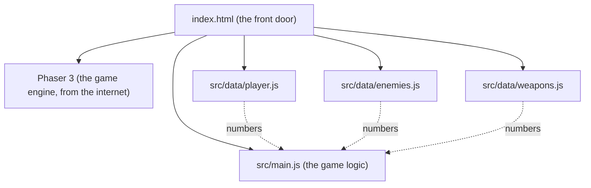

**Key idea:** the `data` files hold **numbers and names** (speeds, health, colors). `main.js` holds **rules** (how things move and fight). You can edit the data files freely without breaking the rules.

| File | What lives there | Example you can change |
|---|---|---|
| `player.js` | your speed, size, color | `speed: 400` = too much coffee |
| `enemies.js` | Bill speed, health, spawn rate | `everyMs: 300` = chaos |
| `weapons.js` | Coffee Splash fire rate, range, damage | `fireEveryMs: 300` = triple espresso |

---

## Chapter 2: The game loop

A game is a flipbook. The screen is redrawn about **60 times every second**, and between each drawing the game decides what moved.

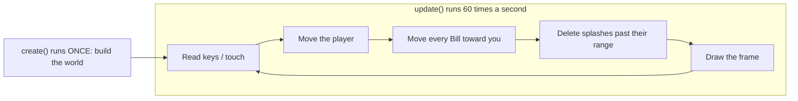

**Think of it like video:** 60 frames per second, except each frame is calculated on the spot instead of recorded.

**Bonus: why we "normalize" movement.** Pressing right and up at once would push you 1 step right *and* 1 step up, about 1.41 steps total, so diagonals would be faster. Normalizing shrinks the arrow back to length 1.

```
 Without normalizing        With normalizing
       ↑ 1                      ↑ 0.71
       |  ↗ 1.41                |  ↗ 1.0
       |/                       |/
       +---→ 1                  +---→ 0.71
```

---

## Chapter 3: The camera and the world

The world (4000 × 4000 pixels of office carpet) is much bigger than your screen. The camera is a window that follows you around, like a photographer tracking a subject.

```
+------------------------- WORLD (4000 x 4000) -------------------------+
|                                                                       |
|              $ ← Bill spawns here, just outside the window            |
|        +-------- CAMERA VIEW (your screen) --------+                  |
|        |                                           |                  |
|        |                  ■ You                     |  $               |
|        |                                           |                  |
|        +-------------------------------------------+                  |
|                       $                                               |
+-----------------------------------------------------------------------+
```

The HUD ("AGE 40...") is pinned to the **screen**, not the world, so it stays put while the carpet scrolls.

---

## Chapter 4: Spawning and chasing

**Spawning** means creating enemies while the game runs. A **timer** goes off every 0.9 seconds and drops one Bill on a random edge just outside the camera view.

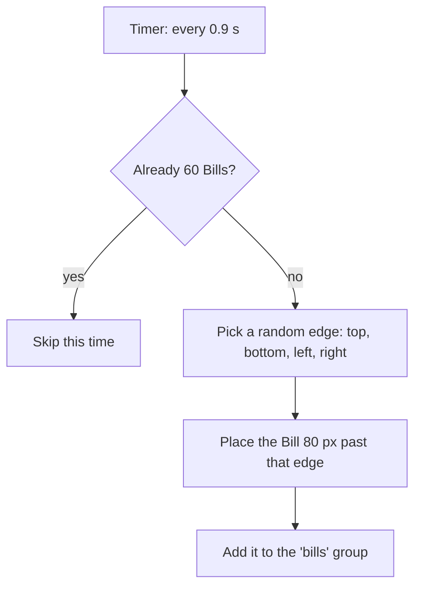

**Chasing** happens inside the game loop. Every frame, each Bill turns to face you and moves forward.

```
frame 1      frame 2      frame 3      frame 4
$            
              $
                           $
                                        $ ■
```

A **group** is a bag holding every Bill, so one line of code can move them all. Bills also **collide with each other**, so they form a crowd instead of melting into one square.

---

## Chapter 5: Targeting

Coffee Splash aims for you. Every second it checks the distance to **every** Bill and keeps the shortest one.

```
          $ 310px
                          
   $ 180px    ■ You  ───────▶  $ 95px  ← nearest, so it gets the coffee
                          
                 $ 240px
```

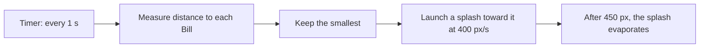

Deleting splashes that missed is important. Without it, thousands of invisible drops would pile up and slow the game down.

---

## Chapter 6: Collisions and health

Every frame the physics engine asks: **is any splash touching any Bill?** This is called an **overlap check**. When the answer is yes, a small function runs.

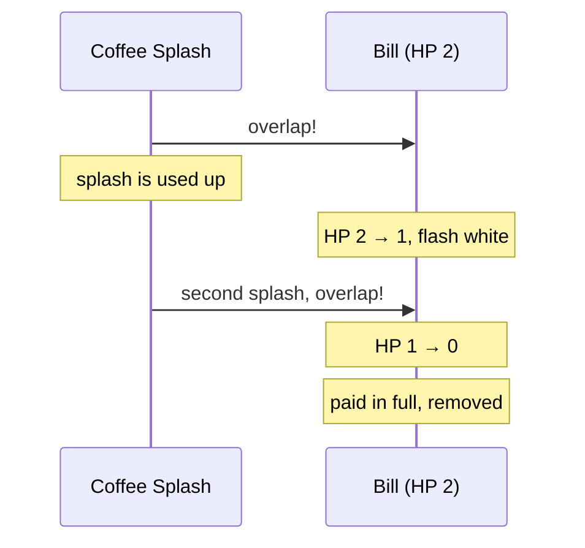

**HP (hit points)** is a number on each enemy. Damage subtracts from it, and at zero the enemy is gone. Two numbers control how tough the fight feels:

| Bill `hp` | Splash `damage` | Splashes needed |
|---|---|---|
| 2 | 1 | 2 (current) |
| 1 | 1 | 1 (easy) |
| 6 | 2 | 3 (tough) |

The white flash is the first bit of **game juice**: a tiny effect that makes a hit *feel* like a hit.

---

## Chapter 7: Taking damage

You have **10 HP**. Touching a Bill costs 1. Right after a hit you get a short **safe window** (0.7 s) so a crowd can't drain you all at once in a single moment.

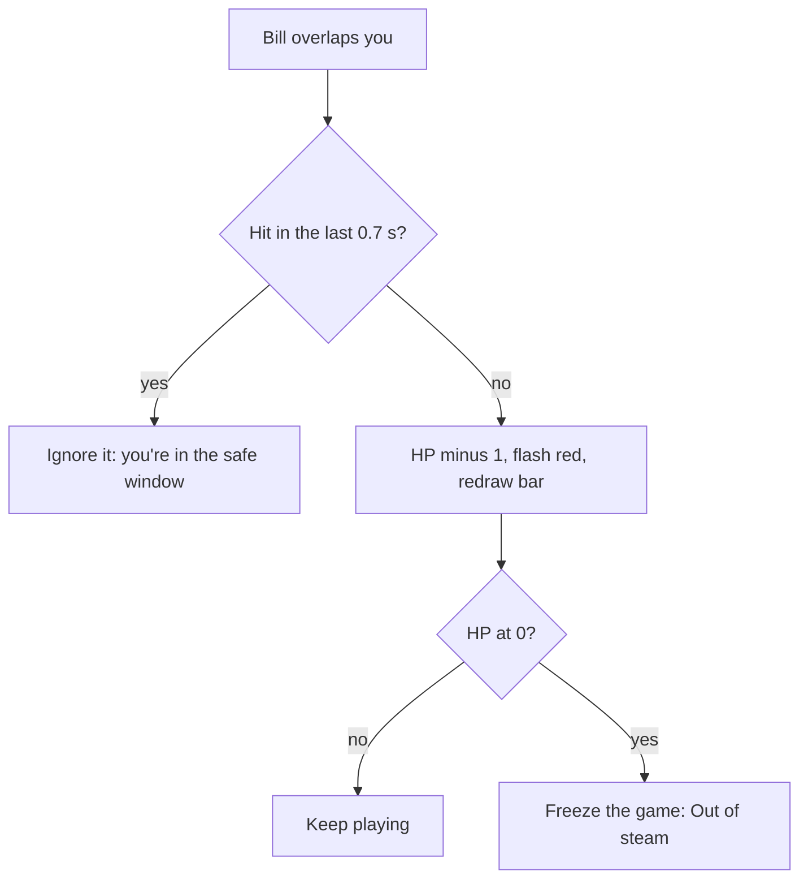

```
Time:     0.0s    0.3s    0.7s    1.0s    1.4s
Touch:     $       $       $       $       $
Damage:   -1       .      -1       .      -1
          [ hit ][ safe  ][ hit ][ safe  ][ hit ]
```

The health bar is drawn **on the screen, not in the world** (like the HUD), and redrawn after every hit: a dark empty bar, then a red bar whose width is `HP / maxHP`.

```
10 HP  [##########]
 6 HP  [######    ]
 2 HP  [##        ]
```

---

## Chapter 8: Game Over and restarting

When HP hits 0, the game **freezes the physics**, lays a dark sheet over the screen, and shows four things:

```
+-------------------------------------------+
|                GAME OVER                  |
|     Crushed by a late electric bill.      |  <- random line from deaths.js
|           You lasted 2:13                 |  <- time since the run started
|            [  Try again  ]                |  <- click, tap, or Space
+-------------------------------------------+
```

**Restarting** means running `create()` again from scratch. Anything remembered *outside* the scene (like `gameOver` or your HP) has to be reset by hand at the top of `create()`, or the new run would start already dead.

```
 Try again
     |
     v
 scene.restart()  -->  create() runs again  -->  reset: gameOver, timer, touch
                                             -->  rebuild: floor, you, Bills group
```

The jokes live in `src/data/deaths.js`, grouped by **who killed you**. Later, each enemy type gets its own list.

| Killer | Example line |
|---|---|
| bill | "Died of autopay failure." |
| (later) email | "Replied all. Fatally." |

---

## Chapter 9: The endless floor (a magic trick)

Before, the carpet was one giant 4000 x 4000 rug with walls at the edges. Now there's no rug at all. The carpet is **exactly the size of your screen**, glued to the camera, and its **pattern slides** as you move.

```
 OLD: a huge rug, camera moves over it      NEW: a screen-sized rug, pattern slides
 +--------------------------+               +----------+
 |  +------+                |               |##########|  camera moves right 64px
 |  |camera| ->             |               |##########|  -> pattern shifts left 64px
 |  +------+          WALL  |               +----------+  -> looks like you walked
 +--------------------------+                            (and it never ends)
```

It's the same trick as old cartoons: the character runs in place while the background scrolls behind them. Each frame:

```
floor.tilePositionX = camera.scrollX
floor.tilePositionY = camera.scrollY
```

| | Old giant rug | New sliding rug |
|---|---|---|
| Size in memory | 4000 x 4000 | screen size |
| Edge of the world | wall at 4000px | none |
| You notice the difference | no | no |

Updated Chapter 3 note: the world no longer has an edge, so the big box in that diagram now goes on forever.

---

## Chapter 10: Wisdom gems and experience (XP)

Every paid-off Bill leaves a blue **Wisdom gem**. Gems near you get pulled in by a **magnet**; the rest wait on the floor until you walk closer.

```
            ◆  (far: waits)
                                 
       ◆ ─────▶ ■ You             magnet radius = 90px
          ◆ ──▶                   (gems inside it fly to you)
                                 
                     ◆  (far: waits)
```

Each gem adds XP. When the bar fills, you **level up**, the leftover XP carries over, and the next level asks for 40% more:

| Level | Gems needed to reach the next one |
|---|---|
| 1 → 2 | 5 |
| 2 → 3 | 7 |
| 3 → 4 | 10 |
| 4 → 5 | 14 |
| 5 → 6 | 20 |

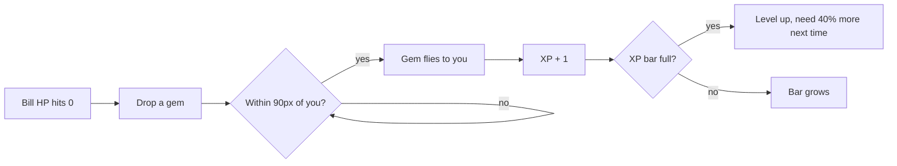

This growing cost is a **curve**: early levels come fast so the game feels generous, later ones slow down so each one feels earned.

---

## Chapter 11: The level-up screen

When the XP bar fills, the world **pauses** and you pick 1 of 3 random upgrades.

```
+--------------------------------------------+
|                 LEVEL 2!                   |
|  Pick one (click, tap, or press 1 / 2 / 3) |
|  +--------------------------------------+  |
|  | 1. Extra Shot                        |  |
|  |    Coffee fires 20% faster.          |  |
|  +--------------------------------------+  |
|  | 2. Reading Glasses                   |  |
|  |    Gem magnet reaches 40% farther.   |  |
|  +--------------------------------------+  |
|  | 3. Annual Checkup                    |  |
|  |    +3 max HP, and heal 3.            |  |
|  +--------------------------------------+  |
+--------------------------------------------+
```

**The big idea: data vs. stats.** The data files are the *recipe*. At the start of each run, the game copies those numbers into a `stats` object. Upgrades change the **copy**, so a new run always starts back at the recipe.

```
 src/data files (recipe, never changes)
        │  copied at the start of every run
        ▼
 stats  { speed 220, damage 1, fireEveryMs 1000, ... }
        │  upgrades edit this copy
        ▼
 Dark Roast  →  damage 1 → 2
 Extra Shot  →  fireEveryMs 1000 → 800
```

**Pausing** means stopping two things: the physics (nothing moves or collides) and the clock (no new Bills, no shots). Picking an upgrade turns both back on.

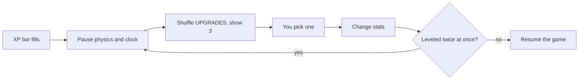

---

## Chapter 12: Audio cues and game controllers

**Synthesized sound (Web Audio API):** Instead of loading MP3 files, the browser generates sound waves on the fly using numbers `[frequency, duration, waveShape]`.

```
  Sound Recipe (sounds.js)                Browser Synthesizer (sfx.js)
  billPaid: [                             Oscillator ──▶ Gain (fade out) ──▶ Speakers
    [880 Hz,  0.06s, "square"],   ───▶    ♪ 880 Hz  (B5)
    [1320 Hz, 0.10s, "square"]            ♪ 1320 Hz (E6) -> "Cha-ching!"
  ]
```

**Controller input:** A thumbstick gives two numbers from `-1.0` to `+1.0` (left/right and up/down). Because sticks never rest at a perfect `0.0`, we ignore tiny values under `0.2` (a **deadzone**) so your character doesn't drift when you let go.

```
        Thumbstick Deadzone                        "Held" vs "Just Pressed"
            -1.0 (up)                         Frame:   1     2     3     4
         +-------------+                      Button: [up]  [up]  [up]  [  ]
         |   .-----.   |                      Held:   yes   yes   yes   no
   -1.0  |  /  0.2  \  | +1.0                 Just:   YES   no    no    no
  (left) | |  (dead) | | (right)                      (moves menu 1 step, not 3)
         |  \       /  |
         +-------------+
            +1.0 (down)
```

---

## Chapter 13: Area weapons, knockback, and conditional upgrades

Until now, you only had a **single-target projectile** (Coffee Splash). Now you can unlock **area-of-effect (AoE)** weapons that hit every enemy inside a circle around you:

```
  1. Coffee Splash             2. Dad Joke (Aura)          3. The Word "No." (Knockback)
   (single nearest)          (damages all in radius)      (damages + shoves outward)

                        . - ~ - .                    . - ~ - .
      ■ ───▶ $               /   $     \                  /  ↖$   ↗$                             |     ■     |                |     ■      |
                             \       $ /                  \  ↙$      /
                              ' - _ - '                    ' - _ - '
```

**How Knockback works:** To push a Bill directly away from you, we find the arrow pointing from you to the Bill `(bill.x - player.x, bill.y - player.y)`, divide by the distance `d` so the arrow has length `1`, and multiply by `noPush` (95 pixels).

**Conditional Upgrades (`when`):** You shouldn't see "Louder Groan" before you even own **Dad Joke**. Each upgrade can have a `when(stats)` check:

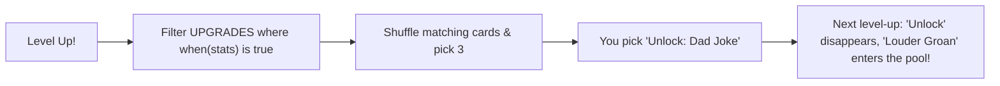

---

## Chapter 14: The Age Clock, Pause, and Boss Fights

**1. The Age Clock:** Instead of a plain timer, we convert elapsed seconds into **years of age** (`secondsPerYear: 20` in `player.js`, so 1 year passes every 20 seconds while playtesting):

```
  Elapsed seconds:   0s ────────▶ 20s ────────▶ 40s (Age 42.0)
  Your Age:         40.0         41.0         42.0 ──▶ BOSS SPAWNS!
```

**2. Pausing cleanly:** When you press **P**, **Esc**, or controller **Start**, `scene.time.paused = true` freezes Phaser's clock, which means `this.time.now` also stops advancing—so pausing for 5 minutes won't accidentally age you or spawn the boss early!

**3. Boss Lifecycle (The Performance Review):**

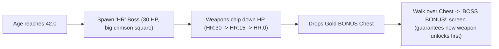

---

## Chapter 15: Wave Schedules & Enemy State Machines

**1. Wave Schedule tied to Age (`SPAWNING.waves`):** Instead of spawning at the same slow pace forever, the game checks your age against a table in `enemies.js` and speeds up the spawn timer while mixing in new enemy types:

| Age Milestone | Spawn Delay | What Spawns |
|---|---|---|
| **Age 40** | every `900ms` | 100% Bills (`$`) |
| **Age 41** | every `750ms` | 70% Bills + 30% **Spam Likely** (`TEL`) |
| **Age 42** | *Boss Event* | **The Performance Review** (`HR:30`) |
| **Age 43** | every `580ms` | 60% Bills + 40% Spam Likely |
| **Age 45+** | every `440ms` | 55% Bills + 45% Spam Likely (pure chaos) |

**2. Enemy State Machines:** Different enemies now have different "brains" inside `update()`:

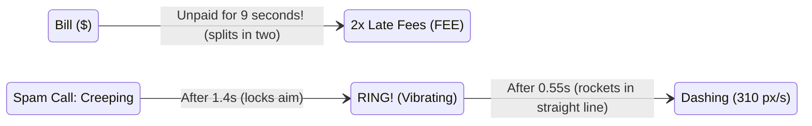

Because **Spam Likely** locks its aim when it starts ringing and pauses for `0.55s` to vibrate (`RING!`), you get a clear visual + audio cue to sidestep out of its path before it rockets across the screen!

---

## Chapter 16: Weighted Spawning & Weapon Evolutions

**1. Weighted Spawn Tables (`wave.mix`):** Instead of simple coin flips, each wave now gives every enemy a **raffle ticket count** (weight). Adding `[enemy, weight]` to a wave automatically adjusts the odds:

```
  Age 44 Wave Mix:  [["bill", 4], ["spamCall", 2], ["snackAttack", 2], ["backTwinge", 2], ["officeGossip", 1]]
  Total Tickets = 11:
  [ $ ][ $ ][ $ ][ $ ][ TEL ][ TEL ][ YUM ][ YUM ][ OUCH ][ OUCH ][ CC: ]
   \_______4/11______/ \___2/11___/  \___2/11___/  \____2/11____/  \_1/11_/
```

**2. Weapon Evolutions (Synergy Recipes):** Just like *Vampire Survivors*, upgrading a weapon **and** holding its matching passive unlocks a super-card at the top of your next level-up or boss chest:

```mermaid
flowchart LR
    W1["Upgraded Coffee"] & P1["Good Night's Sleep"] --> E1["EVOLVE: Cold Brew Concentrate
(3-way piercing espresso spread!)"]
    W2["Upgraded Dad Joke"] & P2["Reading Glasses"] --> E2["EVOLVE: Unhinged Pun Storm
(Giant double-speed cringe ring!)"]
    W3['Upgraded "No."'] & P3["Comfortable Shoes"] --> E3["EVOLVE: Healthy Boundaries
(Huge shockwave + heals 1 HP!)"]
```

---

## Chapter 17: Procedural Pixel-Art Sprites (`src/sprites.js`)

Instead of loading external `.png` files, `makePixelArt(scene, key, rows, palette, scale)` paints tiny text grids into real Phaser textures at startup. Each letter maps to a hex color (`"."` is transparent):

```
  Grid in src/sprites.js ("gem")         Rendered Sprite in Game
  "...BB..."                             
  "..BWWB.."                                   ⟐  Sparkling
  ".BWLLWB."      ──(makePixelArt)──▶         ⟐⟐⟐  Faceted
  "BWLCCLLB"                                   ⟐  Crystal
  ".BLLLLB."
```

| Sprite Key | Visual Design |
|---|---|
| `floor` | 128x128 woven office carpet tile with quadrant seams, fiber speckles, and a faint coffee-ring stain |
| `player` | 16x16 midlife hero with salt-and-pepper temples, glasses, dress shirt, red tie, and orange coffee mug |
| `bill` / `lateFee` | Green dollar-bill envelope (`$`) and jagged red PAST DUE notice (`!`) |
| `spamCall` | Glowing purple smartphone with red caller-ID alert screen |
| `snackAttack` / `backTwinge` | Pink frosted donut with rainbow sprinkles; jagged yellow-orange lightning bolt |
| `officeGossip` | Corporate email envelope with a red unread notification badge (`CC:`) |
| `performanceReview` / `mortgageRefinance` / `midlifeCrisis` | Giant HR clipboard with frowny chart, columned purple bank (`APR`), and cherry-red convertible (`V8`) |

Plus, `player.setFlipX(x < 0)` and a sine-wave wobble `Math.sin(time / 55) * 7` give your character a jaunty walking bounce as you move!

---

## Chapter 18: Reaching Age 50 (The Reaper & Win Screen)

Just like the 30-minute Reaper in *Vampire Survivors*, surviving to **Age 50.0** triggers **Father Time (`50:9999`)**, an unstoppable hooded figure with a scythe. Touching him doesn't mean you lost—it triggers the golden **"YOU SURVIVED YOUR 40s!"** victory screen!


---

## Chapter 19: Game Juice, Chiptune Groove & Title Screen

**1. Layered "Game Juice" on Every Hit:** None of these effects change the math of the game, yet together they make combat feel 10x more physical:

```
  Weapon hits Enemy
        ├── 1. White Flash + Squash-and-Stretch (scaleX 1.22, scaleY 0.82 for 55ms)
        ├── 2. Floating Damage Number ("-2" drifts up & fades out; gold when >= 2)
        ├── 3. Shredded Paper Confetti (6-16 colored scraps burst outward on KO)
        └── 4. Camera Shake (120ms jolt on hurt, 180ms rumble on Boss arrival)
```

**2. Sequenced Chiptune Groove (`SOUNDS.music`):** A `setInterval` in `sfx.js` steps through a 16-note bassline (`triangle` wave) and melody (`square` wave) every `165ms`. And because clicking **"CLOCK IN"** on the Title Screen unlocks the browser's `AudioContext`, the groove and sound effects work from frame 1!

---

## Chapter 20: Meta-Progression, 401(k) Shop & `localStorage` (`src/data/meta.js`)

In a roguelite like *Vampire Survivors*, **Run Stats** (`stats`) reset when you die, while **Meta-Progression** (`meta`) saves permanently in the browser's `localStorage` so every run makes the next one a little stronger:

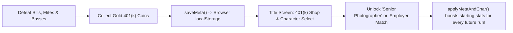

| Feature | How it works |
|---|---|
| **401(k) Coins (`coin401k`)** | 35% drop from Bills, 2 from Elites, 5 from Decade Bosses; pulled in by your magnet |
| **Permanent Shop (`META_SHOP`)** | **Employer Match** (+2 max HP/rank), **Home Espresso** (+10% speed & fire rate/rank), **CPA on Retainer** (+25% magnet/rank) |
| **3 Playable Archetypes (`CHARACTERS`)** | **The 9-to-5er** (Free), **The Senior Photographer** (10k: starts with Dad Joke + 25% wider radius & faster feet), **The Grad Student at 45** (15k: starts with "No." shockwave + huge magnet) |

---

## Chapter 21: One Simulation, Three Cameras (`src/view3d.js`)

How can a game switch mid-run between a **2D 16-Bit** top-down view, a **Diablo 3/4** isometric dungeon crawler, and a **3D Third-Person** action view without rewriting a single rule of gameplay? By separating the **Simulation (Model)** from the **Camera (View)**:

```
   PHASER 2D SIMULATION (The "Truth")             THREE.JS 3D RENDERER (src/view3d.js)
  ┌──────────────────────────────────┐           ┌────────────────────────────────────────┐
  │  Player & Bills move on (x, y)   │ ──sync──► │ Maps 2D (x, y) -> 3D Floor (x, 0, z)   │
  │  Arcade Physics checks overlaps  │           │ Style 1 (Diablo 3/4): high angle,      │
  │  Timers fire weapons & waves     │           │   38° FOV, dark fog + warm torchlight  │
  │  HUD, XP bar & menus draw on top │ ◄─project─│ Style 2 (3D Third-Person): low behind  │
  └──────────────────────────────────┘           │   shoulder, 60° FOV, bright sky & fog  │
                                                 └────────────────────────────────────────┘
```

| Camera Style (`V` Key) | Camera Offset `(dx, dy, dz)` | Field of View (`FOV`) | Lighting & Atmosphere |
|---|---|---|---|
| **1. `2D 16-Bit`** | Directly overhead (2D tileSprite) | Orthographic / Flat | Crisp 16-bit pixel art sprites & multi-zone office floor |
| **2. `Diablo 3/4`** | `(-260, +420, +320)` angled 45° | Narrow (`38°`) | Dark `#090b14` fog + golden player torchlight (`PointLight`) + long shadows |
| **3. `3D Third-Person`** | `(0, +165, +250)` over-the-shoulder | Wide (`60°`) | Stylized `#283866` sky + horizon fog + 3D hero, enemy, and boss meshes |

---

## Chapter 22: Pacing Math, Physical Barriers & Climbable Mezzanine Platforms

### 1. Why the First 40 Seconds Felt Too Hard (DPS vs. Spawn Rate)
In a survival game, early-game fun comes from **Kills Per Second (KPS)** outpacing **Spawns Per Second (SPS)** just enough that you can scoop up gems and hit Level 3-4 before the first Boss arrives:

| Metric | Old Value (Too Hard) | New Value (Balanced Progression) |
|---|---|---|
| **Starter Coffee Fire Rate** | `1000ms` (1.0 shot/sec) | **`650ms` (1.54 shots/sec)** |
| **Regular Bill HP & Overdue Split** | `2 HP` (took 2.0s to kill!), splits in `9s` | **`1 HP` (1 splash pays it off!), splits in `14s`** |
| **XP Curve & Gem Magnet** | `5 XP` for Lv 2 (`1.4x` growth), `90px` magnet | **`3 XP` for Lv 2 (`1.25x` growth), `120px` magnet** |
| **Player Survivability** | `10 HP`, no level-up heal | **`14 HP` + heals `+2 HP` on every Level-Up!** |

### 2. Solid Scenery Barriers & 2.5D Mezzanine Platforms (`ent.elev`)
Every office prop (`prop_desk`, `prop_plant`, `prop_cooler`) now has a solid Arcade Physics hitbox, and we added **Raised Mezzanine Platforms (`prop_platform`)** with a **6-step staircase**:

```
             TOP GUARDRAIL (Solid Ledge Barrier)
            ╔═══════════════════════════════════╗
  STAIRCASE ║                                   ║
  ┌─┬─┬─┬─┬─╢     RAISED MEZZANINE DECK         ║ RIGHT
  │1│2│3│4│5│        (Elevation = +42)          ║ GUARDRAIL
  └─┴─┴─┴─┴─╢   Walk up the stairs on the left  ║ (Solid)
  Open Ramp ║   to take the High Ground!        ║
            ╚═══════════════════════════════════╝
            BOTTOM GUARDRAIL (Solid Ledge Barrier)
```

---

## Chapter 23: Chameleon UI (`src/ui.js`) & Smashable Props (`damagePlant`)

### 1. Why Web Games Use an HTML/CSS UI Layer (`#ui-layer`) Over the Canvas
Drawing complex menus, fonts, and cards inside a WebGL canvas takes hundreds of lines of positioning math. Layering a DOM `<div id="ui-layer">` on top gives us CSS Grid, Flexbox, `backdrop-filter: blur()`, and **CSS Custom Properties (`--var`)** so pressing **`[V]`** transforms the entire UI aesthetic automatically:

```
  Press [V] -> window.syncUITheme() sets #ui-layer[data-theme="0 | 1 | 2"]
        ├── Theme 0 (16-Bit):  --font-head: 'Press Start 2P'; --pod-skew: 0deg;  ("CORP-OS v1.98")
        ├── Theme 1 (Diablo):  --font-head: 'Cinzel';         --border-col: gold; ("SANCTUARY HR")
        └── Theme 2 (AAA 3D):  --font-head: 'Bungee';         --pod-skew: -4deg; ("MIDLIFE ROYALE")
```

### 2. Smashable Potted Plants & Loot Table (`damagePlant`)
Just like candlesticks in *Vampire Survivors*, every `prop_plant` has `hp: 2` and rolls a 3-way loot table when smashed:

| Roll (`Math.random()`) | Drop Reward | Effect |
|---|---|---|
| `0.00 - 0.38` (**38%**) | **Leftover Breakroom Pizza (`pizza`)** | Restores **`+3 HP`** immediately on pickup! |
| `0.38 - 0.78` (**40%**) | **401(k) Coin + Wisdom Gem** | **`+1k` permanent coin** + **`+1 XP`** |
| `0.78 - 1.00` (**22%**) | **Bonus Stash Jackpot** | **3 Wisdom Gems + 1 Gold 401(k) Coin!** |

---

## Chapter 24: Active-Play Clocks, the Age 80-100 Senior Campaign & Mid-Run Save States

### 1. Why You Hit Age 50.8 in 40 Seconds (Wall-Clock Time vs. Active-Play Time)
In Phaser 3, `this.time.now` measures **wall-clock time** since the page loaded. Even when `this.time.paused = true` (like while you are reading 3 Perk Cards on the Level-Up screen), `this.time.now` keeps ticking!
- **Old Buggy Formula:** `elapsedSec = (this.time.now - startTime) / 1000` (spending 30 seconds reading Level-Up cards aged you 3 full years while paused!).
- **New Active-Play Accumulator:** We now add `runElapsedMs += delta` **only** when `!gameOver && !levelUpOpen && !paused && !titleOpen && !retire80Open`. Reading upgrade cards or pausing now takes **zero** seconds off your life clock!

### 2. The Full 60-Year Arc: Age 40 -> 80 (Retirement) -> 100 (Bonus Senior Rounds)
```
  AGE 40 ───────► AGE 50 ───────► AGE 60 ───────► AGE 70 ───────► AGE 80 (RETIREMENT!) ───────► AGE 100 (CENTENARIAN!)
  [Checkpt]       [Checkpt]       [Checkpt]       [Checkpt]       [Claim Win OR Keep Going]     [20 Bonus Senior Rounds]
     │               │               │               │                       │                             │
   Lv +0           Lv +3           Lv +6           Lv +9                   Lv +12                    6 AM Pickleball
  45: 📋 HR       52: 🏦 Bank     60: 🏎️ Crisis   70: 🏡 HOA Pres.        80: 🏖️ Audit              90: 🏓 Champ / 100: 🏆
```

### 3. Two-Tier Save System in `localStorage` (`src/data/meta.js`)
| Storage Key | What It Saves | When It Updates |
|---|---|---|
| `midlife_survivors_save_v1` | **Permanent Career Dossier:** 401(k) Coins, Shop Ranks (including **Pension Plan**), Unlocked Characters, **Best Age**, and **Unlocked Decade Checkpoints (`40, 50, 60, 70, 80`)** | Every coin pickup, shop purchase, checkpoint unlock, and run end |
| `midlife_survivors_run_v1` | **Mid-Run Save State:** Exact `currentAge`, `hp`, `level`, `xp`, `bossesSpawned`, and your entire `stats` upgrade build | Auto-saves every 3 seconds of active play + when clicking **Save & Exit** |

---

## Chapter 25: Universal 2D Menu Navigation, Direct Gamepad Polling & Mobile Touch UX

### 1. How `window.menuNav` Makes Every Screen Work with Arrow Keys, WASD & Controllers
Instead of writing separate keyboard/controller code for the Title Screen, Level-Up Cards, Pause/Options, Age 80 Retirement, and Game Over screens, every interactive card or button is registered with `bindNavItem(el, rowIndex, onActivate)` in `src/ui.js`:

```
  TITLE DOSSIER 2D NAVIGATION GRID (data-nav-row)
  ┌─────────────────────────────────────────────────────────────────────┐
  │ Row 0: [ ☕ The 9-to-5er ]  [ 📸 Photographer ]  [ 🎓 Grad Student ] │ ◄─ Left / Right
  │ Row 1: [ 🔓 Age 40 ] [ 🔒 Age 50 ] [ 🔒 Age 60 ] [ 🔒 70 ] [ 🔒 80 ] │ ◄─ Left / Right
  │ Row 2: [ 💼 Employer Match (Max HP)                      BUY 2k   ] │ ▲
  │ Row 3: [ ☕ Home Espresso (Move Speed & Fire Rate)        BUY 2k   ] │ │ Up / Down
  │ Row 4: [ 🧾 CPA on Retainer (Gem & Coin Magnet)          BUY 2k   ] │ │
  │ Row 5: [ 📈 Pension Plan (+1 Starting Weapon Damage)     BUY 3k   ] │ ▼
  │ Row 6: [ 👾 16-Bit Retro ]  [ 🕯️ Diablo 3/4 ]  [ 🚀 Fortnite 3D  ] │ ◄─ Left / Right
  │ Row 7: [ 💾 RESUME SAVED RUN (if a mid-run save exists)           ] │
  │ Row 8: [ ☕ START NEW RUN AT AGE 40 (Default Focus!)              ] │ ◄─ Space / Enter / A
  └─────────────────────────────────────────────────────────────────────┘
```

### 2. Why Direct `navigator.getGamepads()` Beats Canvas-Only Gamepad Plugins
When you click an HTML `<button>` inside `#ui-layer`, browser focus moves from the `<canvas>` to that `<button>`. By reading `navigator.getGamepads()` directly every frame in `readPad()` (and listening to `window.addEventListener("keydown")` with `e.preventDefault()`), controller sticks, D-pads, Arrow keys, and the **Spacebar Pause & Options Screen** stay 100% responsive no matter what you clicked last!

---

## Chapter 26: Pacing Level-Ups & 3-Tier Perk Scaling Across the Playthrough

### 1. Why Pure Multiplication Clustered Early Level-Ups (`3 -> 4 -> 5 -> 6`)
When `firstLevelXp` was `3` and `growth` was `1.25`, `Math.round(xpNeeded * 1.25)` produced:
- **Old Curve:** `3 -> 4 -> 5 -> 6 -> 8 -> 10` gems (6 level-up screens in your first 36 kills, interrupting gameplay every 5 seconds!).
- **New Compound + Step Curve (`Math.round(xpNeeded * 1.35 + 4)` starting at `8`):**

| Level Transition | Old Gems Needed | New Gems Needed | Approx. Gameplay Between Menus |
|---|---|---|---|
| **Lv 1 -> Lv 2** | `3` | **`8`** | ~15 seconds of initial combat |
| **Lv 2 -> Lv 3** | `4` | **`15`** | ~20 seconds |
| **Lv 3 -> Lv 4** | `5` | **`24`** | ~25 seconds |
| **Lv 4 -> Lv 5** | `6` | **`36`** | ~32 seconds |
| **Lv 5 -> Lv 6** | `8` | **`53`** | ~40 seconds |
| **Lv 6 -> Lv 7** | `10` | **`76`** | ~48 seconds |
| **Lv 7 -> Lv 8** | `13` | **`107`** | ~55 seconds |

### 2. 3-Tier Perk Progression (`src/data/upgrades.js`)
Perks now display their **Rank (`RANK 1/4 -> 4/4`)** on the card ribbon and unlock in 3 distinct career stages:
1. **Tier 1 (40s - Foundation):** Unlock `Dad Joke` and `"No."`, pick up passives (`Comfortable Shoes`, `Good Night's Sleep`, `Reading Glasses`), and level up weapon ranks (`Rank 1 -> 2+`).
2. **Tier 2 (50s & 60s - Evolutions):** Once a weapon reaches **Rank 2+** AND you own its matching Passive, its **✨ Evolution** (`Cold Brew Concentrate`, `Unhinged Pun Storm`, `Healthy Boundaries`) unlocks!
3. **Tier 3 (Late Career & 80-100 Senior Rounds):** Unlocks **Executive Delegation (`📊`)** (`+1` damage and `10%` faster fire rate to ALL weapons, 4 ranks) and **Titanium Knees (`🦿`)** (`+4 Max HP`, `+4` heal, `+10%` speed, 3 ranks)!

---

## Chapter 27: Character-Following Speech Bubbles & Browser Voice Synthesis (`window.speechSynthesis`)

### 1. Why the Old Dad Jokes Were Hard to Read (Fade-Immediately vs. Hold-Then-Fade)
Previously, `fireDadJoke` spawned a `12px` text label at the spot where you were standing and immediately started fading `alpha -> 0` over `0.75s`. As soon as you walked away, the text was already half-transparent and left behind!
- **New `showPlayerSpeechBubble` (`src/main.js`):**
  1. Renders a bold `14px` gold-on-navy speech pill (`💬 "Who touched the thermostat?!"`).
  2. **Follows your character every frame** in `update()` right above your head (`project3DToPhaserWorld(this, player.x, (player.elev || 0) + 68, player.y)`).
  3. **Holds at 100% opacity for `2.30 seconds`**, then smoothly fades out over `0.55s` (**`2.85 seconds` total**)!

### 2. Zero-File Character Voice Acting with the Web Speech API (`speakDadJoke` in `src/sfx.js`)
Modern browsers include a built-in text-to-speech synthesizer (`window.speechSynthesis`) alongside Web Audio:
```js
const utter = new SpeechSynthesisUtterance(text);
utter.pitch = currentAge >= 80 ? 0.84 : 0.94; // deeper senior voice at Age 80+!
utter.rate  = 1.05;
window.speechSynthesis.speak(utter);
```
You can also toggle **`🗣️ DAD JOKE VOICE: ◀ SPOKEN 🗣️ / TEXT ONLY 💬 ▶`** anytime inside the **Spacebar Pause & Options Screen**!

---

## Chapter 28: Telephoto Isometric Overview (`FOV 16°`) vs. Immersive 3D Horizon (`FOV 68°`)

### 1. Why Mode 1 and Mode 2 Looked Too Similar Before
In 3D photography and game cameras, two things define how a view feels: **Focal Length (`FOV`)** and **Camera Pitch (whether you see the horizon)**. Previously, both modes had medium FOVs (`38°` vs `60°`) and looked down at the floor, so neither showed a true isometric overview nor a true 3D horizon!

```
  MODE 1: DIABLO 3/4 ISOMETRIC OVERVIEW                 MODE 2: AAA 3D IMMERSIVE THIRD-PERSON
  ─────────────────────────────────────                 ─────────────────────────────────────
  📷 Camera at (-760, 1060, +760), FOV = 16°            ☀️ Glowing Sun + ☁️ 3D Clouds + 🏙️ 32 Skyscrapers
       \                                                ───────────────────────────────────── (Horizon)
        \   Parallel telephoto rays                     📷 Low Chase Cam (y=68, FOV=68°) ──► [☕ Hero 1.22x]
         ▼  (Zero perspective distortion!)              ═══════════════ 3D Corporate Plaza Floor ═════════════
  ╔═════════════════════════════════════╗
  ║ 🔥 [Mezzanine]   [☕]    [Desk]  🔥 ║
  ║     Wide Tactical Dungeon Overview  ║
  ╚═════════════════════════════════════╝
```

### 2. Side-by-Side Comparison (`src/view3d.js`)
| Property | Mode 1: `Diablo 3/4` (Isometric Overview) | Mode 2: `AAA 3D` (3D Immersive World) |
|---|---|---|
| **Field of View (`camera3d.fov`)** | **`16°` Telephoto Lens** (flattens perspective into parallel isometric lines) | **`68°` Wide-Angle Action Lens** (exaggerates 3D depth and speed) |
| **Camera Position & Aim** | High diagonal `(-760, 1060, +760)` looking at `(0, 10, 0)` | Low shoulder height `(0, 68, +142)` looking out at `(0, 34, -280)` |
| **World Environment** | Dark Obsidian Sanctuary flagstones (`floorTexDiablo`) + 4 Flaming Mezzanine Braziers + flickering torchlight | 360° ring of **32 3D Corporate Skyscrapers**, **Glowing Sunset Sun**, **14 Floating 3D Clouds**, and **Tall Cubicle Walls** |
| **Hero Scale & Animation** | `0.95x` tactical scale | **`1.22x` foreground hero scale** with 3D swinging leg stride (`legL` / `legR`) |

---

## Chapter 29: Unlockable Life Stages (`src/data/stages.js`) & Multi-Zone World Biomes

### 1. Replacing the Endless Checkerboard with 5 Unlockable Life Chapters
To make the world reflect the real journey of adulthood (Career -> Birth/Hospital -> Parenting/Home -> Navigating Friendships -> Retirement), we created `src/data/stages.js`. Each stage defines its own multi-zone 512x512 procedural floor, 3D sky/fog palette, enemy swarm labels, and Phase 7 interactive challenges:

```
  AGE 40: 🏢 OFFICE ──► AGE 44: 🏥 HOSPITAL ──► AGE 50: 🏡 HOME & YARD ──► AGE 60: 🍻 SOCIAL PATIO ──► AGE 80: 🌴 RESORT
  Career & Cubicles     Birth & 3AM Feedings    Parenting & LEGO Bricks    Navigating Friendships      Pickleball & HOA
  [BILL / RE:RE:]       [CO-PAY / 3AM CRY]      [TUITION / LEGO! / MATH]   [SPLIT$ / FLAKE! / DRAMA]   [COPAY / BINGO]
```

### 2. How `makeFloorTexture` Paints Distinct Architectural Zones (`src/view3d.js`)
Instead of a 2-color grid, `makeFloorTexture(style, stageObj)` paints a `512x512` architectural canvas cached per stage (`floorTexCache[`${mode}_${stId}`]`):
- **🏥 Hospital (`hospital`):** Mint/slate terrazzo tiles + red & cyan emergency triage stripes + white medical cross emblem.
- **🏡 Suburban Home (`home`):** Warm oak living room planks + green backyard lawn + crimson family rug + **scattered colorful LEGO bricks**.
- **🍻 Social Courtyard (`social`):** Cobblestone patio + cedar bistro deck + radial golden string-light glow pools.
- **🌴 Sunset Palms Resort (`senior`):** Terracotta resort lanai + white-lined **Pickleball Court** with kitchen zones.

---

## Chapter 30: Universal 4-Device Input Abstraction & Live Rebinding (`#controls-modal`)

### 1. The Input Abstraction Layer (`meta.controls`)
Instead of hardcoding specific keys or buttons inside the game loop, all 4 input devices (**Keyboard**, **Mouse**, **Touch**, and **Video Game Controller**) feed into a single unified **Input Abstraction Layer** backed by `meta.controls` in `localStorage`:

```
===================================================================================
            4-DEVICE INPUT ABSTRACTION & CONFIGURATION PIPELINE
===================================================================================

  [⌨️ KEYBOARD]            [🖱️ MOUSE]              [📱 TOUCH]            [🎮 CONTROLLER]
  Custom Key Codes         Hold-Click Steer /      Floating Stick /      Left & Right Sticks
  (W/A/S/D + Arrows,       Cursor Auto-Follow /    Fixed Left or Right / + D-Pad + Custom
   Pause, View, Mute)      Click-Drag / R-Click    Direct Touch Follow   Button Indices (0-11)
         │                         │                        │                      │
         └─────────────────────────┴───────────┬────────────┴──────────────────────┘
                                               ▼
                        ┌─────────────────────────────────────────────┐
                        │   `meta.controls` (Saved in localStorage)   │
                        │   Configured via `#controls-modal` UI       │
                        └──────────────────────┬──────────────────────┘
                                               ▼
                    ┌──────────────────────────┴──────────────────────────┐
                    ▼                                                     ▼
     [GAMEPLAY MOVEMENT VECTOR (x, y)]                     [UNIVERSAL MENU NAV (`menuNav`)]
     Normalized unit vector (len = 1.0)                    2D Row/Col Focus + Activate/Back
===================================================================================
```

### 2. How Live Key & Controller Button Listening Works (`window.rebindState`)
When you select a Keyboard or Controller binding row in `#controls-modal`, `window.rebindState` enters listening mode:
1. **Keyboard Capture (`window.rebindState.type === "key"`):** The global `keydown` listener intercepts the very next key press (`e.code`), writes it to `meta.controls[field]`, saves to `localStorage`, and updates the HUD key badges (`⏸ PAUSE [KEY]`, `[KEY]`, `🔊 [KEY]`).
2. **Controller Capture (`window.rebindState.type === "pad"`):** Inside `readPad()`, the game scans `gp.buttons[0..11]` for the first newly pressed physical button on your controller (or lets you cycle button presets with `◀ / ▶`), binding that button index immediately.

---

## Chapter 31: Broadcast Lower-Third UI & Contextual Narrative Engines (`#hud-lower-third`)

### 1. Why Move the HUD to a Broadcast Lower Third?
In TV broadcasts, documentaries, and modern narrative action games, a **Lower Third** places all telemetry and commentary in the bottom 18% of the frame. In *Midlife Survivors*, moving the HUD from the top to `.hud-lower-third` solves two big problems at once:
1. **Unobstructed 3D Horizon & Up-Field Vision:** In `AAA 3D` and `Diablo 3/4` modes, enemies approach from the upper half of the screen and the 3D skyline sits at the top. A bottom console keeps the upper 82% of the viewport completely clear.
2. **Live Storytelling + In-Game Help in One Peripheral Eye-Line:** By pairing a **Contextual Story & Help Ticker (`#hud-context-bar`)** on the top lip of the lower third with a **Situational Radar (`#hud-radar-row`)** inside the center module, the game teaches its mechanics and tells your midlife story in real time as events unfold on screen.

```
===========================================================================================
                 BROADCAST LOWER-THIRD HUD & CONTEXTUAL STORY ENGINE
===========================================================================================
  ┌─────────────────────────────────────────────────────────────────────────────────────┐
  │                        82% UNOBSTRUCTED 3D / ISOMETRIC ARENA                        │
  │               (Skyscrapers, Horizon Sun, Floating Clouds & Action)                  │
  ├─────────────────────────────────────────────────────────────────────────────────────┤
  │ [📖 CHAPTER 1]  "Another Monday in the cubicle farm..."  │ 💡 TIP: Crack Plants...  │ ◄─ Upper Lip: Context Ticker
  ├───────────────────────────┬──────────────────────────────┬──────────────────────────┤
  │ [👔] ACTUARY LV.1         │ 🏢 OFFICE  AGE 42.4 / 80.0   │ SAVED $420   PAID 18     │ ◄─ Main Lower-Third Deck
  │ ❤️ HP [█████] ⭐ XP [███] │ [──────────●───────────────] │ [⏸ PAUSE] [🎮] [🔊]      │
  │ [☕2] [🏷️1] [🪴1]         │ 👀 4 Threats • 🪴 3 Plants   │ [16-Bit][Diablo][AAA 3D] │
  └───────────────────────────┴──────────────────────────────┴──────────────────────────┘
===========================================================================================
```

### 2. Priority Queue for Contextual Story & Help (`updateContextAndRadar`)
Every HUD update, `updateContextAndRadar()` in `src/ui.js` evaluates what is happening on screen using a 10-tier priority cascade:

| Priority | Condition Checked | Badge | Contextual Story & In-Game Help |
|---|---|---|---|
| **1. Event Override** | `window.pushContextEvent(...)` active | Custom (`🚨 BOSS`, `🌱 LOOT`, `🎓 CHAPTER`) | Instant feedback when a Boss spawns/dies, a Plant drops loot, or a Bill splits |
| **2. Critical Vitals** | `hp / maxHp <= 0.34` | `🚨 CRITICAL` | Warns that burnout is imminent and directs you to Pizza slices or Potted Plants |
| **3. Active Boss** | `bossCount > 0` | `🚨 BOSS ALERT` | Names the active Boss (`THE AUDIT` or `THE MORTGAGE`) and advises kiting around desks |
| **4. Unclaimed Chest** | `chests.length > 0` | `🎁 BONUS LOOT` | Alerts you to walk over the golden chest for a free perk upgrade + `$100` |
| **5. Floor Pizza** | `window.pizzas.length > 0` | `🍕 RECOVERY` | Guides you to the warm pizza slice for `+25 HP` |
| **6. Sugar Crash** | `player.slowTimer > 0` | `🍩 SUGAR CRASH` | Explains the 55% Frosting Glaze slowdown and warns to dodge pink rings |
| **7. Spam Call** | `spamCount > 0` | `📞 SPAM CALL` | Warns about expanding Robo-Ring shockwaves |
| **8. High Ground** | `player.elev > 15` | `⛰️ HIGH GROUND` | Celebrates climbing the Mezzanine (`+25%` Bonus Damage & Throw Range) |
| **9. Elite Threats** | `replyAllCount > 0` or `sciaticaCount > 0` | `📨 ELITE THREAT` | Explains Reply-All paper-clip bursts or Sciatica pincer flanks |
| **10. Stage Story** | Default (rotates every `6.5s`) | `📖 CHAPTER` | Cycles through 4 stage-specific story & help beats in `STAGE_NARRATIVES` |

---

## Chapter 32: Semantic Versioning & In-Game Patch Notes (`src/data/version.js`)

### 1. How Our Version Number Works (`V. 1.8.19`)
Game developers use a 3-part version number (`Major.Phase.Build`) so anyone looking at the Title Screen or a screenshot knows the exact state of the game:

```
=============================================================================
                  MIDLIFE SURVIVORS VERSIONING SCHEME
=============================================================================
                      V .   1   .   8   .   19
                            │       │       │
                            │       │       └──► BUILD / COMMIT STEP (#19)
                            │       │            Increments on every update!
                            │       │
                            │       └──────────► FEATURE MILESTONE (8)
                            │                    Increments when a major
                            │                    system lands (3D, Stages, HUD)
                            │
                            └──────────────────► MAJOR ERA (1 = Playable Core)
=============================================================================
```

### 2. Single Source of Truth (`src/data/version.js`)
Instead of typing the version string separately into the Title Screen, the Pause Menu, and the HUD, we store `window.GAME_VERSION` in `src/data/version.js`:

| UI Surface | Element ID | What It Shows |
|---|---|---|
| **Title Screen Dossier** | `#title-version-pill` + `#title-changelog-btn` | `🏷️ V. 1.8.19 • Last updated on: Oct 30, 2026` + **`📜 PATCH NOTES`** button |
| **Pause & Options Menu** | `#pause-modal` kicker + `#pause-changelog-btn` | `✓ AUTO-SAVED // V. 1.8.19 • LAST UPDATED ON: OCT 30, 2026` + Patch Notes row |
| **Lower-Third HUD** | `#hud-dept` | `MIDLIFE ROYALE // AAA 3D // V. 1.8.19` (visible in every screenshot) |
| **Patch Notes Modal** | `#changelog-modal` | Scrollable release dossier showing each version's date, title, and bulleted highlights |

---

## Chapter 33: The Midlife Survivors Mythos, Subjects & Scenarios (`src/data/lore.js`)

### 1. The Core Mythos: *Form W-40 & The Great Compounding*
Every great roguelike connects its gameplay loop to its world mythos. In *Midlife Survivors*, that link is **Form W-40 ("The Great Compounding")**:

```
===========================================================================================
                 THE MIDLIFE SURVIVORS MYTHOS: "THE GREAT COMPOUNDING"
===========================================================================================
   🕛 MIDNIGHT ON YOUR 40TH BIRTHDAY
   You are automatically enrolled in Form W-40 by the Bureau of Actuarial Survival.
   Every postponed task from your 20s & 30s achieves physical sentient form!
                                       │
                                       ▼
   ┌───────────────────────────────────────────────────────────────────────────────────┐
   │                        THE THREE PLAYABLE SUBJECTS                                │
   ├───────────────────────────┬───────────────────────────┬───────────────────────────┤
   │ ☕ SUBJECT #01            │ 📸 SUBJECT #02            │ 🎓 SUBJECT #03            │
   │ The 9-to-5er              │ The Senior Photographer   │ The Grad Student at 45    │
   │ "Artie" Pendelton (40)    │ Rami "The Shutter" D (42) │ EMAT Night-Owl (45)       │
   │ Relic: Hot Coffee Splash  │ Relic: Dad Joke Aura      │ Relic: The Word "No."     │
   └───────────────────────────┴─────────────┬─────────────┴───────────────────────────┘
                                             │
                                             ▼
   ┌───────────────────────────────────────────────────────────────────────────────────┐
   │                   THE FIVE BUREAUS OF ADULTHOOD (SCENARIOS)                       │
   │  I.   🏢 Age 40: The Open-Plan Office      ──► Boss: 📋 Performance Review (45)   │
   │  II.  🏥 Age 44: St. Deductible Hospital   ──► 3:00 AM Maternity & Triage Wing    │
   │  III. 🏡 Age 50: Suburban Home & Yard      ──► Boss: 🏦 30-Year Mortgage (52)     │
   │  IV.  🍻 Age 60: The Social Courtyard      ──► Bosses: 🏎️ V8 (60) & 🏡 HOA (70)  │
   │  V.   🌴 Age 80: Sunset Palms Resort       ──► Bosses: 🏖️ 80, 🏓 90, 👑 100       │
   └───────────────────────────────────────────────────────────────────────────────────┘
===========================================================================================
```

### 2. How `src/data/lore.js` Powers Both the Title Dossier & the 4-Tab Lore Archive (`#lore-modal`)
By storing all worldbuilding in `window.GAME_LORE` (`src/data/lore.js`), the game renders it across two interactive UI surfaces:
1. **Live Subject Bio Strip (`#title-subject-bio` on the Title Dossier):** Whenever you select a character card on the Title Screen, the strip below the cards updates with that Subject's codename, real name, origin story, and quote.
2. **Interactive 4-Tab Lore Archive (`#lore-modal`):** Clicking **`📖 MYTHOS & LORE`** on the Title Screen or Pause Menu opens a tabbed dossier covering **1. World Mythos**, **2. Subject Dossiers**, **3. Life Scenarios**, and **4. Boss Registry**.

---

## Chapter 34: 401(k) Compound Interest Curves & Survival Dividends (`window.getCoinYieldInfo`)

### 1. Why Flat Coin Values Feel Too Slow as Shop Ranks Scale
In our 401(k) Retirement Shop (`src/data/meta.js`), upgrade costs grow with each rank (`5k -> 10k -> 15k -> 20k -> 25k -> 30k`). When every coin on the floor was always worth flat `+1k`, a long 5-minute run barely paid more per minute than a 30-second run!

To reward staying alive longer without making the first 30 seconds crazy, we built a **Compound Interest Yield Curve** (`PICKUPS.coin401k.compoundTiers` in `src/data/pickups.js` + `window.getCoinYieldInfo()` in `src/main.js`):

```
===========================================================================================
              401(k) COMPOUND INTEREST YIELD CURVE & 5-YEAR DIVIDENDS
===========================================================================================
  Coin Value
  (+k / 🪙)
    +6k 🪙 │                                                        ╭───────── 6x GOLDEN
    +5k 🪙 │                                             ╭──────────╯          (Age 80+)
    +4k 🪙 │                                  ╭──────────╯ 5x COMPOUND (Age 70)
    +3k 🪙 │                       ╭──────────╯ 4x EXECUTIVE (Age 60)
    +2k 🪙 │            ╭──────────╯ 3x SENIORITY (Age 50 / 100s)
    +1k 🪙 │ ───────────╯ 2x VESTED (Age 44 / 42s)
           └────────────┴──────────┴──────────┴──────────┴──────────┴─────────► Run Progress
          Age 40       Age 44     Age 50     Age 60     Age 70     Age 80+
          (0:00)       (0:42)     (1:40)     (2:55)     (4:10)     (5:20+)
                         ▲          ▲          ▲          ▲          ▲
                    📈 Automatic 5-Year Dividends (+6k, +9k, +12k, +16k, +20k...)
===========================================================================================
```

### 2. How the Three Layers of Coin Scaling Work Together
| Layer | How It Works | Early Run (Age 40-43) | Mid Run (Age 50-59) | Late Run (Age 70-80+) |
|---|---|---|---|---|
| **1. Floor Coin Yield (`getCoinYieldInfo`)** | Every coin picked up multiplies by your current Yield Tier | **`+1k` per coin** (`55%` drop chance) | **`+3k` per coin** (`60%` drop chance) | **`+5k to +6k` per coin** (`70%+` drop chance) |
| **2. Elite, Plant & Boss Multipliers (`bonusMult`)** | Elites, Plant Jackpots, and Bosses drop `2x` double-value coins + Boss Chest dividends | Plant: `+1k to +4k`<br>Boss Chest: `+4k` | Plant: `+3k to +12k`<br>Boss Chest: `+12k` | Plant: `+6k to +24k`<br>Boss Chest: `+24k` |
| **3. 5-Year Survival Dividends (`lastDividendAge`)** | Automatic bonus banked every 5 years of Age (`45, 50, 55, 60, 65, 70, 75, 80...`) | **Age 45:** `+6k` bonus | **Age 50:** `+9k`<br>**Age 55:** `+12k` | **Age 70:** `+19k`<br>**Age 80:** `+24k` (+`15k` Retire) |

---

## Chapter 35: Mobile Responsive Game UI (Portrait, Landscape & Touch Safe-Areas)

### 1. Why Mobile Web Games Need 3 Distinct Responsive Rules
A mobile player might hold their phone **vertically in Portrait (`390x844`)**, **horizontally in Landscape (`844x390`)**, or play on a **Touch Tablet (`820x1180`)**. To make sure the UI scales cleanly across all three, we combine native viewport metadata with 3 responsive CSS breakpoints:

```
===========================================================================================
                 MOBILE UI SCALING: PORTRAIT VS. LANDSCAPE BREAKPOINTS
===========================================================================================
   📱 MOBILE PORTRAIT (max-width: 768px)         📲 MOBILE LANDSCAPE (max-height: 520px)
   ┌───────────────────────────────────┐         ┌────────────────────────────────────────┐
   │                   [⏸][🎮][🎥][🔊] │ ◄─Dock  │                        [⏸][🎮][🎥][🔊] │
   │                                   │         │                                        │
   │         78% OPEN ARENA            │         │            78% OPEN ARENA              │
   │         [☕ Hero + Swarms]         │         │          [☕ Hero + Swarms]             │
   │                                   │         ├────────────────────────────────────────┤
   ├───────────────────────────────────┤         │ [📖 CHAPTER] Story... │ 💡 Tip...      │
   │ [📖 CHAPTER] Story... + 💡 Tip    │         ├────────────┬───────────────┬───────────┤
   ├─────────────────────┬─────────────┤         │ ❤️ HP ⭐ XP │ 🏢 AGE 42.4   │ 🪙 24k    │
   │ [👔] ❤️ HP  ⭐ XP    │ 🪙 24k 📈2x │         │            │ 👀 4 Threats  │ 📈 2x     │
   ├─────────────────────┴─────────────┤         └────────────┴───────────────┴───────────┘
   │ 🏢 AGE 42.4 [────●────] 👀 4      │
   └───────────────────────────────────┘
===========================================================================================
```

### 2. The Four Mobile Scaling Pillars (`index.html` & `src/ui.js`)
| Mobile Pillar | Implementation | Why It Matters |
|---|---|---|
| **1. Native Viewport & Safe Areas** | `<meta name="viewport" content="width=device-width, initial-scale=1, maximum-scale=1, user-scalable=no, viewport-fit=cover">` + `env(safe-area-inset-*)` | Stops mobile browsers from shrinking the UI to a fake `980px` desktop width and keeps the HUD clear of iPhone notches and home bars |
| **2. Touch-Scrollable Modals (`94dvh`)** | `.modal-card { max-height: 94dvh; touch-action: pan-y; overscroll-behavior: contain; }` | Overrides the canvas's `touch-action: none` inside menus so players can swipe up/down smoothly through the Title Dossier, Shop, and Lore Archive |
| **3. Compact Lower-Third Deck** | Hides duplicate `.util-btns` & `.style-pill` inside `.hud-right` on mobile (since the top `.mobile-dock` has them) and stacks `.hud-left` + `.hud-right` above `.hud-center` | Cuts mobile HUD height in half so the Broadcast Lower-Third never crowds the action arena |
| **4. Dynamic Thumbstick Clearance** | `joy.style.bottom = (ltEl.offsetHeight + 12) + "px"` in `updateTouchJoystickUI()` | Automatically positions Fixed Left/Right virtual thumbsticks `12px` above the top edge of `#hud-lower-third` on any screen size |

---

## Coming next

- **Phase 6 & 7: Sharing with friends + building stage-specific props & interactive challenges (Birth, Parenting, Friendships)!**

---

## Chapter: The clean screen (V. 1.9.0)

Before, a console covered the bottom quarter of the screen. Now the play area gets almost all of it.

```
┌──────────────────────────────────────────────┐
│████████████ XP BAR ████████████░░░░░░  LV 3 │  <- fills as you grab Wisdom gems
│ 🪙 12k            AGE 47            ⏸  🔊   │  <- coins, age, pause/mute
│ ☕ 😂 👟          ▬▬▬▬░░             (taps)   │  <- your loadout, this year's progress
│                                              │
│                  You (47)                    │
│                    🧍                         │
│                   ▬▬▬▬                       │  <- HP bar rides under you
│        $ BILL             TEL                │
│                                              │
└──────────────────────────────────────────────┘
```

**Rule of thumb:** if you don't need it while dodging, it belongs in the pause menu.

---

## Chapter: The lower third (V. 1.10.0)

Messages line up like a TV producer's rundown. The most urgent one goes on air.

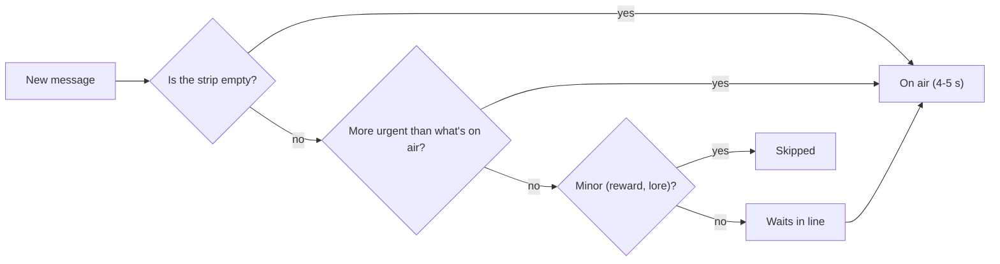

| Kind | Priority | Example |
|---|---|---|
| Alert | 5 | BOSS: Annual Performance Review just walked in |
| Win | 4 | SURVIVED: Grab the gold chest |
| Tip (once ever) | 3 | Spam Likely rings before it charges |
| Chapter card | 2 | AGE 50: The knees start talking |
| Reward | 1 | 401(k): +9k deposited |

---

## Chapter: The clean title screen (V. 1.11.0)

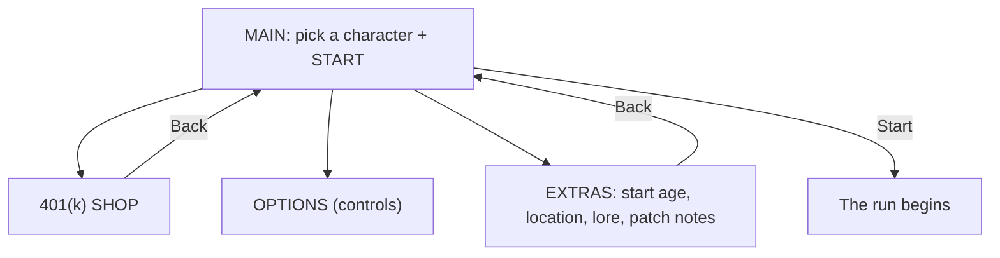

**Before:** about a dozen choices on one long screen. **After:** two decisions (who, then Start), everything else one tap away.

---

## Chapter: Layers (z-index)

```
 z 30  ┌────────────── TITLE SCREEN ──────────────┐   <- written last, so it wins
 z 30  │  ┌──────────── OPTIONS ─────────────┐    │   <- same number, written earlier: hidden!
       │  └──────────────────────────────────┘    │
       └──────────────────────────────────────────┘
 z 12   HUD and lower third
 z 1    the game itself
```

**Rule:** a menu opened *from* another menu needs a higher layer number than its parent.

---

## Chapter: Game time vs. real time (V. 1.13.0)

```
Real clock:  ████████████████████████  keeps going no matter what
Game clock:  ██████░░░░ PAUSED ░░░░████  stops when a menu is open

Lower third message (4 s):
  before fix  [show]---(you pause)---(expired while hidden)
  after fix   [show]---(you pause: held)---[show again]--done
```

---

## Chapter: Object pooling and the double move (V. 1.14.1)

```
You walk right  ──────────────▶

  [desk] [plant] [cooler]  ...  (only 25 pieces exist)
     │
     └── falls off the left edge ──▶ picked up, set down on the right

Bug:   code moves desk +420 px ──▶ physics adds +420 px again ──▶ desk lands at +840 (teleport!)
Fix:   body.moves = false        ──▶ physics leaves the position alone
```

---

## Chapter: A full life in an hour (V. 1.15.0)

```
real minutes  0     5     12    20    30    40    50    60
age           40    45    52    60    70    80    90    100
              │     │     │     │     │     │     │     │
              start  📈    🏠    🏎️    🏡    🏖️    🏓    💀
                   review mortgage crisis HOA retire pickle DEATH (the win)
```
One number controls all of it: `secondsPerYear: 60`.

---

## Chapter: Packs, curves and swarms (V. 1.16.0)

```
enemies per minute
1100 |                                         ●  (85)
     |
 500 |                        ●  (65)
 170 |           ●  (50)
  50 |  ● (40)
     +-------------------------------------------- age
```

Swarm patterns:
```
   RING              WALL               PACK
 $ $ $ $ $         ☎ ☎ ☎ ☎ ☎ ☎               🍩🍩
$    🧍    $                                 🍩🍩🍩
 $ $ $ $ $             🧍                 🧍
 (closes in)        (sweeps across)     (one clump)
```

---

## Chapter: The stand-still test (V. 1.16.1)

```
HP lost while standing still at age 40
  60 |                                   ● after
  40 |                       ●
  20 |            ●
   0 |●━━━━━━━━━━━━━━━━━━━━━━━━━━━━━━━━━━━━ before (always 0)
     0s         20s        40s        60s
```
Same test, two settings, clear answer.

---

## Chapter: Nine ways to chase you (V. 1.17.0)

```
CHASE        CHARGE           ORBIT + SHOOT       SPIRAL            GHOST
 $ → → 🧍     📅 ━━━━━━━━▶      💬 ↻  · · → 🧍     📝 ⟲ ⟲ → 🧍      👻 (faded) → 💭 (solid)
Bill         Calendar Invite   Group Chat          Math Homework     3 AM Thought
```
Each one asks for a different dodge: outrun, sidestep, close the gap, break out, or time your hits.

---

## Chapter: Weapon shapes (V. 1.18.0)

```
AIMED        AURA         BOOMERANG       ORBIT          PIERCING LINE
🧍 ☕ → $     ((🧍))        🧍 📺 ⇄ $ $     📊 🧍 📊        🧍 🎧 ━━$━━$━━$━▶
Coffee       Dad Joke     TV Remote       Spreadsheet    Podcast at 2x
```
Same enemies, five different ways to deal with them.

---

## Chapter: How a score reaches the leaderboard (V. 1.19.0)

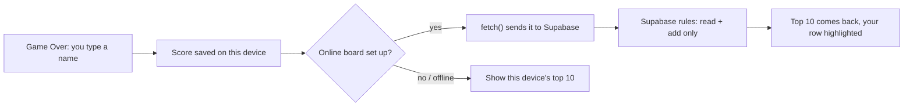


## Chapter: Press vs. release (V. 1.20.0)

```
 finger DOWN ───────────── finger UP
     │                          │
 old: button fired here     new: button fires here
     (game restarts while       (touch is finished, so the
      the finger is still on     new run starts with a clean
      the glass, and the new     slate)
      run never hears it lift)
```

| Input | When a button fires |
|---|---|
| Mouse | on press (feels snappy) |
| Touch | on release; slide off to cancel |
| Perk cards on touch | first tap selects, second tap picks |


## Chapter: One game, two rulebooks (V. 1.21.0)

| Setting | Midlife | Full Life |
|---|---|---|
| Ages | 40 to 65 (+5 per Overtime rank) | 40 to 100 |
| Seconds per year | 45 | 60 |
| Bosses | Review, Mortgage, V8 | all six |
| Ending | Retirement Party | Father Time |
| Leaderboard | `scores_midlife` | `scores` |

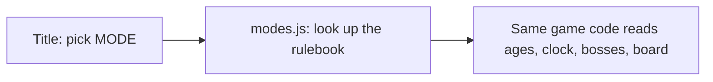


## Chapter: Timers on effects (V. 1.22.0)

```
pick up Energy Drink at 3:10
   buffs.speedUntil = now + 12 s   →  3:22
every frame:  is now < 3:22 ?  yes → speed × 1.35
                               no  → normal speed
```

| Item | Effect | How long |
|---|---|---|
| 👝 Fanny Pack | pulls every gem and coin | 2.5 s |
| 🥤 Energy Drink | +35% speed | 12 s |
| 🌴 PTO Day | clears non-boss enemies | instant |


## Chapter: Events and listeners (V. 1.23.0)

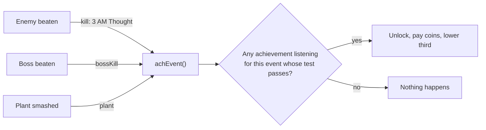


## Chapter: Balancing with a robot (V. 1.24.0)

| Bot run (dodges, random perks) | Before | After |
|---|---|---|
| Brand new player | 4.7 min, 31k coins | 2.7 min, 10k coins |
| Half upgraded | (not tested) | 3.9 min, 32k |
| Fully upgraded, standing still | 13 min, 5,766k coins | 3.9 min |
| Fully upgraded, dodging | 7.3 min | 5.8 min, 116k |

```
your level goes up ─► enemies get tougher (+7% HP per level)
                   ─► bigger crowds, faster spawns
shop upgrades      ─► you start stronger WITHOUT raising your level
= permanent upgrades are the way to beat the clock
```

## Chapter: Making a larger world readable (V. 1.27.1, Codex)

```text
          OUTER LOOP
      +-------+-------+
      |       |       |
   Accounts   |    Quiet zone
      |       |       |
Files +---- ATRIUM ---+ Meetings
      |       |       |
   Breakroom  |    Wellness
      |       |       |
      +-------+-------+
          OUTER LOOP
```

This is a route sketch, not a collision map. The 3072x2048 office keeps the same character size, so distance feels real. Wood flooring connects destinations; brighter carpet identifies work areas. Small wear marks tell stories without adding obstacles. The minimap reveals nearby ground as we walk, so exploration leaves a visible record. Before these routes enter the main game, we still need to test whether swarms flow around furniture.

## Chapter: Keeping furniture on the floor (V. 1.27.2, Codex)

```text
 upper-left light
        \
       [ desk ]
         |  |       legs meet the floor
        ######      tight contact shadow
          ....      short southeast cast
 ~~~~~~~~~~~~~~~~~  mat, caster wear, carpet
```

A detached shadow suggests height above the ground. The scene now reads the bottom edge of each imported furniture texture once and places short shadow pixels directly against it. A quieter cast sits lower right; chair mats and scuffs sit underneath the furniture. The sprite exports keep their plain magenta background because shadows belong to the scene. This changes visual contact without changing collision.

## Chapter: Leaving room for a title (V. 1.27.3, Codex)

```text
| quiet left third | office story, hero and enemies |
| optional title   | strongest contrast and detail |
```

The title is added later. The illustration provides a low-contrast area behind it, while the action stays on the right. This lets one clean, text-free cover work with several title treatments.

## Chapter: Designing for the crop (V. 1.28.1, Codex)

```text
1920px desktop: | hero |   quiet menu space   | enemies |
 900px crop:           |   quiet menu space   |
```

The center crop preserves the menu area while removing much of the scene's story. A crop check makes this visible before UI integration. If showing the hero on phones is essential, compose a separate portrait image rather than squeezing every desktop element into the middle.

## Chapter: Four steps that loop (V. 1.28.3, Codex)

```text
frame:     1             2              3             4
pose:  left stride -> feet pass -> right stride -> feet pass
       ^______________________________________________|
```

Opposite strides are the readable beats. Passing poses bridge them, while the Bill's paper corner flutters slightly. All cells stay 48x48, use one scale, and share the same lowest foot baseline. The large generated source is converted to exact native frames and palette colors before integration. The review GIF enlarges those pixels by four without smoothing.

## Chapter: A portrait in the same visual world (V. 1.28.4, Codex)

```text
photo: face + pose + studio
                 |
     navy shadows, warm highlights, pixel clusters
                 |
       illustrated bio portrait
```

The subject remains the real creator. Shared color and edge treatment establish consistency with the game while preserving his personal setting. The page and its social metadata point to the same new image filename, with alt text describing the illustrated scene.

## Chapter: Matching the drawing language (V. 1.28.6, Codex)

```text
recognizable face + broad shade clusters + navy outline
                         |
               same game-art language
```

Pixel size is one part of consistency. Face proportions, silhouette, color grouping and prop detail also matter. The second studio portrait uses the office key art as a direct style reference while preserving the real subject and setting.

## Chapter: One mark at several sizes (V. 1.28.9, Codex)

```text
16x16 source grid -> 32x32 browser/header -> 64x64 larger use
     one pixel          2x2 block              4x4 block
```

The cream clock face and teal outline carry the identity at the smallest size. Integer enlargement repeats whole pixels instead of inventing intermediate edge colors. The home-screen icon uses the same shape with padding. A new query tag on the favicon links tells browsers to refresh the previous icon.

## Chapter: Giving a swarm different personalities (V. 1.28.10, Codex)

```text
Late Fee       stride → tuck → opposite stride → tuck
Donut          ground → lift → ground → lift
3 AM Thought   solid → gaps → sparse → solid
               same world anchor throughout
```

A sprite sheet is a row of poses. Timing and shape changes make a scurry feel different from a float even with four poses each. An anchor keeps the character attached to the same place while its drawing changes. Walking feet keep a shared baseline; Donut deliberately rises two pixels in airborne poses. Ghost fading uses omitted whole pixels, so edges stay crisp. The art preview shows these motions separately from combat rules, which continue to control speed, hits and attacks.

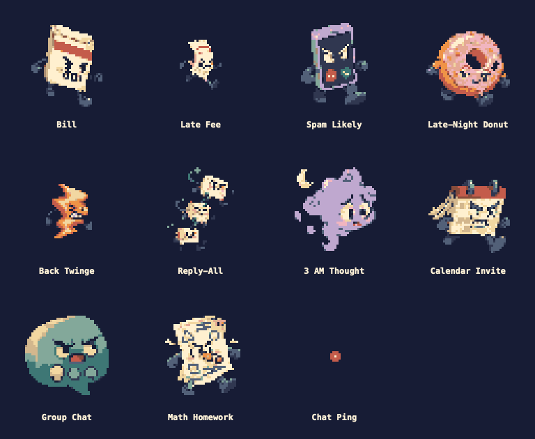

## Chapter: New art, same rules (V. 1.28.12, Codex)

```text
original enemy body   ->   position + facing + existing state
  same collisions                       |
                                 animated artwork
                                 + contact shadow
```

The invisible original sprite still owns movement, health and collisions. Its attached drawing has no physics body. This makes the visual pass safe for game balance: a new 48px source frame cannot silently enlarge the target. A missing sheet simply leaves the original drawing visible. The shared run clock freezes visual animations during menus; destroying the original removes its artwork and shadow.

## Chapter: Belonging to the room (V. 1.28.13, Codex)

```text
               desk drawing
             ┌──────────────┐
hero behind  │              │
             └──── base ────┘  <- floor position decides draw order
                  hero in front
```

The hero's original physics object still controls movement and collisions. A 56x60 walking drawing follows its floor position. Desks use a smaller ground footprint than their full illustration, so the visible upper half does not behave like an invisible wall. Contact shadows and chair mats attach the furniture to the carpet. Repeating the approved campus in neighboring sections keeps the world open-ended; sections outside the camera are skipped by the renderer.

## Chapter: One image, two article views (V. 1.28.15, Codex)

```text
Markdown post ──> devlog reader
       same versioned PNG
static article ──> direct shared link
```

The simplified twins portrait follows the birth announcement in both views. A versioned filename avoids stale-image caching. The older illustration stays available while the article uses the new file.

## Chapter: Planning an overworld before building it (V. 1.28.16, Codex)

```text
Archive       Server        Executive
   |--- plaza loops and broad routes ---|
Parking       Lobby/start   Bullpen
   |--- plaza loops and broad routes ---|
Wellness      Break Room    Conference
```

Each district has a recognizable landmark outside its clear fighting plaza. Main paths are 224px wide; side loops are 160px. A 16px-grid check verifies that all proposed routes and nine 512x512 plazas connect across wrapping edges. The illustrated map expresses the mood; the measured plan controls dimensions. Neither replaces the live world until the layout is approved.


## Chapter: Promotion gates and reachable floor (V. 1.28.17, Codex)
An unlock list says which rooms you should enter. A reachability check also asks whether you can physically get there without sneaking through a wall gap or wrapping around a gate. We close the proposed door rectangles, then flood outward from the Lobby across the remaining floor. Locked wings must never join that flood, including at opposite map edges.

```text
40: Lobby <--> large Bullpen
45:   + Break Room + Parking
50:   + Server + Conference
55:   + Executive
60:   + Wellness
Secret achievement --> tiny Archive
```

This validates the floor proposal before furniture is placed. Runtime enemies and door animations still need their own implementation and crowd tests.


## Chapter: Art bounds and clear openings (V. 1.28.18, Codex)
A gate's picture can be wider than its usable doorway. We measure the doorway separately so decorative posts do not silently squeeze a swarm. Both posts stand outside the 224px clear span, and open panels must retract completely out of it. The same separation lets a desk have a small floor footprint while its monitor rises above that footprint.

```text
24px post |<-------- 224px clear -------->| 24px post
          -112                         +112
          no jamb or open leaf inside
```

The manifest carries native image size, foot-point origin and proposed footprint as separate data. Runtime collision and enemy navigation still belong to implementation and testing.


## Chapter: Flow fields, or how a swarm finds the door (V. 1.29.0)
Until now every enemy did the simplest thing possible: point at you and walk. That works on an empty floor. Put a desk in the way and they walk straight into it and stay there, while you stand on the other side, perfectly safe.

A **flow field** fixes this for hundreds of enemies at once. Instead of every enemy solving its own maze, the game solves the maze **once, from your point of view**, and writes the answer on the floor.

```text
Step 1: lay a grid of 32px cells around the player
Step 2: mark cells under furniture as blocked  (##)
Step 3: flood outward from the player, counting steps

   5  4  3  3  3  4  5          The numbers are "steps to reach you".
   4  3  2  2  2  3  4          Every enemy just walks toward a
   4 ## ## ## ##  3  4          neighbor with a SMALLER number.
   5 ## ## ## ##  4  5
   6  7  7  7  6  5  6   <- enemy here (7) heads right (6, 5...)
   7  8  8  8  7  6  7      and goes AROUND the desk to reach you.
           P = 0 (you, above the desk)
```

Three things make it cheap:
- **One flood serves everyone.** 350 enemies all read the same numbers. Steering all of them takes about 0.2 milliseconds.
- **It only rebuilds a few times a second**, and only for the area around you (about 1,000 pixels in each direction).
- **Open space falls back to the old straight chase.** If an enemy's step count matches the straight-line distance, nothing is in the way, so it just heads right at you.

The same numbers answer a second question for free: **"can anything reach the player from here?"** A cell with no number is either inside furniture or sealed off, like a wing behind a locked promotion gate. Spawning checks this, so enemies never appear inside a desk or behind a door you haven't unlocked.

| | Before (straight line) | After (flow field) |
|---|---|---|
| 12 donuts behind a desk, 8 seconds | 0 reach you | most reach you within 2 seconds |
| Spawn inside furniture | possible | moved to the nearest open spot |
| Locked room | n/a | counted as unreachable |


## Chapter: Color variants and materials (V. 1.29.2, Codex)
Color variants reuse one shape and floor footprint while changing selected surfaces. A pool can have a different rim while its water stays blue-green, and a tree can have a different pot while its leaves stay green. This creates variety without introducing different collision shapes. The native checker confirms both colorways have exactly the same occupied pixels.

```text
Same shape + same floor footprint
                 |
          two colorways
       |                 |
 rim / pot changes    water / leaves stay
```


## Chapter: Close Calls, and why the picture isn't the hit box (V. 1.30.0)
A **near miss** sounds simple: an enemy got close but didn't touch you. To make it fair, the game tracks a tiny story for every nearby enemy:

```text
 far away  ->  enters the "close" ring, moving toward you  ->  closest point  ->  distance grows again
                                                                   |
                                         never touched you?  ->  CLOSE CALL!  (+XP, speed blip, streak)
                                         touched you?        ->  that's a hit, no reward, streak resets
```

**The surprise while building it:** the design measured "close" from the player's *size number* (32 pixels). But the physics box the game actually uses for damage is 48x52. So a "near miss" by the formula was really a hit. The fix: measure the gap between the two **real hit boxes**, the same ones that decide damage.

```text
 +--------------+   gap   +----+
 | player body  | <-----> |Bill|     gap <= 0   -> touching (damage)
 |   48 x 52    |         |box |     0 < gap <= 14 -> close call ring
 +--------------+         +----+     gap > 14   -> just an enemy
```

Lesson: **what you see is not always what collides.** Sprites, data sizes and physics boxes can drift apart, especially after an art swap. Always test against the thing that actually decides the outcome.

Fairness rules that stop cheating:
- The enemy has to be *moving toward you*. Running past a parked enemy doesn't count.
- If you're standing still, the enemy needs a clear path (the flow field checks this). Hiding behind a desk while enemies circle earns nothing.
- XP from Close Calls caps at 6 per 10 seconds, so gems are still the main way to level.

## Vertical slice (V. 1.31.0, Codex)
A vertical slice finishes a small playable part of the game all the way through. Our Lobby and Bullpen combine final-sized props, floors, collision, enemies and captions so Rami can judge how they feel together. Testing those two areas catches scale and movement problems before they spread across nine districts. Reusable tiles and prop IDs let us rearrange the slice without painting a new map.

```text
64px tiles + prop IDs + floor footprints
                    |
        playable Lobby and Bullpen
                    |
       Rami plays and gives feedback
                    |
          build the next district
```

## Anticipation (Nov 2, Codex)
Anticipation is the warning pose before an attack. A clipboard pulling back or a car revving tells the player to move before damage happens. A bold silhouette helps that warning remain visible in a crowded fight. Art supplies the poses; Claude will set the timing and collision after review.

```text
walk / drive  ->  wind-up  ->  attack  ->  recover
                     |
              time to move away
```


## 2026-11-02: Built space and unlocked space (Codex)
A promotion gate separates the room assembly from the rule that grants access. The room data stores floors and furniture; the door supplies a solid footprint until promotion logic removes it. Review-only controls can open it for testing without changing the shipped state.

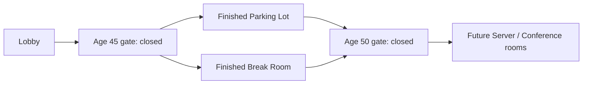

## 2026-11-02: Guarding the right lines
An `if` without braces covers only the next line. Indentation is just looks; the computer ignores it.

| Code | Which lines are protected? |
|---|---|
| `if (shadow) moveShadow();`<br>`    setShadowDepth();` | only `moveShadow()`; `setShadowDepth()` always runs, and crashes when there's no shadow |
| `if (shadow) {`<br>`  moveShadow();`<br>`  setShadowDepth();`<br>`}` | both lines, so a shadowless ghost is safe |

## 2026-11-02: Teleporting through walls ("tunneling")
Jumping an object to a new spot skips the physics check, so it can land behind a wall. Stepping checks every bit of the way.

```
Before (one jump of 95px):        After (8px steps, checked):
 You ←  Bill |wall|  •Bill         You ←  Bill→→→|wall|
             (lands inside)                     (stops here)
```

## 2026-11-02: When two good routes cancel out
```
        ↑  leftover pull (away from you!)
   ←  [Bill]  →     left and right pulls cancel
  ┌────────────┐
  │    DESK    │
  └────────────┘
       You
Fix: if the blend points somewhere strange, take the single best step (left OR right).
```

## Chapter: The priority queue (Spotlight pacing, Nov 3)

At age 45, four cards used to fire within seconds: a promotion, a boss, the Lounge and a tip. Now they wait in line.

```
time ──────────────────────────────────────────────▶
 0s   ART FROM PAYROLL   (room, rank 1)
 2s   ── boss arrives, cuts in ──▶ PERFORMANCE REVIEW (rank 3)
 9s   card leaves → 12 s breather
 21s  next card in line, if it isn't stale yet
      Lounge card: skipped (a room card just ran; the arrow still shows the way)
      Chest tip: too old → skipped, shows next time instead
```

| Card | Rank | Waits at most |
|---|---|---|
| Boss | 3 (cuts in) | 15 s |
| New hire | 2 | 20 s |
| Room, Lounge | 1 | 25 s / 15 s |
| Tip | 0 | 20 s |

## Chapter: Caching (Quick Retry, Nov 3)
**Idea:** do slow work once, keep the result, check for it before doing the work again.

```
BEFORE (every Quick Retry)                 AFTER
  unpack 66 pictures   ~4.0 s                 have the pieces? yes -> skip   0 s
  cut into pieces      (skipped, had them)    lay out the office             0.3 s
  lay out the office   0.3 s                  bake the floor                 0.2 s
  bake the floor       0.2 s                  ---------------------------------
  -------------------------                   total ~0.5 s (in the slow test browser)
  total ~5 s
```

**The check is the whole trick:** `if (scene.textures.exists(key)) skip`. The texture manager is the cache: it outlives a single run, so anything stored there is still around on Retry.
**Watch out:** a cache can go stale. If the art changes mid-session, the old pieces would stay. Here that's fine, because art only changes when a new version loads, and a new version reloads the page.

## Chapter: Object pooling (damage numbers, Nov 4)
**Idea:** reuse a fixed set of objects instead of creating and destroying them constantly.

```
BEFORE                                   AFTER (pool of 40)
hit → make new text → draw → fade        hit → take a hidden number from the pool
    → destroy                                → set "-3", show it → fade → hide it again
200+ texts alive at age 60               never more than 40, all reused
a new picture uploaded every hit         one font picture, uploaded once
```

**Two guards:** if every pooled number is still on screen, skip the new one; and no more than 6 new numbers per frame, so a huge swarm can't flood the screen.
**Watch out:** objects in a pool must be reset fully each time (text, position, color, transparency), or old values leak into the next use.

## Chapter: Scarcity makes choices (the loadout, Nov 4)

Before V. 1.83.0 there were 6 weapons and no limit, so every long run ended with all of them. Now there are 13 weapons and only 6 slots.

```
BEFORE                         AFTER
weapons: 6   slots: unlimited  weapons: 13   slots: 6
every run ends the same        each run is a different build

 [☕][😂][🛑][📺][📊][🎧]        [☕][🥘][🔇][❄️][  ][  ]
  you own it all                 two slots left: what do you want to be?
```

| Style | Badge | Example weapon | Example passive |
|---|---|---|---|
| Healing | plus sign | Mom's Casserole | Multivitamin |
| Shield | shield | Noise-Cancelling Headphones | Cardigan |
| Offense | lightning bolt | Reply-All Storm | Bifocals |
| Defense | brick wall | Thermostat Wars (freezes) | Lumbar Support |

**The idea:** a limit is what turns a menu into a decision. The badges help a player see the build they're drifting toward, so they can lean into it on purpose.

## Chapter: Logging in vs. being allowed (accounts, Nov 4)

```
 YOU ──email──▶ Supabase Auth ──6-digit code──▶ YOUR INBOX
  │                                               │
  └────────── type the code in the game ◀─────────┘
                     │
                     ▼
              a signed pass (token) that says "this is user 1234"
                     │
                     ▼
   player_saves table:  row 1234 ✅ yours    row 5678 ❌ not yours
```

| Word | Question it answers | In our game |
|---|---|---|
| Authentication | Who are you? | The emailed code (later Google or Apple) |
| Authorization | What can you touch? | Row-level security: only your own save row |

**The idea:** the public key in the game is like the building's front door. Anyone can walk in, but the row rules decide which locker opens for you.

## Chapter: Webhooks and robot memory (Discord posts, Nov 4)
A webhook is a private web address tied to one Discord channel. Send it a message and the message shows up in that channel.

```
 you push to GitHub, or the clock hits evening
              |
              v
      +----------------+      "already posted?"     +--------------------+
      | GitHub Action  | <------------------------> | discord-state.json |
      | (the robot)    |      writes down new posts | (the robot's notes)|
      +----------------+                            +--------------------+
              |
   locked secrets hold the 3 addresses
      |            |            |
      v            v            v
 #changelog     #devlog       #stats
```

| Channel | What wakes the robot | What it reads |
|---|---|---|
| #changelog | The evening clock | `src/data/version.js` |
| #devlog | A push that changes the memo list | `devlog/posts.js` |
| #stats | The morning stats task saving its summary | `reports/discord-stats.md` |

**Why the notes file matters:** the robot starts each run with an empty head. Without its notes, every run would repost every memo.

## Chapter: Fog of war (the minimap, Nov 4)

The office is cut into a grid. Every square starts dark. Squares near you turn on, and stay on for the rest of the run.

```
  start of the run          after a walk east
  . . . . . . . .           . . . . . . . .
  . . . . . . . .           . # # # # # # .
  . . # @ # . . .           . # # # # # @ .
  . . # # # . . .           . # # # # # # .
  . . . . . . . .           . . . . . . . .
  @ = you   # = seen   . = still dark
```

Drawing the map is a stencil:
1. Paint the whole floor plan (built once from the level data).
2. Lay the "seen" grid on top as a stencil, and keep only the painted parts under seen squares.
3. Draw the dots: doors (green open, red locked), chests, the Lounge, interns, bosses, and your arrow.

| Piece | Where it lives |
|---|---|
| Tuning (reveal radius, where the sign stands) | `MINIMAP` at the top of `src/minimap.js` |
| Floor plan source | `src/data/start-area.js` (floors, walls, rooms) |
| Found the map yet? | `meta.mapFound` (saved forever, so you only find it once) |

## Chapter: Footprints (Nov 4)
```
   picture (what you see, 128 x 72)
  +--------------------------+
  |      futon backrest      |   <- you can walk "behind" this part
  |                          |
  |   seat cushions          |
  |##########################|   <- footprint (solid, 116 x 24)
  +------------x-------------+
               ^ foot point: where it stands, and how drawing order is decided
```
- Lower foot point on screen = drawn in front.
- Wall art (posters, collage) has no footprint at all: it's just paint on the wall.

## Chapter: Draw order (Nov 4)
```
 screen top
   wall  (feet at y=-144)  depth  9 856   drawn first
   TJ    (feet at y= -70)  depth  9 930   drawn over the wall
   you   (feet at y= -40)  depth 10 000   drawn over TJ
 screen bottom
 tags and bubbles           depth 50 000  always on top
```
- Before the fix, TJ had depth 4.6: smaller than every wall, so always hidden.

## Chapter: Motion silhouettes (Nov 5)

```
Bill (straight)          3 AM Thought (weave)
   $                         3AM
   |                          \
   |                          /
   |                          \
   v                          /
  YOU                        YOU
```

- Both arrive at the same time. Only the path is different.
- Sideways speed comes from a sine wave: `sideways = cos(time) × weavePx × swing speed`.
- Rule of thumb: if two enemies look alike when they're tiny, make them move differently.

## Chapter: Rubber banding (catch-up XP, Nov 8, 2026)

Racing games give the car in last place a quiet speed boost so the race stays close. Midlife Survivors does the same with XP.

```
level
 24 |                                   . . typical level (real runs)
 20 |                         . .
 17 |                  . .            o   <- you at 59, level 15
 12 |          . .           o   o
  9 |     . .        o   o            gap = 5 levels -> gems worth +50%
  1 |. .
    +---------------------------------- age
     40  43  45      50      55      60
```

| How far behind | Extra XP per gem |
|---|---|
| 0 to 1 levels | none |
| 2 levels | +12% |
| 3 levels | +24% |
| 4 levels | +36% |
| 5 levels | +48% |
| 6+ levels | +60% (the cap) |

The numbers live in `LEVELING.catchUp` in `src/data/pickups.js`.

## Punish windows and locked aim (Nov 9, Your New Boss)

```
 chase ──► WARNING (arrows, aim LOCKS) ──► DASH ──► WARNING ──► DASH ──► WINDED (thumbs up) ──► chase
            "step sideways"                                          "your turn: hit him!"
                                                         below half health: 3 dashes, and every 3rd chain = SUGAR CRASH (2 s)
```

| Moment | What he does | What you do |
|---|---|---|
| Warning (0.55-0.65 s) | Plants his feet, chugs, finger guns. Arrows show the exact lane. | Step sideways out of the lane (44 px is enough). |
| Dash | Runs straight down the lane. He can't turn. | Stay out of it. |
| Winded (1.1 s) | Stands still, thumbs up. | Hit him: this is the **punish window**. |

A boss feels fair when you can always read what's coming (the warning) and you always get a moment to hit back (the punish window).


## Shooting bullets out of the air (Nov 9, hittable pings)

```
  BAG: splashes ─┬─ touches ─► BAG: enemies   → damage        (since day one)
                 └─ touches ─► BAG: pings     → pop! "LEFT ON READ"   (new)
  BAG: pings ───── touches ─► YOU             → you get hurt  (unchanged)

  Dad Joke / "No."    ( ·  ·  YOU  ·  · )  every ping inside the circle pops
  Any hit on an enemy      [enemy]•ping  → pings within 40 px pop too
```

| Weapon type | How it finds pings |
|---|---|
| Flying (coffee splash) | Physics overlap between two groups |
| Pulse (Dad Joke, "No.") | Distance check: inside the radius? |
| Everything else | A hit on an enemy pops pings right next to it |

Collision is always the same question: which two groups should care when they touch?


## Rewards that feel like rewards (Nov 9, Errand payoff)

```
 reach the errand ──► 💥 shockwave (320 px) ──► room empties      SEE it
                  ├─► bar jumps (+half a level of XP)               WATCH it
                  └─► ☑ CHECKED OFF 15s: +50% dmg, +50% gem XP     FEEL it
```

| Before | After |
|---|---|
| +40k coins (a number in the menu) | Same coins, plus three things you notice right now |
| 1 errand per run | Up to 3, two minutes apart, no repeats |

A reward feels good when it changes the next 15 seconds of play, not just a total.


## Exponential curves run away (Nov 9, Performance Bonus)

```
 XP needed per level (×1.35 each time)
 L2   ▏8
 L10  ▎~200
 L15  █▌~950
 L20  ███████ ~4,300
 L25  ██████████████████████████████ ~19,000   ← your upgrades stop here
```

| Drip | What it follows | Late game |
|---|---|---|
| Level-ups | the XP curve (runs away) | one every few minutes |
| **Performance Bonus** | a clock: 75 s with no level-up (35-75 s with Workload) | about one a minute |

When one system slows down on purpose, a steady second drip keeps the choices coming.


## A race instead of a fight (Nov 9, Clean Out Your Desk)

```
   🧍 you ───────► 📎            normal enemy:  target = YOU
          ╲
           ╲ 🧺 "50¢" ───► ☕     Bargain Hunter: target = nearest keepsake
                                 gets there first → SOLD! 50¢
```

| Same code | Different target | New feeling |
|---|---|---|
| steer toward a point | you | a fight |
| steer toward a point | your stuff | a race |

Changing what an enemy wants turns an old sprite into a new problem.


## A new level is mostly new data (Nov 9, Maple Hollow)

```
            ┌───────────── START_AREA_LAYOUT ─────────────┐
 title pick │  office list:  floors, walls, spawn, rooms  │──► pathfinding
 ──────────►│  home list:    streets, lawns, houses       │──► enemy spawns
            └─────────────────────────────────────────────┘──► bosses + events
   office-only systems ask "isOffice()?"  →  promotions, Lounge, interns, errands
```

| Piece | Office | Maple Hollow |
|---|---|---|
| Data | src/data/start-area.js | src/data/maple-hollow.js |
| Builder | src/start-area.js | src/maple-hollow.js |
| Everything else | shared | shared |

## Whole-number scaling (Nov 11, the crisp pass)

```
 art (4 px wide)      at 2x: even            at 1.5x: uneven
 ┌─┬─┬─┬─┐            ┌──┬──┬──┬──┐          ┌─┬──┬─┬──┐
 │A│B│C│D│    ──►     │AA│BB│CC│DD│          │A│BB│C│DD│
 └─┴─┴─┴─┘            └──┴──┴──┴──┘          └─┴──┴─┴──┘
                      every pixel same size   A and C lose half their width
```

| Screen | Zoom before | Zoom now |
|---|---|---|
| Laptop (720p) | 1 | 1 |
| MacBook | 1.25, then blurred 2x | 1, then hard-edged 2x |
| 1080p monitor | 1.5 | 2 (Close) or 1 (Wide) |
| Phone | 0.95, then blurred 3x | 1, then hard-edged 3x |

Light and soft shadows are the one exception: they stay smooth on purpose.

## Camera bounds (Nov 11, the tree wall)
The camera is a window that follows the hero. Bounds are the rectangle the window has to stay inside.

```
 camera bounds (outside of the forest)
 +--------------------------------------+
 | TREES TREES TREES TREES TREES TREES  |  192 px of solid forest
 | T  +----------------------------+  T |
 | R  | the town (where you walk)  |  R |
 | E  |        [ screen ]          |  E |
 | E  |          hero              |  E |
 | S  +----------------------------+  S |
 | TREES TREES TREES TREES TREES TREES  |
 +--------------------------------------+
   past this line: nothing is drawn, and the screen can never get here
```

| Thing | Stops where |
|---|---|
| The hero | 40 px inside the town's edge |
| The screen | the outside of the forest |
| The art | the outside of the forest |

## Draw order (Nov 11, the front door)
Things are drawn back to front. A bigger depth number goes on top.

```
 before                      after
 hero        (top)           hero        (top)
 house front                 doorway     <- house's number + a hair
 doorway     <- hidden       house front
 lawn        (bottom)        lawn        (bottom)
```

| Thing | Depth | Result |
|---|---|---|
| Doorway, before | fixed, small | always under the house |
| Doorway, after | follows the house | shows when the door opens |

## Baked in vs. separate objects (Nov 11, your backyard)

```
 OLD: one picture                 NEW: ground + objects
 +---------------------+          +---------------------+
 | grass, goal, pit,   |          | grass, path, dirt   |  <- ground picture
 | chairs all painted  |          +---------------------+
 | into one image      |             [goal]  [chair][pit]   <- each its own sprite
 +---------------------+             [tree]                    with a base that blocks
```

| | Baked in | Separate objects |
|---|---|---|
| Blocks you | no, or by an invisible box | at its base |
| Walk behind it | no | yes |
| Move or swap it | repaint the yard | change one line of data |

## Palette swap with a mask (Nov 12, one grass color)

```
 house frame (416 px wide)
 +--------------------------------+------+
 |                                |      |
 |   FACADE: masked off           | side |   <- swap allowed here
 |   (siding keeps its green)     | strip|
 |                                |      |
 +--------------------------------+------+
     x 8 to 344                     344 to 416
```

| Old color | New color | Where |
|---|---|---|
| #83A89A grass | #9BAE73 | lawns, street grass, side strips |
| #3E7775 tuft | #6D895B | only when touching grass |
| #83A89A siding | unchanged | inside the facade mask |


## Chapter: Corner sliding

```
 fence end            fence end
    ||                    ||
    ||  <- hero hits      ||    peek 28 px left: open!
  [HERO] the post       [HERO]--> slide over, then walk up
    path                  path
```

| Without corner sliding | With corner sliding |
|---|---|
| Box hits the post, stops | Box hits the post, peeks sideways |
| Player must line up exactly | Game lines you up for you |
| Feels like a wall | Feels like a doorway |

## Chapter: Culling

```
+-----------------------------------------+
|  woods     road     woods     road      |   the whole town: hundreds of pieces
|        +-----------------+              |
|  road  |   YOUR SCREEN   |  woods       |   drawn: only what's inside the box
|        |   (+400 px)     |              |   (plus a 400 px border)
|        +-----------------+              |
|  woods     road     YOUR BLOCK          |   skipped: everything else
+-----------------------------------------+
```

| Without culling | With culling |
|---|---|
| Every piece drawn every frame | Only nearby pieces drawn |
| Cost grows with the map | Cost stays about one screen's worth |

## Chapter: Spawn points

```
   ELEMENTARY                      you're close:  boss comes out HERE (the playground)
 +------------------------+
 |   swings   [HERE]      |
 |                        |        you're far:   boss comes out at the school's edge
 +-----------[EDGE]-------+                       nearest you, then walks to you
              |
            road
              |
           [ YOU ]
```

## Chapter: Reference object

```
 hero = 60 px tall, the ruler for everything

  1.7x |                    [ door ] [ fridge ] [ lamp ]
       |
  1.0x |   (o)  hero  ......................................  never above this line:
       |   /|\          [sofa back] [chair] [counter] [desk]   things you sit at or lean on
  0.5x |   / \   ..........................................
       |               [coffee table] [basket] [toy bin]      low things
       +----------------------------------------------------
```
Rami's editor layout made almost every piece 130-150% bigger. Measured against the hero, the house art was about 1.4x too small, so the rooms read as empty floor.

## 2026-11-13: connected clearance (Codex)

    door -> [96px square] -> clear floor -> [96px square] -> door
                     95px gap: stop

Footprint checks use the part touching the floor. A continuous path must fit the whole square, including at the doorway. The house repaint records its tiny laundry closet separately because an appliance leaves too little standing room inside.

## 2026-11-13: making an object read on a busy rug (Codex)

    pale table top + dark base
              over
    dark patterned rug
              =
    a visible edge and visible props

Material contrast makes a prop readable without adding another heavy outline. Keep one source painting per selected asset and link the review export back to it.

## Chapter: Wall faces

```
 FLOOR PLAN (seen straight down)        TOP-DOWN GAME (seen from the front, a bit above)
 +----------------------------+         +----------------------------+
 | living                     |         |  [window] [fireplace] [TV] |  <- wall face, 128 px: art hangs here
 |                            |         |----------------------------|
 +----------------------------+         | living floor               |
 | dining                     |         |                            |
 |                            |         |######## wall face ####|door|  <- the next room's wall, with a doorway
 +----------------------------+         | dining floor               |
                                        +----------------------------+
```
The rooms didn't get bigger. The house got taller, by one wall face per row of rooms (368 px in all), and the doorways go where the 96 px routes need them.

## Chapter: Stuck flags

```
 BEFORE                                   AFTER
 chest touches you                        chest touches you
      |                                        |
 flag says "menu open"? --yes--> wait     is a menu really on screen? --yes--> wait
      |  (flag stuck = wait forever)           |no
      no                                  flag still says "open"? --> clear it, note it
      |                                        |
   open chest                               open chest
```
A flag is a sticky note the game writes to itself. Sticky notes fall out of date. When a sticky note and the screen disagree, believe the screen.


## Chapter: The canvas is not the furniture (2026-11-13, Codex)

```text
+------------- clear canvas -------------+
|                                        |
|        painted cabinet                 |
|        +-------------+                 |
|        | visible top |                 |
|        +-------------+                 |
|        [  footprint  ]                 |
+----------------------------------------+
             96px clear route -> door
```
The empty margins do not block movement. The footprint fits the cabinet's visible base. If the cabinet is meant to be wider, repaint it at that width, then check the route again. A larger invisible footprint cannot make the room feel furnished.


## Chapter: A full room can still have a clear route (2026-11-13, Codex)

```text
north wall: [storage] [picture] [window]
+------------------------------------+
| shelf      flat rug        plant   |
|         +-------------+            |
| door -->| 96px route  |            |
|         +-------------+            |
| boxes                     hamper   |
+------------------------------------+
```
The shelf, boxes and hamper have solid footprints at the edges. The rug adds detail but no collision, so the route can cross it. The wall-coverage check uses the visible paintings, while the doorway check uses footprints. Both need to pass before placement is approved.


## Chapter: Connected doors can hide a trapped pocket (2026-11-13, Codex)

```text
door A --> clear route --> door B
             | furniture blocks the way
             X
       [isolated clear floor]
```
The doors can pass a route check while the room still contains floor you cannot reach. Count disconnected clear positions separately, and check whether any solid footprints overlap. An art export can pass its pixel checks while its proposed layout still needs review.

## 2026-11-13: why road edges must agree (Codex)

```text
STRAIGHT TILE       JUNCTION TILE
curb | asphalt | curb
     |         |    <- the curb positions must continue
curb | asphalt | curb
```

Matching color hides a color seam. Matching the exact curb positions hides a shape seam. A correct PNG size proves neither, so road connections need their own check before the game uses the art.

## 2026-11-14: make the connection measurable (Codex)

```text
512px street band
| 96px side |       320px asphalt       | 96px side |
            ^96                       ^416
            |       center 256        |
            same positions on the next tile
```

Painting supplies the texture, light and character. Fitting painted strips to shared coordinates supplies the exact connection. The checker measures the final picture, including the joining strip and center line, rather than trusting the manifest's stated width.
