# Building Midlife Survivors: The Textbook

A picture-first guide to how this game works, one chapter per idea. Each chapter adds what we just built. Read it in any order, but it makes the most sense from top to bottom.

## Environment layers: make the room support the action (Nov 1, 2026, Codex)

```text
  Health bar                         always readable
  Furniture + people                 ordered by floor contact
  Light pools + paper + short shadows quiet detail
  Carpet / wood                      repeating seamless patterns
```

`Floor -> light and floor marks -> furniture and people -> health bar`

The office kit separates solid illustrated props from flat floor details. The cabinet and printer block their floor footprints; papers and coffee stains do not. The 64x64 carpet and wood textures have identical opposite edges, so copies join seamlessly on the existing 32px grid. Low-contrast floors and small upper-left light accents keep attention on moving characters and discoveries.

## Character animation: four directions, one consistent frame (Oct 31, 2026, Codex)

```text
             Walk 1    Walk 2    Walk 3    Walk 4
  Down         []        []        []        []
  Up           []        []        []        []
  Left         []        []        []        []
  Right        []        []        []        []
       Every box is the same 56x60 game frame.
```

`Move -> choose direction -> advance walk pose -> stop -> hold pose`

The sheet is a flipbook. We imported all three characters using a shared crop and scale for each sheet, then exported exact 224x240 grids with magenta backgrounds. The preview advances through poses as distance accumulates, rather than playing a walk loop when the hero is stationary. Separate idle and combat sequences can be added after the walking pass looks right.

## Prop families: three ways through Tuesday (Oct 31, 2026, Codex)

```text
               SAME DESK FRAME
            /         |         \
        File tray  Paper stacks  Pizza box
          Tidy      Overloaded   Working lunch
            \         |         /
              SAME FLOOR FOOTPRINT
```

`Shared desk shape + one readable story = a cohesive prop family`

The desk base, camera and palette tie the variants together. A few large objects carry the personality, rather than tiny scattered detail. Each imported frame is 96x104 with the same bottom anchor and floor collision area, so the artwork can vary without changing navigation. Check readability at game size before producing the full furniture set.

## Corporate Campus: exploration before decoration (Oct 31, 2026, Codex)

```text
  Accounts Payable      Quiet Zone
       |     \          /     |
       |      CROSSROADS      |    outer routes connect departments
       |     /          \    |
    Breakroom          Wellness
```

`Landmark -> detour -> small discovery -> alternate route back`

A blockout tests space using existing art and simple placeholders. Our four departments give the office memorable destinations; optional finds reward curiosity. The 192-pixel crossroads and outer routes preserve room to move. The first test checks navigation; the next should add crowds before final scenery is commissioned.

## Art study: big illustration, tiny game character (Oct 31, 2026, Codex)
Follow-up: the revised hero is 56x60, about 15% larger. A desk must block its full floor footprint, rather than only its front edge. Otherwise the hero can walk inside it and disappear. Sorting by feet still makes the back wall cover part of someone behind it.

`behind = partly covered | beside = blocked | in front = visible`

Floors also need a layer below every actor. Our first study used layer 0 for the floor; walking north made the hero's foot-based layer negative, which put him under it. Giving floors a fixed background layer preserves visibility on either side of the map origin.


`Key art -> simpler sprite -> 1x movement test -> feedback`

The key art sets the mood. The sprite keeps only what the player needs to recognize: grey temples, black glasses, a red tie and an orange mug. Our hero uses the existing 48x52 game frame. Inspect at 2x, judge readability at 1x. Nearest-neighbor scaling enlarges square pixels without blending their edges.

```text
      desk top           artwork can be tall
   +--------------+
   |    monitor   |      hero can pass BEHIND this
   +--------------+
   [ shallow base ]      feet collide HERE
          o              hero in front draws on top
```

---

## Chapter 1: The map of the project

Your game is just a handful of plain files. The browser opens `index.html`, which loads everything else in order.

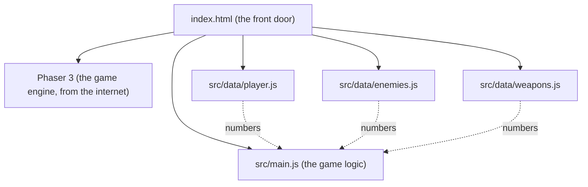

**Key idea:** the `data` files hold **numbers and names** (speeds, health, colors). `main.js` holds **rules** (how things move and fight). You can edit the data files freely without breaking the rules.

| File | What lives there | Example you can change |
|---|---|---|
| `player.js` | your speed, size, color | `speed: 400` = too much coffee |
| `enemies.js` | Bill speed, health, spawn rate | `everyMs: 300` = chaos |
| `weapons.js` | Coffee Splash fire rate, range, damage | `fireEveryMs: 300` = triple espresso |

---

## Chapter 2: The game loop

A game is a flipbook. The screen is redrawn about **60 times every second**, and between each drawing the game decides what moved.

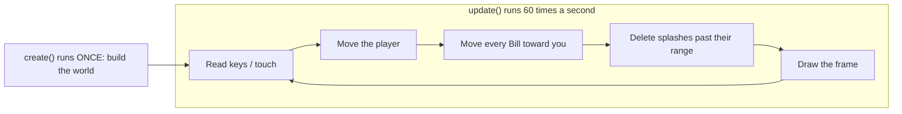

**Think of it like video:** 60 frames per second, except each frame is calculated on the spot instead of recorded.

**Bonus: why we "normalize" movement.** Pressing right and up at once would push you 1 step right *and* 1 step up, about 1.41 steps total, so diagonals would be faster. Normalizing shrinks the arrow back to length 1.

```
 Without normalizing        With normalizing
       ↑ 1                      ↑ 0.71
       |  ↗ 1.41                |  ↗ 1.0
       |/                       |/
       +---→ 1                  +---→ 0.71
```

---

## Chapter 3: The camera and the world

The world (4000 × 4000 pixels of office carpet) is much bigger than your screen. The camera is a window that follows you around, like a photographer tracking a subject.

```
+------------------------- WORLD (4000 x 4000) -------------------------+
|                                                                       |
|              $ ← Bill spawns here, just outside the window            |
|        +-------- CAMERA VIEW (your screen) --------+                  |
|        |                                           |                  |
|        |                  ■ You                     |  $               |
|        |                                           |                  |
|        +-------------------------------------------+                  |
|                       $                                               |
+-----------------------------------------------------------------------+
```

The HUD ("AGE 40...") is pinned to the **screen**, not the world, so it stays put while the carpet scrolls.

---

## Chapter 4: Spawning and chasing

**Spawning** means creating enemies while the game runs. A **timer** goes off every 0.9 seconds and drops one Bill on a random edge just outside the camera view.

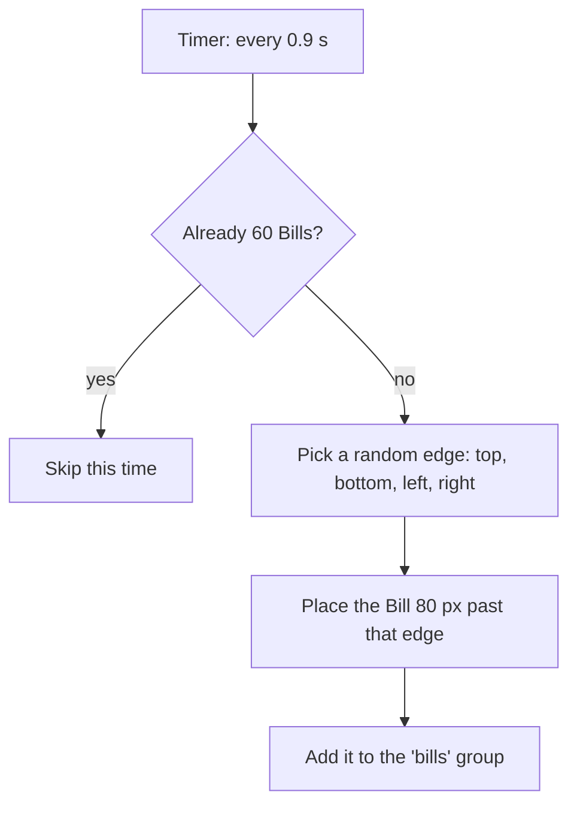

**Chasing** happens inside the game loop. Every frame, each Bill turns to face you and moves forward.

```
frame 1      frame 2      frame 3      frame 4
$            
              $
                           $
                                        $ ■
```

A **group** is a bag holding every Bill, so one line of code can move them all. Bills also **collide with each other**, so they form a crowd instead of melting into one square.

---

## Chapter 5: Targeting

Coffee Splash aims for you. Every second it checks the distance to **every** Bill and keeps the shortest one.

```
          $ 310px
                          
   $ 180px    ■ You  ───────▶  $ 95px  ← nearest, so it gets the coffee
                          
                 $ 240px
```

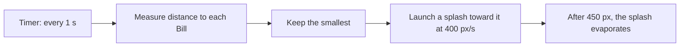

Deleting splashes that missed is important. Without it, thousands of invisible drops would pile up and slow the game down.

---

## Chapter 6: Collisions and health

Every frame the physics engine asks: **is any splash touching any Bill?** This is called an **overlap check**. When the answer is yes, a small function runs.

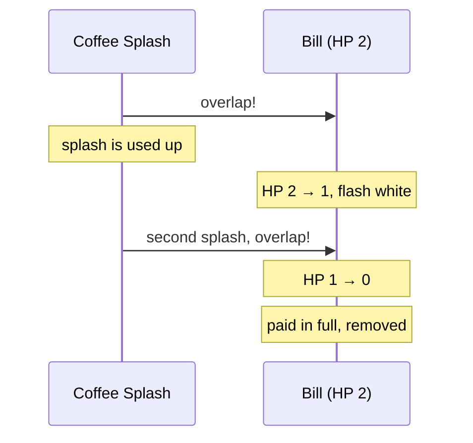

**HP (hit points)** is a number on each enemy. Damage subtracts from it, and at zero the enemy is gone. Two numbers control how tough the fight feels:

| Bill `hp` | Splash `damage` | Splashes needed |
|---|---|---|
| 2 | 1 | 2 (current) |
| 1 | 1 | 1 (easy) |
| 6 | 2 | 3 (tough) |

The white flash is the first bit of **game juice**: a tiny effect that makes a hit *feel* like a hit.

---

## Chapter 7: Taking damage

You have **10 HP**. Touching a Bill costs 1. Right after a hit you get a short **safe window** (0.7 s) so a crowd can't drain you all at once in a single moment.

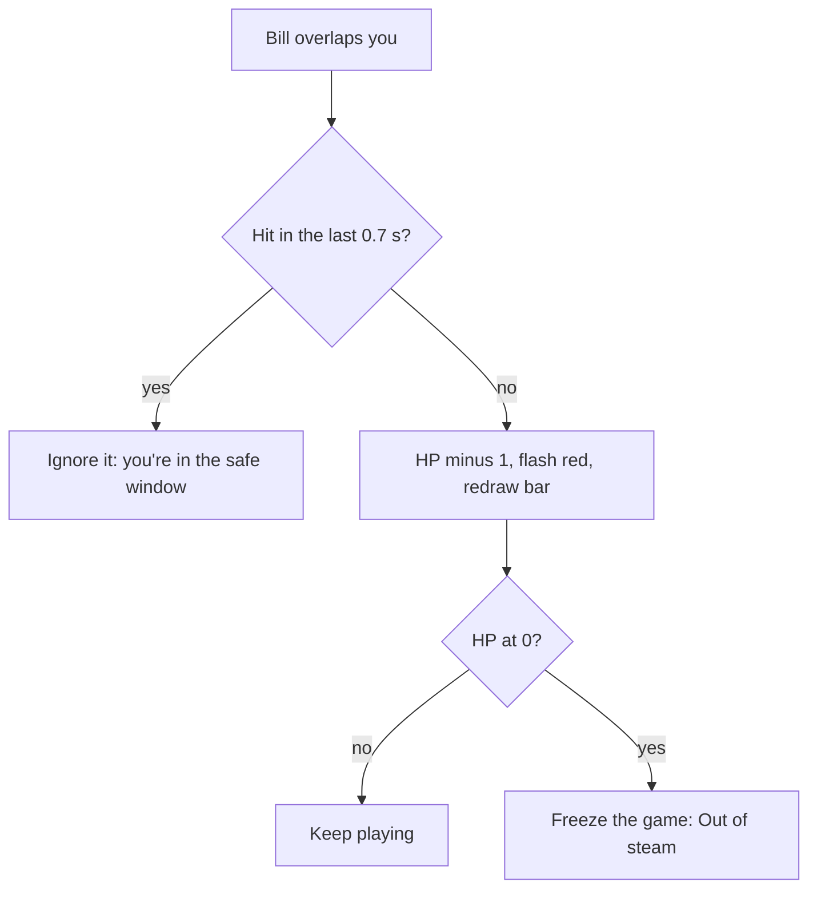

```
Time:     0.0s    0.3s    0.7s    1.0s    1.4s
Touch:     $       $       $       $       $
Damage:   -1       .      -1       .      -1
          [ hit ][ safe  ][ hit ][ safe  ][ hit ]
```

The health bar is drawn **on the screen, not in the world** (like the HUD), and redrawn after every hit: a dark empty bar, then a red bar whose width is `HP / maxHP`.

```
10 HP  [##########]
 6 HP  [######    ]
 2 HP  [##        ]
```

---

## Chapter 8: Game Over and restarting

When HP hits 0, the game **freezes the physics**, lays a dark sheet over the screen, and shows four things:

```
+-------------------------------------------+
|                GAME OVER                  |
|     Crushed by a late electric bill.      |  <- random line from deaths.js
|           You lasted 2:13                 |  <- time since the run started
|            [  Try again  ]                |  <- click, tap, or Space
+-------------------------------------------+
```

**Restarting** means running `create()` again from scratch. Anything remembered *outside* the scene (like `gameOver` or your HP) has to be reset by hand at the top of `create()`, or the new run would start already dead.

```
 Try again
     |
     v
 scene.restart()  -->  create() runs again  -->  reset: gameOver, timer, touch
                                             -->  rebuild: floor, you, Bills group
```

The jokes live in `src/data/deaths.js`, grouped by **who killed you**. Later, each enemy type gets its own list.

| Killer | Example line |
|---|---|
| bill | "Died of autopay failure." |
| (later) email | "Replied all. Fatally." |

---

## Chapter 9: The endless floor (a magic trick)

Before, the carpet was one giant 4000 x 4000 rug with walls at the edges. Now there's no rug at all. The carpet is **exactly the size of your screen**, glued to the camera, and its **pattern slides** as you move.

```
 OLD: a huge rug, camera moves over it      NEW: a screen-sized rug, pattern slides
 +--------------------------+               +----------+
 |  +------+                |               |##########|  camera moves right 64px
 |  |camera| ->             |               |##########|  -> pattern shifts left 64px
 |  +------+          WALL  |               +----------+  -> looks like you walked
 +--------------------------+                            (and it never ends)
```

It's the same trick as old cartoons: the character runs in place while the background scrolls behind them. Each frame:

```
floor.tilePositionX = camera.scrollX
floor.tilePositionY = camera.scrollY
```

| | Old giant rug | New sliding rug |
|---|---|---|
| Size in memory | 4000 x 4000 | screen size |
| Edge of the world | wall at 4000px | none |
| You notice the difference | no | no |

Updated Chapter 3 note: the world no longer has an edge, so the big box in that diagram now goes on forever.

---

## Chapter 10: Wisdom gems and experience (XP)

Every paid-off Bill leaves a blue **Wisdom gem**. Gems near you get pulled in by a **magnet**; the rest wait on the floor until you walk closer.

```
            ◆  (far: waits)
                                 
       ◆ ─────▶ ■ You             magnet radius = 90px
          ◆ ──▶                   (gems inside it fly to you)
                                 
                     ◆  (far: waits)
```

Each gem adds XP. When the bar fills, you **level up**, the leftover XP carries over, and the next level asks for 40% more:

| Level | Gems needed to reach the next one |
|---|---|
| 1 → 2 | 5 |
| 2 → 3 | 7 |
| 3 → 4 | 10 |
| 4 → 5 | 14 |
| 5 → 6 | 20 |

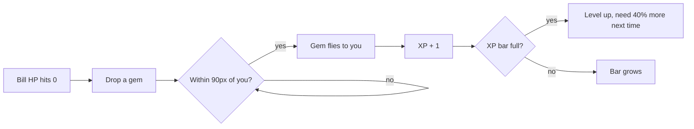

This growing cost is a **curve**: early levels come fast so the game feels generous, later ones slow down so each one feels earned.

---

## Chapter 11: The level-up screen

When the XP bar fills, the world **pauses** and you pick 1 of 3 random upgrades.

```
+--------------------------------------------+
|                 LEVEL 2!                   |
|  Pick one (click, tap, or press 1 / 2 / 3) |
|  +--------------------------------------+  |
|  | 1. Extra Shot                        |  |
|  |    Coffee fires 20% faster.          |  |
|  +--------------------------------------+  |
|  | 2. Reading Glasses                   |  |
|  |    Gem magnet reaches 40% farther.   |  |
|  +--------------------------------------+  |
|  | 3. Annual Checkup                    |  |
|  |    +3 max HP, and heal 3.            |  |
|  +--------------------------------------+  |
+--------------------------------------------+
```

**The big idea: data vs. stats.** The data files are the *recipe*. At the start of each run, the game copies those numbers into a `stats` object. Upgrades change the **copy**, so a new run always starts back at the recipe.

```
 src/data files (recipe, never changes)
        │  copied at the start of every run
        ▼
 stats  { speed 220, damage 1, fireEveryMs 1000, ... }
        │  upgrades edit this copy
        ▼
 Dark Roast  →  damage 1 → 2
 Extra Shot  →  fireEveryMs 1000 → 800
```

**Pausing** means stopping two things: the physics (nothing moves or collides) and the clock (no new Bills, no shots). Picking an upgrade turns both back on.

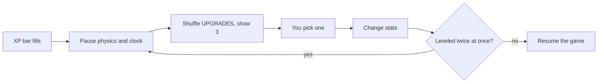

---

## Chapter 12: Audio cues and game controllers

**Synthesized sound (Web Audio API):** Instead of loading MP3 files, the browser generates sound waves on the fly using numbers `[frequency, duration, waveShape]`.

```
  Sound Recipe (sounds.js)                Browser Synthesizer (sfx.js)
  billPaid: [                             Oscillator ──▶ Gain (fade out) ──▶ Speakers
    [880 Hz,  0.06s, "square"],   ───▶    ♪ 880 Hz  (B5)
    [1320 Hz, 0.10s, "square"]            ♪ 1320 Hz (E6) -> "Cha-ching!"
  ]
```

**Controller input:** A thumbstick gives two numbers from `-1.0` to `+1.0` (left/right and up/down). Because sticks never rest at a perfect `0.0`, we ignore tiny values under `0.2` (a **deadzone**) so your character doesn't drift when you let go.

```
        Thumbstick Deadzone                        "Held" vs "Just Pressed"
            -1.0 (up)                         Frame:   1     2     3     4
         +-------------+                      Button: [up]  [up]  [up]  [  ]
         |   .-----.   |                      Held:   yes   yes   yes   no
   -1.0  |  /  0.2  \  | +1.0                 Just:   YES   no    no    no
  (left) | |  (dead) | | (right)                      (moves menu 1 step, not 3)
         |  \       /  |
         +-------------+
            +1.0 (down)
```

---

## Chapter 13: Area weapons, knockback, and conditional upgrades

Until now, you only had a **single-target projectile** (Coffee Splash). Now you can unlock **area-of-effect (AoE)** weapons that hit every enemy inside a circle around you:

```
  1. Coffee Splash             2. Dad Joke (Aura)          3. The Word "No." (Knockback)
   (single nearest)          (damages all in radius)      (damages + shoves outward)

                        . - ~ - .                    . - ~ - .
      ■ ───▶ $               /   $     \                  /  ↖$   ↗$                             |     ■     |                |     ■      |
                             \       $ /                  \  ↙$      /
                              ' - _ - '                    ' - _ - '
```

**How Knockback works:** To push a Bill directly away from you, we find the arrow pointing from you to the Bill `(bill.x - player.x, bill.y - player.y)`, divide by the distance `d` so the arrow has length `1`, and multiply by `noPush` (95 pixels).

**Conditional Upgrades (`when`):** You shouldn't see "Louder Groan" before you even own **Dad Joke**. Each upgrade can have a `when(stats)` check:

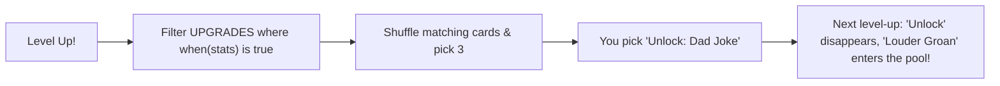

---

## Chapter 14: The Age Clock, Pause, and Boss Fights

**1. The Age Clock:** Instead of a plain timer, we convert elapsed seconds into **years of age** (`secondsPerYear: 20` in `player.js`, so 1 year passes every 20 seconds while playtesting):

```
  Elapsed seconds:   0s ────────▶ 20s ────────▶ 40s (Age 42.0)
  Your Age:         40.0         41.0         42.0 ──▶ BOSS SPAWNS!
```

**2. Pausing cleanly:** When you press **P**, **Esc**, or controller **Start**, `scene.time.paused = true` freezes Phaser's clock, which means `this.time.now` also stops advancing—so pausing for 5 minutes won't accidentally age you or spawn the boss early!

**3. Boss Lifecycle (The Performance Review):**

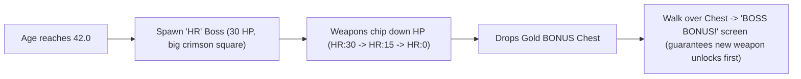

---

## Chapter 15: Wave Schedules & Enemy State Machines

**1. Wave Schedule tied to Age (`SPAWNING.waves`):** Instead of spawning at the same slow pace forever, the game checks your age against a table in `enemies.js` and speeds up the spawn timer while mixing in new enemy types:

| Age Milestone | Spawn Delay | What Spawns |
|---|---|---|
| **Age 40** | every `900ms` | 100% Bills (`$`) |
| **Age 41** | every `750ms` | 70% Bills + 30% **Spam Likely** (`TEL`) |
| **Age 42** | *Boss Event* | **The Performance Review** (`HR:30`) |
| **Age 43** | every `580ms` | 60% Bills + 40% Spam Likely |
| **Age 45+** | every `440ms` | 55% Bills + 45% Spam Likely (pure chaos) |

**2. Enemy State Machines:** Different enemies now have different "brains" inside `update()`:

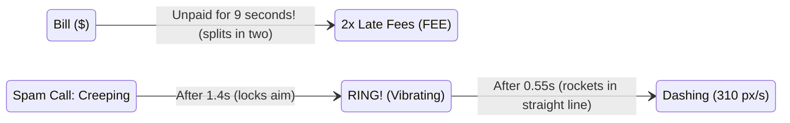

Because **Spam Likely** locks its aim when it starts ringing and pauses for `0.55s` to vibrate (`RING!`), you get a clear visual + audio cue to sidestep out of its path before it rockets across the screen!

---

## Chapter 16: Weighted Spawning & Weapon Evolutions

**1. Weighted Spawn Tables (`wave.mix`):** Instead of simple coin flips, each wave now gives every enemy a **raffle ticket count** (weight). Adding `[enemy, weight]` to a wave automatically adjusts the odds:

```
  Age 44 Wave Mix:  [["bill", 4], ["spamCall", 2], ["snackAttack", 2], ["backTwinge", 2], ["officeGossip", 1]]
  Total Tickets = 11:
  [ $ ][ $ ][ $ ][ $ ][ TEL ][ TEL ][ YUM ][ YUM ][ OUCH ][ OUCH ][ CC: ]
   \_______4/11______/ \___2/11___/  \___2/11___/  \____2/11____/  \_1/11_/
```

**2. Weapon Evolutions (Synergy Recipes):** Just like *Vampire Survivors*, upgrading a weapon **and** holding its matching passive unlocks a super-card at the top of your next level-up or boss chest:

```mermaid
flowchart LR
    W1["Upgraded Coffee"] & P1["Good Night's Sleep"] --> E1["EVOLVE: Cold Brew Concentrate
(3-way piercing espresso spread!)"]
    W2["Upgraded Dad Joke"] & P2["Reading Glasses"] --> E2["EVOLVE: Unhinged Pun Storm
(Giant double-speed cringe ring!)"]
    W3['Upgraded "No."'] & P3["Comfortable Shoes"] --> E3["EVOLVE: Healthy Boundaries
(Huge shockwave + heals 1 HP!)"]
```

---

## Chapter 17: Procedural Pixel-Art Sprites (`src/sprites.js`)

Instead of loading external `.png` files, `makePixelArt(scene, key, rows, palette, scale)` paints tiny text grids into real Phaser textures at startup. Each letter maps to a hex color (`"."` is transparent):

```
  Grid in src/sprites.js ("gem")         Rendered Sprite in Game
  "...BB..."                             
  "..BWWB.."                                   ⟐  Sparkling
  ".BWLLWB."      ──(makePixelArt)──▶         ⟐⟐⟐  Faceted
  "BWLCCLLB"                                   ⟐  Crystal
  ".BLLLLB."
```

| Sprite Key | Visual Design |
|---|---|
| `floor` | 128x128 woven office carpet tile with quadrant seams, fiber speckles, and a faint coffee-ring stain |
| `player` | 16x16 midlife hero with salt-and-pepper temples, glasses, dress shirt, red tie, and orange coffee mug |
| `bill` / `lateFee` | Green dollar-bill envelope (`$`) and jagged red PAST DUE notice (`!`) |
| `spamCall` | Glowing purple smartphone with red caller-ID alert screen |
| `snackAttack` / `backTwinge` | Pink frosted donut with rainbow sprinkles; jagged yellow-orange lightning bolt |
| `officeGossip` | Corporate email envelope with a red unread notification badge (`CC:`) |
| `performanceReview` / `mortgageRefinance` / `midlifeCrisis` | Giant HR clipboard with frowny chart, columned purple bank (`APR`), and cherry-red convertible (`V8`) |

Plus, `player.setFlipX(x < 0)` and a sine-wave wobble `Math.sin(time / 55) * 7` give your character a jaunty walking bounce as you move!

---

## Chapter 18: Reaching Age 50 (The Reaper & Win Screen)

Just like the 30-minute Reaper in *Vampire Survivors*, surviving to **Age 50.0** triggers **Father Time (`50:9999`)**, an unstoppable hooded figure with a scythe. Touching him doesn't mean you lost—it triggers the golden **"YOU SURVIVED YOUR 40s!"** victory screen!

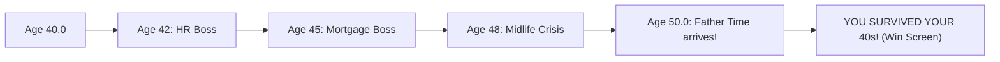

---

## Chapter 19: Game Juice, Chiptune Groove & Title Screen

**1. Layered "Game Juice" on Every Hit:** None of these effects change the math of the game, yet together they make combat feel 10x more physical:

```
  Weapon hits Enemy
        ├── 1. White Flash + Squash-and-Stretch (scaleX 1.22, scaleY 0.82 for 55ms)
        ├── 2. Floating Damage Number ("-2" drifts up & fades out; gold when >= 2)
        ├── 3. Shredded Paper Confetti (6-16 colored scraps burst outward on KO)
        └── 4. Camera Shake (120ms jolt on hurt, 180ms rumble on Boss arrival)
```

**2. Sequenced Chiptune Groove (`SOUNDS.music`):** A `setInterval` in `sfx.js` steps through a 16-note bassline (`triangle` wave) and melody (`square` wave) every `165ms`. And because clicking **"CLOCK IN"** on the Title Screen unlocks the browser's `AudioContext`, the groove and sound effects work from frame 1!

---

## Chapter 20: Meta-Progression, 401(k) Shop & `localStorage` (`src/data/meta.js`)

In a roguelite like *Vampire Survivors*, **Run Stats** (`stats`) reset when you die, while **Meta-Progression** (`meta`) saves permanently in the browser's `localStorage` so every run makes the next one a little stronger:

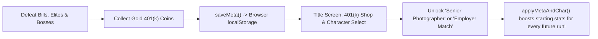

| Feature | How it works |
|---|---|
| **401(k) Coins (`coin401k`)** | 35% drop from Bills, 2 from Elites, 5 from Decade Bosses; pulled in by your magnet |
| **Permanent Shop (`META_SHOP`)** | **Employer Match** (+2 max HP/rank), **Home Espresso** (+10% speed & fire rate/rank), **CPA on Retainer** (+25% magnet/rank) |
| **3 Playable Archetypes (`CHARACTERS`)** | **The 9-to-5er** (Free), **The Senior Photographer** (10k: starts with Dad Joke + 25% wider radius & faster feet), **The Grad Student at 45** (15k: starts with "No." shockwave + huge magnet) |

---

## Chapter 21: One Simulation, Three Cameras (`src/view3d.js`)

How can a game switch mid-run between a **2D 16-Bit** top-down view, a **Diablo 3/4** isometric dungeon crawler, and a **3D Third-Person** action view without rewriting a single rule of gameplay? By separating the **Simulation (Model)** from the **Camera (View)**:

```
   PHASER 2D SIMULATION (The "Truth")             THREE.JS 3D RENDERER (src/view3d.js)
  ┌──────────────────────────────────┐           ┌────────────────────────────────────────┐
  │  Player & Bills move on (x, y)   │ ──sync──► │ Maps 2D (x, y) -> 3D Floor (x, 0, z)   │
  │  Arcade Physics checks overlaps  │           │ Style 1 (Diablo 3/4): high angle,      │
  │  Timers fire weapons & waves     │           │   38° FOV, dark fog + warm torchlight  │
  │  HUD, XP bar & menus draw on top │ ◄─project─│ Style 2 (3D Third-Person): low behind  │
  └──────────────────────────────────┘           │   shoulder, 60° FOV, bright sky & fog  │
                                                 └────────────────────────────────────────┘
```

| Camera Style (`V` Key) | Camera Offset `(dx, dy, dz)` | Field of View (`FOV`) | Lighting & Atmosphere |
|---|---|---|---|
| **1. `2D 16-Bit`** | Directly overhead (2D tileSprite) | Orthographic / Flat | Crisp 16-bit pixel art sprites & multi-zone office floor |
| **2. `Diablo 3/4`** | `(-260, +420, +320)` angled 45° | Narrow (`38°`) | Dark `#090b14` fog + golden player torchlight (`PointLight`) + long shadows |
| **3. `3D Third-Person`** | `(0, +165, +250)` over-the-shoulder | Wide (`60°`) | Stylized `#283866` sky + horizon fog + 3D hero, enemy, and boss meshes |

---

## Chapter 22: Pacing Math, Physical Barriers & Climbable Mezzanine Platforms

### 1. Why the First 40 Seconds Felt Too Hard (DPS vs. Spawn Rate)
In a survival game, early-game fun comes from **Kills Per Second (KPS)** outpacing **Spawns Per Second (SPS)** just enough that you can scoop up gems and hit Level 3-4 before the first Boss arrives:

| Metric | Old Value (Too Hard) | New Value (Balanced Progression) |
|---|---|---|
| **Starter Coffee Fire Rate** | `1000ms` (1.0 shot/sec) | **`650ms` (1.54 shots/sec)** |
| **Regular Bill HP & Overdue Split** | `2 HP` (took 2.0s to kill!), splits in `9s` | **`1 HP` (1 splash pays it off!), splits in `14s`** |
| **XP Curve & Gem Magnet** | `5 XP` for Lv 2 (`1.4x` growth), `90px` magnet | **`3 XP` for Lv 2 (`1.25x` growth), `120px` magnet** |
| **Player Survivability** | `10 HP`, no level-up heal | **`14 HP` + heals `+2 HP` on every Level-Up!** |

### 2. Solid Scenery Barriers & 2.5D Mezzanine Platforms (`ent.elev`)
Every office prop (`prop_desk`, `prop_plant`, `prop_cooler`) now has a solid Arcade Physics hitbox, and we added **Raised Mezzanine Platforms (`prop_platform`)** with a **6-step staircase**:

```
             TOP GUARDRAIL (Solid Ledge Barrier)
            ╔═══════════════════════════════════╗
  STAIRCASE ║                                   ║
  ┌─┬─┬─┬─┬─╢     RAISED MEZZANINE DECK         ║ RIGHT
  │1│2│3│4│5│        (Elevation = +42)          ║ GUARDRAIL
  └─┴─┴─┴─┴─╢   Walk up the stairs on the left  ║ (Solid)
  Open Ramp ║   to take the High Ground!        ║
            ╚═══════════════════════════════════╝
            BOTTOM GUARDRAIL (Solid Ledge Barrier)
```

---

## Chapter 23: Chameleon UI (`src/ui.js`) & Smashable Props (`damagePlant`)

### 1. Why Web Games Use an HTML/CSS UI Layer (`#ui-layer`) Over the Canvas
Drawing complex menus, fonts, and cards inside a WebGL canvas takes hundreds of lines of positioning math. Layering a DOM `<div id="ui-layer">` on top gives us CSS Grid, Flexbox, `backdrop-filter: blur()`, and **CSS Custom Properties (`--var`)** so pressing **`[V]`** transforms the entire UI aesthetic automatically:

```
  Press [V] -> window.syncUITheme() sets #ui-layer[data-theme="0 | 1 | 2"]
        ├── Theme 0 (16-Bit):  --font-head: 'Press Start 2P'; --pod-skew: 0deg;  ("CORP-OS v1.98")
        ├── Theme 1 (Diablo):  --font-head: 'Cinzel';         --border-col: gold; ("SANCTUARY HR")
        └── Theme 2 (AAA 3D):  --font-head: 'Bungee';         --pod-skew: -4deg; ("MIDLIFE ROYALE")
```

### 2. Smashable Potted Plants & Loot Table (`damagePlant`)
Just like candlesticks in *Vampire Survivors*, every `prop_plant` has `hp: 2` and rolls a 3-way loot table when smashed:

| Roll (`Math.random()`) | Drop Reward | Effect |
|---|---|---|
| `0.00 - 0.38` (**38%**) | **Leftover Breakroom Pizza (`pizza`)** | Restores **`+3 HP`** immediately on pickup! |
| `0.38 - 0.78` (**40%**) | **401(k) Coin + Wisdom Gem** | **`+1k` permanent coin** + **`+1 XP`** |
| `0.78 - 1.00` (**22%**) | **Bonus Stash Jackpot** | **3 Wisdom Gems + 1 Gold 401(k) Coin!** |

---

## Chapter 24: Active-Play Clocks, the Age 80-100 Senior Campaign & Mid-Run Save States

### 1. Why You Hit Age 50.8 in 40 Seconds (Wall-Clock Time vs. Active-Play Time)
In Phaser 3, `this.time.now` measures **wall-clock time** since the page loaded. Even when `this.time.paused = true` (like while you are reading 3 Perk Cards on the Level-Up screen), `this.time.now` keeps ticking!
- **Old Buggy Formula:** `elapsedSec = (this.time.now - startTime) / 1000` (spending 30 seconds reading Level-Up cards aged you 3 full years while paused!).
- **New Active-Play Accumulator:** We now add `runElapsedMs += delta` **only** when `!gameOver && !levelUpOpen && !paused && !titleOpen && !retire80Open`. Reading upgrade cards or pausing now takes **zero** seconds off your life clock!

### 2. The Full 60-Year Arc: Age 40 -> 80 (Retirement) -> 100 (Bonus Senior Rounds)
```
  AGE 40 ───────► AGE 50 ───────► AGE 60 ───────► AGE 70 ───────► AGE 80 (RETIREMENT!) ───────► AGE 100 (CENTENARIAN!)
  [Checkpt]       [Checkpt]       [Checkpt]       [Checkpt]       [Claim Win OR Keep Going]     [20 Bonus Senior Rounds]
     │               │               │               │                       │                             │
   Lv +0           Lv +3           Lv +6           Lv +9                   Lv +12                    6 AM Pickleball
  45: 📋 HR       52: 🏦 Bank     60: 🏎️ Crisis   70: 🏡 HOA Pres.        80: 🏖️ Audit              90: 🏓 Champ / 100: 🏆
```

### 3. Two-Tier Save System in `localStorage` (`src/data/meta.js`)
| Storage Key | What It Saves | When It Updates |
|---|---|---|
| `midlife_survivors_save_v1` | **Permanent Career Dossier:** 401(k) Coins, Shop Ranks (including **Pension Plan**), Unlocked Characters, **Best Age**, and **Unlocked Decade Checkpoints (`40, 50, 60, 70, 80`)** | Every coin pickup, shop purchase, checkpoint unlock, and run end |
| `midlife_survivors_run_v1` | **Mid-Run Save State:** Exact `currentAge`, `hp`, `level`, `xp`, `bossesSpawned`, and your entire `stats` upgrade build | Auto-saves every 3 seconds of active play + when clicking **Save & Exit** |

---

## Chapter 25: Universal 2D Menu Navigation, Direct Gamepad Polling & Mobile Touch UX

### 1. How `window.menuNav` Makes Every Screen Work with Arrow Keys, WASD & Controllers
Instead of writing separate keyboard/controller code for the Title Screen, Level-Up Cards, Pause/Options, Age 80 Retirement, and Game Over screens, every interactive card or button is registered with `bindNavItem(el, rowIndex, onActivate)` in `src/ui.js`:

```
  TITLE DOSSIER 2D NAVIGATION GRID (data-nav-row)
  ┌─────────────────────────────────────────────────────────────────────┐
  │ Row 0: [ ☕ The 9-to-5er ]  [ 📸 Photographer ]  [ 🎓 Grad Student ] │ ◄─ Left / Right
  │ Row 1: [ 🔓 Age 40 ] [ 🔒 Age 50 ] [ 🔒 Age 60 ] [ 🔒 70 ] [ 🔒 80 ] │ ◄─ Left / Right
  │ Row 2: [ 💼 Employer Match (Max HP)                      BUY 2k   ] │ ▲
  │ Row 3: [ ☕ Home Espresso (Move Speed & Fire Rate)        BUY 2k   ] │ │ Up / Down
  │ Row 4: [ 🧾 CPA on Retainer (Gem & Coin Magnet)          BUY 2k   ] │ │
  │ Row 5: [ 📈 Pension Plan (+1 Starting Weapon Damage)     BUY 3k   ] │ ▼
  │ Row 6: [ 👾 16-Bit Retro ]  [ 🕯️ Diablo 3/4 ]  [ 🚀 Fortnite 3D  ] │ ◄─ Left / Right
  │ Row 7: [ 💾 RESUME SAVED RUN (if a mid-run save exists)           ] │
  │ Row 8: [ ☕ START NEW RUN AT AGE 40 (Default Focus!)              ] │ ◄─ Space / Enter / A
  └─────────────────────────────────────────────────────────────────────┘
```

### 2. Why Direct `navigator.getGamepads()` Beats Canvas-Only Gamepad Plugins
When you click an HTML `<button>` inside `#ui-layer`, browser focus moves from the `<canvas>` to that `<button>`. By reading `navigator.getGamepads()` directly every frame in `readPad()` (and listening to `window.addEventListener("keydown")` with `e.preventDefault()`), controller sticks, D-pads, Arrow keys, and the **Spacebar Pause & Options Screen** stay 100% responsive no matter what you clicked last!

---

## Chapter 26: Pacing Level-Ups & 3-Tier Perk Scaling Across the Playthrough

### 1. Why Pure Multiplication Clustered Early Level-Ups (`3 -> 4 -> 5 -> 6`)
When `firstLevelXp` was `3` and `growth` was `1.25`, `Math.round(xpNeeded * 1.25)` produced:
- **Old Curve:** `3 -> 4 -> 5 -> 6 -> 8 -> 10` gems (6 level-up screens in your first 36 kills, interrupting gameplay every 5 seconds!).
- **New Compound + Step Curve (`Math.round(xpNeeded * 1.35 + 4)` starting at `8`):**

| Level Transition | Old Gems Needed | New Gems Needed | Approx. Gameplay Between Menus |
|---|---|---|---|
| **Lv 1 -> Lv 2** | `3` | **`8`** | ~15 seconds of initial combat |
| **Lv 2 -> Lv 3** | `4` | **`15`** | ~20 seconds |
| **Lv 3 -> Lv 4** | `5` | **`24`** | ~25 seconds |
| **Lv 4 -> Lv 5** | `6` | **`36`** | ~32 seconds |
| **Lv 5 -> Lv 6** | `8` | **`53`** | ~40 seconds |
| **Lv 6 -> Lv 7** | `10` | **`76`** | ~48 seconds |
| **Lv 7 -> Lv 8** | `13` | **`107`** | ~55 seconds |

### 2. 3-Tier Perk Progression (`src/data/upgrades.js`)
Perks now display their **Rank (`RANK 1/4 -> 4/4`)** on the card ribbon and unlock in 3 distinct career stages:
1. **Tier 1 (40s - Foundation):** Unlock `Dad Joke` and `"No."`, pick up passives (`Comfortable Shoes`, `Good Night's Sleep`, `Reading Glasses`), and level up weapon ranks (`Rank 1 -> 2+`).
2. **Tier 2 (50s & 60s - Evolutions):** Once a weapon reaches **Rank 2+** AND you own its matching Passive, its **✨ Evolution** (`Cold Brew Concentrate`, `Unhinged Pun Storm`, `Healthy Boundaries`) unlocks!
3. **Tier 3 (Late Career & 80-100 Senior Rounds):** Unlocks **Executive Delegation (`📊`)** (`+1` damage and `10%` faster fire rate to ALL weapons, 4 ranks) and **Titanium Knees (`🦿`)** (`+4 Max HP`, `+4` heal, `+10%` speed, 3 ranks)!

---

## Chapter 27: Character-Following Speech Bubbles & Browser Voice Synthesis (`window.speechSynthesis`)

### 1. Why the Old Dad Jokes Were Hard to Read (Fade-Immediately vs. Hold-Then-Fade)
Previously, `fireDadJoke` spawned a `12px` text label at the spot where you were standing and immediately started fading `alpha -> 0` over `0.75s`. As soon as you walked away, the text was already half-transparent and left behind!
- **New `showPlayerSpeechBubble` (`src/main.js`):**
  1. Renders a bold `14px` gold-on-navy speech pill (`💬 "Who touched the thermostat?!"`).
  2. **Follows your character every frame** in `update()` right above your head (`project3DToPhaserWorld(this, player.x, (player.elev || 0) + 68, player.y)`).
  3. **Holds at 100% opacity for `2.30 seconds`**, then smoothly fades out over `0.55s` (**`2.85 seconds` total**)!

### 2. Zero-File Character Voice Acting with the Web Speech API (`speakDadJoke` in `src/sfx.js`)
Modern browsers include a built-in text-to-speech synthesizer (`window.speechSynthesis`) alongside Web Audio:
```js
const utter = new SpeechSynthesisUtterance(text);
utter.pitch = currentAge >= 80 ? 0.84 : 0.94; // deeper senior voice at Age 80+!
utter.rate  = 1.05;
window.speechSynthesis.speak(utter);
```
You can also toggle **`🗣️ DAD JOKE VOICE: ◀ SPOKEN 🗣️ / TEXT ONLY 💬 ▶`** anytime inside the **Spacebar Pause & Options Screen**!

---

## Chapter 28: Telephoto Isometric Overview (`FOV 16°`) vs. Immersive 3D Horizon (`FOV 68°`)

### 1. Why Mode 1 and Mode 2 Looked Too Similar Before
In 3D photography and game cameras, two things define how a view feels: **Focal Length (`FOV`)** and **Camera Pitch (whether you see the horizon)**. Previously, both modes had medium FOVs (`38°` vs `60°`) and looked down at the floor, so neither showed a true isometric overview nor a true 3D horizon!

```
  MODE 1: DIABLO 3/4 ISOMETRIC OVERVIEW                 MODE 2: AAA 3D IMMERSIVE THIRD-PERSON
  ─────────────────────────────────────                 ─────────────────────────────────────
  📷 Camera at (-760, 1060, +760), FOV = 16°            ☀️ Glowing Sun + ☁️ 3D Clouds + 🏙️ 32 Skyscrapers
       \                                                ───────────────────────────────────── (Horizon)
        \   Parallel telephoto rays                     📷 Low Chase Cam (y=68, FOV=68°) ──► [☕ Hero 1.22x]
         ▼  (Zero perspective distortion!)              ═══════════════ 3D Corporate Plaza Floor ═════════════
  ╔═════════════════════════════════════╗
  ║ 🔥 [Mezzanine]   [☕]    [Desk]  🔥 ║
  ║     Wide Tactical Dungeon Overview  ║
  ╚═════════════════════════════════════╝
```

### 2. Side-by-Side Comparison (`src/view3d.js`)
| Property | Mode 1: `Diablo 3/4` (Isometric Overview) | Mode 2: `AAA 3D` (3D Immersive World) |
|---|---|---|
| **Field of View (`camera3d.fov`)** | **`16°` Telephoto Lens** (flattens perspective into parallel isometric lines) | **`68°` Wide-Angle Action Lens** (exaggerates 3D depth and speed) |
| **Camera Position & Aim** | High diagonal `(-760, 1060, +760)` looking at `(0, 10, 0)` | Low shoulder height `(0, 68, +142)` looking out at `(0, 34, -280)` |
| **World Environment** | Dark Obsidian Sanctuary flagstones (`floorTexDiablo`) + 4 Flaming Mezzanine Braziers + flickering torchlight | 360° ring of **32 3D Corporate Skyscrapers**, **Glowing Sunset Sun**, **14 Floating 3D Clouds**, and **Tall Cubicle Walls** |
| **Hero Scale & Animation** | `0.95x` tactical scale | **`1.22x` foreground hero scale** with 3D swinging leg stride (`legL` / `legR`) |

---

## Chapter 29: Unlockable Life Stages (`src/data/stages.js`) & Multi-Zone World Biomes

### 1. Replacing the Endless Checkerboard with 5 Unlockable Life Chapters
To make the world reflect the real journey of adulthood (Career -> Birth/Hospital -> Parenting/Home -> Navigating Friendships -> Retirement), we created `src/data/stages.js`. Each stage defines its own multi-zone 512x512 procedural floor, 3D sky/fog palette, enemy swarm labels, and Phase 7 interactive challenges:

```
  AGE 40: 🏢 OFFICE ──► AGE 44: 🏥 HOSPITAL ──► AGE 50: 🏡 HOME & YARD ──► AGE 60: 🍻 SOCIAL PATIO ──► AGE 80: 🌴 RESORT
  Career & Cubicles     Birth & 3AM Feedings    Parenting & LEGO Bricks    Navigating Friendships      Pickleball & HOA
  [BILL / RE:RE:]       [CO-PAY / 3AM CRY]      [TUITION / LEGO! / MATH]   [SPLIT$ / FLAKE! / DRAMA]   [COPAY / BINGO]
```

### 2. How `makeFloorTexture` Paints Distinct Architectural Zones (`src/view3d.js`)
Instead of a 2-color grid, `makeFloorTexture(style, stageObj)` paints a `512x512` architectural canvas cached per stage (`floorTexCache[`${mode}_${stId}`]`):
- **🏥 Hospital (`hospital`):** Mint/slate terrazzo tiles + red & cyan emergency triage stripes + white medical cross emblem.
- **🏡 Suburban Home (`home`):** Warm oak living room planks + green backyard lawn + crimson family rug + **scattered colorful LEGO bricks**.
- **🍻 Social Courtyard (`social`):** Cobblestone patio + cedar bistro deck + radial golden string-light glow pools.
- **🌴 Sunset Palms Resort (`senior`):** Terracotta resort lanai + white-lined **Pickleball Court** with kitchen zones.

---

## Chapter 30: Universal 4-Device Input Abstraction & Live Rebinding (`#controls-modal`)

### 1. The Input Abstraction Layer (`meta.controls`)
Instead of hardcoding specific keys or buttons inside the game loop, all 4 input devices (**Keyboard**, **Mouse**, **Touch**, and **Video Game Controller**) feed into a single unified **Input Abstraction Layer** backed by `meta.controls` in `localStorage`:

```
===================================================================================
            4-DEVICE INPUT ABSTRACTION & CONFIGURATION PIPELINE
===================================================================================

  [⌨️ KEYBOARD]            [🖱️ MOUSE]              [📱 TOUCH]            [🎮 CONTROLLER]
  Custom Key Codes         Hold-Click Steer /      Floating Stick /      Left & Right Sticks
  (W/A/S/D + Arrows,       Cursor Auto-Follow /    Fixed Left or Right / + D-Pad + Custom
   Pause, View, Mute)      Click-Drag / R-Click    Direct Touch Follow   Button Indices (0-11)
         │                         │                        │                      │
         └─────────────────────────┴───────────┬────────────┴──────────────────────┘
                                               ▼
                        ┌─────────────────────────────────────────────┐
                        │   `meta.controls` (Saved in localStorage)   │
                        │   Configured via `#controls-modal` UI       │
                        └──────────────────────┬──────────────────────┘
                                               ▼
                    ┌──────────────────────────┴──────────────────────────┐
                    ▼                                                     ▼
     [GAMEPLAY MOVEMENT VECTOR (x, y)]                     [UNIVERSAL MENU NAV (`menuNav`)]
     Normalized unit vector (len = 1.0)                    2D Row/Col Focus + Activate/Back
===================================================================================
```

### 2. How Live Key & Controller Button Listening Works (`window.rebindState`)
When you select a Keyboard or Controller binding row in `#controls-modal`, `window.rebindState` enters listening mode:
1. **Keyboard Capture (`window.rebindState.type === "key"`):** The global `keydown` listener intercepts the very next key press (`e.code`), writes it to `meta.controls[field]`, saves to `localStorage`, and updates the HUD key badges (`⏸ PAUSE [KEY]`, `[KEY]`, `🔊 [KEY]`).
2. **Controller Capture (`window.rebindState.type === "pad"`):** Inside `readPad()`, the game scans `gp.buttons[0..11]` for the first newly pressed physical button on your controller (or lets you cycle button presets with `◀ / ▶`), binding that button index immediately.

---

## Chapter 31: Broadcast Lower-Third UI & Contextual Narrative Engines (`#hud-lower-third`)

### 1. Why Move the HUD to a Broadcast Lower Third?
In TV broadcasts, documentaries, and modern narrative action games, a **Lower Third** places all telemetry and commentary in the bottom 18% of the frame. In *Midlife Survivors*, moving the HUD from the top to `.hud-lower-third` solves two big problems at once:
1. **Unobstructed 3D Horizon & Up-Field Vision:** In `AAA 3D` and `Diablo 3/4` modes, enemies approach from the upper half of the screen and the 3D skyline sits at the top. A bottom console keeps the upper 82% of the viewport completely clear.
2. **Live Storytelling + In-Game Help in One Peripheral Eye-Line:** By pairing a **Contextual Story & Help Ticker (`#hud-context-bar`)** on the top lip of the lower third with a **Situational Radar (`#hud-radar-row`)** inside the center module, the game teaches its mechanics and tells your midlife story in real time as events unfold on screen.

```
===========================================================================================
                 BROADCAST LOWER-THIRD HUD & CONTEXTUAL STORY ENGINE
===========================================================================================
  ┌─────────────────────────────────────────────────────────────────────────────────────┐
  │                        82% UNOBSTRUCTED 3D / ISOMETRIC ARENA                        │
  │               (Skyscrapers, Horizon Sun, Floating Clouds & Action)                  │
  ├─────────────────────────────────────────────────────────────────────────────────────┤
  │ [📖 CHAPTER 1]  "Another Monday in the cubicle farm..."  │ 💡 TIP: Crack Plants...  │ ◄─ Upper Lip: Context Ticker
  ├───────────────────────────┬──────────────────────────────┬──────────────────────────┤
  │ [👔] ACTUARY LV.1         │ 🏢 OFFICE  AGE 42.4 / 80.0   │ SAVED $420   PAID 18     │ ◄─ Main Lower-Third Deck
  │ ❤️ HP [█████] ⭐ XP [███] │ [──────────●───────────────] │ [⏸ PAUSE] [🎮] [🔊]      │
  │ [☕2] [🏷️1] [🪴1]         │ 👀 4 Threats • 🪴 3 Plants   │ [16-Bit][Diablo][AAA 3D] │
  └───────────────────────────┴──────────────────────────────┴──────────────────────────┘
===========================================================================================
```

### 2. Priority Queue for Contextual Story & Help (`updateContextAndRadar`)
Every HUD update, `updateContextAndRadar()` in `src/ui.js` evaluates what is happening on screen using a 10-tier priority cascade:

| Priority | Condition Checked | Badge | Contextual Story & In-Game Help |
|---|---|---|---|
| **1. Event Override** | `window.pushContextEvent(...)` active | Custom (`🚨 BOSS`, `🌱 LOOT`, `🎓 CHAPTER`) | Instant feedback when a Boss spawns/dies, a Plant drops loot, or a Bill splits |
| **2. Critical Vitals** | `hp / maxHp <= 0.34` | `🚨 CRITICAL` | Warns that burnout is imminent and directs you to Pizza slices or Potted Plants |
| **3. Active Boss** | `bossCount > 0` | `🚨 BOSS ALERT` | Names the active Boss (`THE AUDIT` or `THE MORTGAGE`) and advises kiting around desks |
| **4. Unclaimed Chest** | `chests.length > 0` | `🎁 BONUS LOOT` | Alerts you to walk over the golden chest for a free perk upgrade + `$100` |
| **5. Floor Pizza** | `window.pizzas.length > 0` | `🍕 RECOVERY` | Guides you to the warm pizza slice for `+25 HP` |
| **6. Sugar Crash** | `player.slowTimer > 0` | `🍩 SUGAR CRASH` | Explains the 55% Frosting Glaze slowdown and warns to dodge pink rings |
| **7. Spam Call** | `spamCount > 0` | `📞 SPAM CALL` | Warns about expanding Robo-Ring shockwaves |
| **8. High Ground** | `player.elev > 15` | `⛰️ HIGH GROUND` | Celebrates climbing the Mezzanine (`+25%` Bonus Damage & Throw Range) |
| **9. Elite Threats** | `replyAllCount > 0` or `sciaticaCount > 0` | `📨 ELITE THREAT` | Explains Reply-All paper-clip bursts or Sciatica pincer flanks |
| **10. Stage Story** | Default (rotates every `6.5s`) | `📖 CHAPTER` | Cycles through 4 stage-specific story & help beats in `STAGE_NARRATIVES` |

---

## Chapter 32: Semantic Versioning & In-Game Patch Notes (`src/data/version.js`)

### 1. How Our Version Number Works (`V. 1.8.19`)
Game developers use a 3-part version number (`Major.Phase.Build`) so anyone looking at the Title Screen or a screenshot knows the exact state of the game:

```
=============================================================================
                  MIDLIFE SURVIVORS VERSIONING SCHEME
=============================================================================
                      V .   1   .   8   .   19
                            │       │       │
                            │       │       └──► BUILD / COMMIT STEP (#19)
                            │       │            Increments on every update!
                            │       │
                            │       └──────────► FEATURE MILESTONE (8)
                            │                    Increments when a major
                            │                    system lands (3D, Stages, HUD)
                            │
                            └──────────────────► MAJOR ERA (1 = Playable Core)
=============================================================================
```

### 2. Single Source of Truth (`src/data/version.js`)
Instead of typing the version string separately into the Title Screen, the Pause Menu, and the HUD, we store `window.GAME_VERSION` in `src/data/version.js`:

| UI Surface | Element ID | What It Shows |
|---|---|---|
| **Title Screen Dossier** | `#title-version-pill` + `#title-changelog-btn` | `🏷️ V. 1.8.19 • Last updated on: Oct 30, 2026` + **`📜 PATCH NOTES`** button |
| **Pause & Options Menu** | `#pause-modal` kicker + `#pause-changelog-btn` | `✓ AUTO-SAVED // V. 1.8.19 • LAST UPDATED ON: OCT 30, 2026` + Patch Notes row |
| **Lower-Third HUD** | `#hud-dept` | `MIDLIFE ROYALE // AAA 3D // V. 1.8.19` (visible in every screenshot) |
| **Patch Notes Modal** | `#changelog-modal` | Scrollable release dossier showing each version's date, title, and bulleted highlights |

---

## Chapter 33: The Midlife Survivors Mythos, Subjects & Scenarios (`src/data/lore.js`)

### 1. The Core Mythos: *Form W-40 & The Great Compounding*
Every great roguelike connects its gameplay loop to its world mythos. In *Midlife Survivors*, that link is **Form W-40 ("The Great Compounding")**:

```
===========================================================================================
                 THE MIDLIFE SURVIVORS MYTHOS: "THE GREAT COMPOUNDING"
===========================================================================================
   🕛 MIDNIGHT ON YOUR 40TH BIRTHDAY
   You are automatically enrolled in Form W-40 by the Bureau of Actuarial Survival.
   Every postponed task from your 20s & 30s achieves physical sentient form!
                                       │
                                       ▼
   ┌───────────────────────────────────────────────────────────────────────────────────┐
   │                        THE THREE PLAYABLE SUBJECTS                                │
   ├───────────────────────────┬───────────────────────────┬───────────────────────────┤
   │ ☕ SUBJECT #01            │ 📸 SUBJECT #02            │ 🎓 SUBJECT #03            │
   │ The 9-to-5er              │ The Senior Photographer   │ The Grad Student at 45    │
   │ "Artie" Pendelton (40)    │ Rami "The Shutter" D (42) │ EMAT Night-Owl (45)       │
   │ Relic: Hot Coffee Splash  │ Relic: Dad Joke Aura      │ Relic: The Word "No."     │
   └───────────────────────────┴─────────────┬─────────────┴───────────────────────────┘
                                             │
                                             ▼
   ┌───────────────────────────────────────────────────────────────────────────────────┐
   │                   THE FIVE BUREAUS OF ADULTHOOD (SCENARIOS)                       │
   │  I.   🏢 Age 40: The Open-Plan Office      ──► Boss: 📋 Performance Review (45)   │
   │  II.  🏥 Age 44: St. Deductible Hospital   ──► 3:00 AM Maternity & Triage Wing    │
   │  III. 🏡 Age 50: Suburban Home & Yard      ──► Boss: 🏦 30-Year Mortgage (52)     │
   │  IV.  🍻 Age 60: The Social Courtyard      ──► Bosses: 🏎️ V8 (60) & 🏡 HOA (70)  │
   │  V.   🌴 Age 80: Sunset Palms Resort       ──► Bosses: 🏖️ 80, 🏓 90, 👑 100       │
   └───────────────────────────────────────────────────────────────────────────────────┘
===========================================================================================
```

### 2. How `src/data/lore.js` Powers Both the Title Dossier & the 4-Tab Lore Archive (`#lore-modal`)
By storing all worldbuilding in `window.GAME_LORE` (`src/data/lore.js`), the game renders it across two interactive UI surfaces:
1. **Live Subject Bio Strip (`#title-subject-bio` on the Title Dossier):** Whenever you select a character card on the Title Screen, the strip below the cards updates with that Subject's codename, real name, origin story, and quote.
2. **Interactive 4-Tab Lore Archive (`#lore-modal`):** Clicking **`📖 MYTHOS & LORE`** on the Title Screen or Pause Menu opens a tabbed dossier covering **1. World Mythos**, **2. Subject Dossiers**, **3. Life Scenarios**, and **4. Boss Registry**.

---

## Chapter 34: 401(k) Compound Interest Curves & Survival Dividends (`window.getCoinYieldInfo`)

### 1. Why Flat Coin Values Feel Too Slow as Shop Ranks Scale
In our 401(k) Retirement Shop (`src/data/meta.js`), upgrade costs grow with each rank (`5k -> 10k -> 15k -> 20k -> 25k -> 30k`). When every coin on the floor was always worth flat `+1k`, a long 5-minute run barely paid more per minute than a 30-second run!

To reward staying alive longer without making the first 30 seconds crazy, we built a **Compound Interest Yield Curve** (`PICKUPS.coin401k.compoundTiers` in `src/data/pickups.js` + `window.getCoinYieldInfo()` in `src/main.js`):

```
===========================================================================================
              401(k) COMPOUND INTEREST YIELD CURVE & 5-YEAR DIVIDENDS
===========================================================================================
  Coin Value
  (+k / 🪙)
    +6k 🪙 │                                                        ╭───────── 6x GOLDEN
    +5k 🪙 │                                             ╭──────────╯          (Age 80+)
    +4k 🪙 │                                  ╭──────────╯ 5x COMPOUND (Age 70)
    +3k 🪙 │                       ╭──────────╯ 4x EXECUTIVE (Age 60)
    +2k 🪙 │            ╭──────────╯ 3x SENIORITY (Age 50 / 100s)
    +1k 🪙 │ ───────────╯ 2x VESTED (Age 44 / 42s)
           └────────────┴──────────┴──────────┴──────────┴──────────┴─────────► Run Progress
          Age 40       Age 44     Age 50     Age 60     Age 70     Age 80+
          (0:00)       (0:42)     (1:40)     (2:55)     (4:10)     (5:20+)
                         ▲          ▲          ▲          ▲          ▲
                    📈 Automatic 5-Year Dividends (+6k, +9k, +12k, +16k, +20k...)
===========================================================================================
```

### 2. How the Three Layers of Coin Scaling Work Together
| Layer | How It Works | Early Run (Age 40-43) | Mid Run (Age 50-59) | Late Run (Age 70-80+) |
|---|---|---|---|---|
| **1. Floor Coin Yield (`getCoinYieldInfo`)** | Every coin picked up multiplies by your current Yield Tier | **`+1k` per coin** (`55%` drop chance) | **`+3k` per coin** (`60%` drop chance) | **`+5k to +6k` per coin** (`70%+` drop chance) |
| **2. Elite, Plant & Boss Multipliers (`bonusMult`)** | Elites, Plant Jackpots, and Bosses drop `2x` double-value coins + Boss Chest dividends | Plant: `+1k to +4k`<br>Boss Chest: `+4k` | Plant: `+3k to +12k`<br>Boss Chest: `+12k` | Plant: `+6k to +24k`<br>Boss Chest: `+24k` |
| **3. 5-Year Survival Dividends (`lastDividendAge`)** | Automatic bonus banked every 5 years of Age (`45, 50, 55, 60, 65, 70, 75, 80...`) | **Age 45:** `+6k` bonus | **Age 50:** `+9k`<br>**Age 55:** `+12k` | **Age 70:** `+19k`<br>**Age 80:** `+24k` (+`15k` Retire) |

---

## Chapter 35: Mobile Responsive Game UI (Portrait, Landscape & Touch Safe-Areas)

### 1. Why Mobile Web Games Need 3 Distinct Responsive Rules
A mobile player might hold their phone **vertically in Portrait (`390x844`)**, **horizontally in Landscape (`844x390`)**, or play on a **Touch Tablet (`820x1180`)**. To make sure the UI scales cleanly across all three, we combine native viewport metadata with 3 responsive CSS breakpoints:

```
===========================================================================================
                 MOBILE UI SCALING: PORTRAIT VS. LANDSCAPE BREAKPOINTS
===========================================================================================
   📱 MOBILE PORTRAIT (max-width: 768px)         📲 MOBILE LANDSCAPE (max-height: 520px)
   ┌───────────────────────────────────┐         ┌────────────────────────────────────────┐
   │                   [⏸][🎮][🎥][🔊] │ ◄─Dock  │                        [⏸][🎮][🎥][🔊] │
   │                                   │         │                                        │
   │         78% OPEN ARENA            │         │            78% OPEN ARENA              │
   │         [☕ Hero + Swarms]         │         │          [☕ Hero + Swarms]             │
   │                                   │         ├────────────────────────────────────────┤
   ├───────────────────────────────────┤         │ [📖 CHAPTER] Story... │ 💡 Tip...      │
   │ [📖 CHAPTER] Story... + 💡 Tip    │         ├────────────┬───────────────┬───────────┤
   ├─────────────────────┬─────────────┤         │ ❤️ HP ⭐ XP │ 🏢 AGE 42.4   │ 🪙 24k    │
   │ [👔] ❤️ HP  ⭐ XP    │ 🪙 24k 📈2x │         │            │ 👀 4 Threats  │ 📈 2x     │
   ├─────────────────────┴─────────────┤         └────────────┴───────────────┴───────────┘
   │ 🏢 AGE 42.4 [────●────] 👀 4      │
   └───────────────────────────────────┘
===========================================================================================
```

### 2. The Four Mobile Scaling Pillars (`index.html` & `src/ui.js`)
| Mobile Pillar | Implementation | Why It Matters |
|---|---|---|
| **1. Native Viewport & Safe Areas** | `<meta name="viewport" content="width=device-width, initial-scale=1, maximum-scale=1, user-scalable=no, viewport-fit=cover">` + `env(safe-area-inset-*)` | Stops mobile browsers from shrinking the UI to a fake `980px` desktop width and keeps the HUD clear of iPhone notches and home bars |
| **2. Touch-Scrollable Modals (`94dvh`)** | `.modal-card { max-height: 94dvh; touch-action: pan-y; overscroll-behavior: contain; }` | Overrides the canvas's `touch-action: none` inside menus so players can swipe up/down smoothly through the Title Dossier, Shop, and Lore Archive |
| **3. Compact Lower-Third Deck** | Hides duplicate `.util-btns` & `.style-pill` inside `.hud-right` on mobile (since the top `.mobile-dock` has them) and stacks `.hud-left` + `.hud-right` above `.hud-center` | Cuts mobile HUD height in half so the Broadcast Lower-Third never crowds the action arena |
| **4. Dynamic Thumbstick Clearance** | `joy.style.bottom = (ltEl.offsetHeight + 12) + "px"` in `updateTouchJoystickUI()` | Automatically positions Fixed Left/Right virtual thumbsticks `12px` above the top edge of `#hud-lower-third` on any screen size |

---

## Coming next

- **Phase 6 & 7: Sharing with friends + building stage-specific props & interactive challenges (Birth, Parenting, Friendships)!**

---

## Chapter: The clean screen (V. 1.9.0)

Before, a console covered the bottom quarter of the screen. Now the play area gets almost all of it.

```
┌──────────────────────────────────────────────┐
│████████████ XP BAR ████████████░░░░░░  LV 3 │  <- fills as you grab Wisdom gems
│ 🪙 12k            AGE 47            ⏸  🔊   │  <- coins, age, pause/mute
│ ☕ 😂 👟          ▬▬▬▬░░             (taps)   │  <- your loadout, this year's progress
│                                              │
│                  You (47)                    │
│                    🧍                         │
│                   ▬▬▬▬                       │  <- HP bar rides under you
│        $ BILL             TEL                │
│                                              │
└──────────────────────────────────────────────┘
```

**Rule of thumb:** if you don't need it while dodging, it belongs in the pause menu.

---

## Chapter: The lower third (V. 1.10.0)

Messages line up like a TV producer's rundown. The most urgent one goes on air.

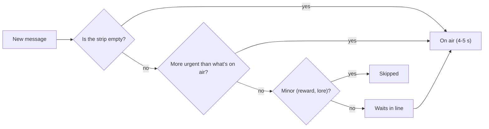

| Kind | Priority | Example |
|---|---|---|
| Alert | 5 | BOSS: Annual Performance Review just walked in |
| Win | 4 | SURVIVED: Grab the gold chest |
| Tip (once ever) | 3 | Spam Likely rings before it charges |
| Chapter card | 2 | AGE 50: The knees start talking |
| Reward | 1 | 401(k): +9k deposited |

---

## Chapter: The clean title screen (V. 1.11.0)

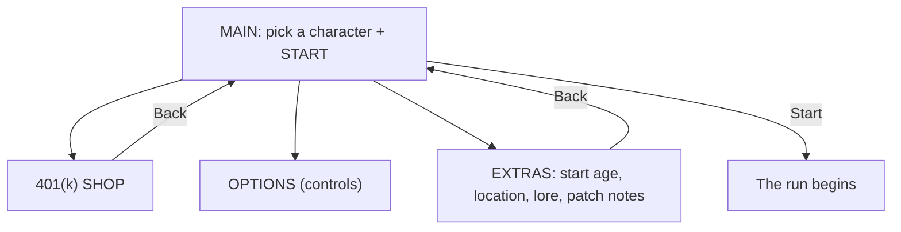

**Before:** about a dozen choices on one long screen. **After:** two decisions (who, then Start), everything else one tap away.

---

## Chapter: Layers (z-index)

```
 z 30  ┌────────────── TITLE SCREEN ──────────────┐   <- written last, so it wins
 z 30  │  ┌──────────── OPTIONS ─────────────┐    │   <- same number, written earlier: hidden!
       │  └──────────────────────────────────┘    │
       └──────────────────────────────────────────┘
 z 12   HUD and lower third
 z 1    the game itself
```

**Rule:** a menu opened *from* another menu needs a higher layer number than its parent.

---

## Chapter: Game time vs. real time (V. 1.13.0)

```
Real clock:  ████████████████████████  keeps going no matter what
Game clock:  ██████░░░░ PAUSED ░░░░████  stops when a menu is open

Lower third message (4 s):
  before fix  [show]---(you pause)---(expired while hidden)
  after fix   [show]---(you pause: held)---[show again]--done
```

---

## Chapter: Object pooling and the double move (V. 1.14.1)

```
You walk right  ──────────────▶

  [desk] [plant] [cooler]  ...  (only 25 pieces exist)
     │
     └── falls off the left edge ──▶ picked up, set down on the right

Bug:   code moves desk +420 px ──▶ physics adds +420 px again ──▶ desk lands at +840 (teleport!)
Fix:   body.moves = false        ──▶ physics leaves the position alone
```

---

## Chapter: A full life in an hour (V. 1.15.0)

```
real minutes  0     5     12    20    30    40    50    60
age           40    45    52    60    70    80    90    100
              │     │     │     │     │     │     │     │
              start  📈    🏠    🏎️    🏡    🏖️    🏓    💀
                   review mortgage crisis HOA retire pickle DEATH (the win)
```
One number controls all of it: `secondsPerYear: 60`.

---

## Chapter: Packs, curves and swarms (V. 1.16.0)

```
enemies per minute
1100 |                                         ●  (85)
     |
 500 |                        ●  (65)
 170 |           ●  (50)
  50 |  ● (40)
     +-------------------------------------------- age
```

Swarm patterns:
```
   RING              WALL               PACK
 $ $ $ $ $         ☎ ☎ ☎ ☎ ☎ ☎               🍩🍩
$    🧍    $                                 🍩🍩🍩
 $ $ $ $ $             🧍                 🧍
 (closes in)        (sweeps across)     (one clump)
```

---

## Chapter: The stand-still test (V. 1.16.1)

```
HP lost while standing still at age 40
  60 |                                   ● after
  40 |                       ●
  20 |            ●
   0 |●━━━━━━━━━━━━━━━━━━━━━━━━━━━━━━━━━━━━ before (always 0)
     0s         20s        40s        60s
```
Same test, two settings, clear answer.

---

## Chapter: Nine ways to chase you (V. 1.17.0)

```
CHASE        CHARGE           ORBIT + SHOOT       SPIRAL            GHOST
 $ → → 🧍     📅 ━━━━━━━━▶      💬 ↻  · · → 🧍     📝 ⟲ ⟲ → 🧍      👻 (faded) → 💭 (solid)
Bill         Calendar Invite   Group Chat          Math Homework     3 AM Thought
```
Each one asks for a different dodge: outrun, sidestep, close the gap, break out, or time your hits.

---

## Chapter: Weapon shapes (V. 1.18.0)

```
AIMED        AURA         BOOMERANG       ORBIT          PIERCING LINE
🧍 ☕ → $     ((🧍))        🧍 📺 ⇄ $ $     📊 🧍 📊        🧍 🎧 ━━$━━$━━$━▶
Coffee       Dad Joke     TV Remote       Spreadsheet    Podcast at 2x
```
Same enemies, five different ways to deal with them.

---

## Chapter: How a score reaches the leaderboard (V. 1.19.0)

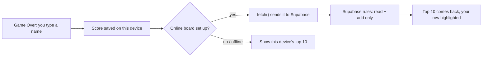


## Chapter: Press vs. release (V. 1.20.0)

```
 finger DOWN ───────────── finger UP
     │                          │
 old: button fired here     new: button fires here
     (game restarts while       (touch is finished, so the
      the finger is still on     new run starts with a clean
      the glass, and the new     slate)
      run never hears it lift)
```

| Input | When a button fires |
|---|---|
| Mouse | on press (feels snappy) |
| Touch | on release; slide off to cancel |
| Perk cards on touch | first tap selects, second tap picks |


## Chapter: One game, two rulebooks (V. 1.21.0)

| Setting | Midlife | Full Life |
|---|---|---|
| Ages | 40 to 65 (+5 per Overtime rank) | 40 to 100 |
| Seconds per year | 45 | 60 |
| Bosses | Review, Mortgage, V8 | all six |
| Ending | Retirement Party | Father Time |
| Leaderboard | `scores_midlife` | `scores` |

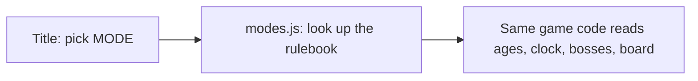


## Chapter: Timers on effects (V. 1.22.0)

```
pick up Energy Drink at 3:10
   buffs.speedUntil = now + 12 s   →  3:22
every frame:  is now < 3:22 ?  yes → speed × 1.35
                               no  → normal speed
```

| Item | Effect | How long |
|---|---|---|
| 👝 Fanny Pack | pulls every gem and coin | 2.5 s |
| 🥤 Energy Drink | +35% speed | 12 s |
| 🌴 PTO Day | clears non-boss enemies | instant |


## Chapter: Events and listeners (V. 1.23.0)

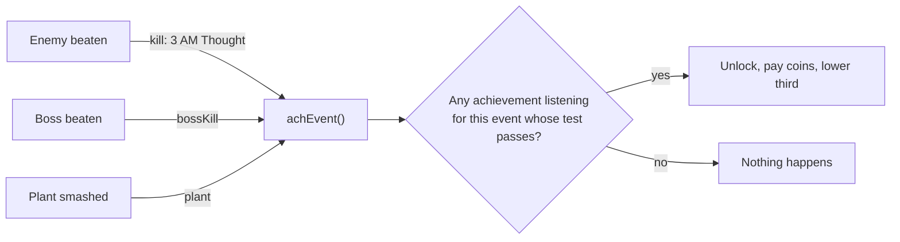


## Chapter: Balancing with a robot (V. 1.24.0)

| Bot run (dodges, random perks) | Before | After |
|---|---|---|
| Brand new player | 4.7 min, 31k coins | 2.7 min, 10k coins |
| Half upgraded | (not tested) | 3.9 min, 32k |
| Fully upgraded, standing still | 13 min, 5,766k coins | 3.9 min |
| Fully upgraded, dodging | 7.3 min | 5.8 min, 116k |

```
your level goes up ─► enemies get tougher (+7% HP per level)
                   ─► bigger crowds, faster spawns
shop upgrades      ─► you start stronger WITHOUT raising your level
= permanent upgrades are the way to beat the clock
```

## Chapter: Making a larger world readable (V. 1.27.1, Codex)

```text
          OUTER LOOP
      +-------+-------+
      |       |       |
   Accounts   |    Quiet zone
      |       |       |
Files +---- ATRIUM ---+ Meetings
      |       |       |
   Breakroom  |    Wellness
      |       |       |
      +-------+-------+
          OUTER LOOP
```

This is a route sketch, not a collision map. The 3072x2048 office keeps the same character size, so distance feels real. Wood flooring connects destinations; brighter carpet identifies work areas. Small wear marks tell stories without adding obstacles. The minimap reveals nearby ground as we walk, so exploration leaves a visible record. Before these routes enter the main game, we still need to test whether swarms flow around furniture.

## Chapter: Keeping furniture on the floor (V. 1.27.2, Codex)

```text
 upper-left light
        \
       [ desk ]
         |  |       legs meet the floor
        ######      tight contact shadow
          ....      short southeast cast
 ~~~~~~~~~~~~~~~~~  mat, caster wear, carpet
```

A detached shadow suggests height above the ground. The scene now reads the bottom edge of each imported furniture texture once and places short shadow pixels directly against it. A quieter cast sits lower right; chair mats and scuffs sit underneath the furniture. The sprite exports keep their plain magenta background because shadows belong to the scene. This changes visual contact without changing collision.
